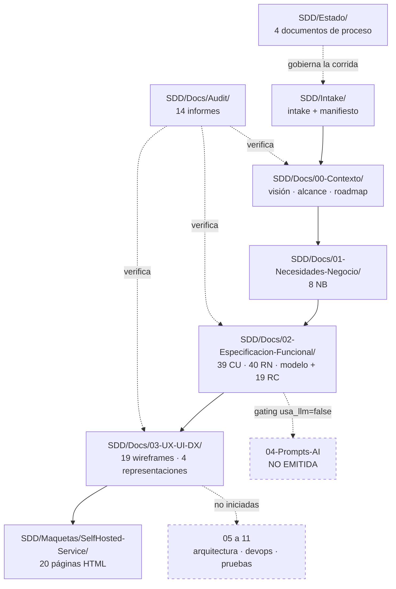
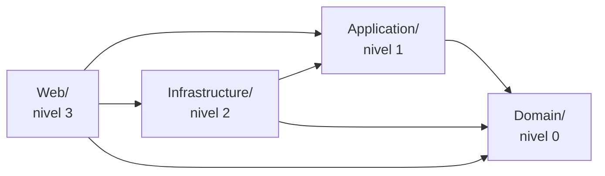

# 00 · Índice maestro

> **Propósito**: dar la visión general del repositorio `SelfHosted.Service.Core` — qué contiene, cómo está organizado, en qué estado está y cuáles son sus decisiones estructurales — para que un agente pueda orientarse antes de abrir cualquier índice temático.
> **Fuente primaria**: `README.md` y `CHANGELOG.md` de la raíz, `SDD/Intake/PRODUCT-MANIFEST-SelfHosted-Service.md`, `SDD/Estado/Informe-Avance.md` y el árbol de `SDD/` verificado sobre disco.
> Este índice **no repite** el detalle de los índices 01–10: los enmarca. Para cada dominio, seguí el puntero.

---

## 1. Qué es este repositorio

`SelfHosted.Service.Core` **no contiene código**. Contiene el corpus documental SDD (*Specification-Driven Development*) del producto **SelfHosted Service**, generado por un «Orquestador SDD» bajo un framework normativo versionado que vive en **otro repositorio** (`IA/IA.SDD`).

| Dato | Valor |
|---|---|
| Repositorio | `SelfHosted.Service.Core` · `https://github.com/UTN-FRP-TUP-Aplicada-2025/SelfHosted.Service.Core.git` · rama `main` |
| Producto documentado | **SelfHosted Service** |
| Naturaleza del contenido | Especificación (SDD), no implementación |
| Proyecto de código | **No iniciado** — no hay `.sln`, `.csproj` ni fuentes |
| Framework normativo aplicado | Conjunto SDD **6.0** (cerrado el 2026-07-30) |
| Volumen vigente | 165 documentos Markdown · 37.172 líneas |
| Volumen archivado | 375 archivos bajo carpetas `_legacy/<fecha>/` |
| Último commit al indexar | `82fb235` (el árbol en disco está **por delante** del último commit; ver §6) |

### Qué es el producto

Panel web autoalojado para **declarar, desplegar y operar arquitecturas de contenedores** en un servidor de red local, con un lienzo visual como superficie central. Su diferencial declarado es la **adopción del parque existente sin reinstanciar**: incorpora contenedores que ya corren en lugar de exigir recrearlos. Un solo usuario administrador, una sola instancia, sin salida a internet.

Stack previsto (declarado, no construido): **.NET 10 · Blazor Interactive Server · MudBlazor 9.7.0 · Z.Blazor.Diagrams · EF Core sobre SQLite (WAL) · Docker.DotNet detrás de `IContenedorEngine`**, con ASP.NET Core Identity por cookie para la interfaz y tokens con ámbitos para la API.

→ Detalle en [`01_Contexto-Y-Producto.md`](01_Contexto-Y-Producto.md).

---

## 2. Mapa del corpus

| Carpeta | Contenido | Índice que la cubre |
|---|---|---|
| `SDD/Intake/` | Intake del cliente y manifiesto derivado (fuente canónica de la jerarquía) | [01](01_Contexto-Y-Producto.md) |
| `SDD/Docs/00-Contexto/` | Visión, alcance, roadmap, acuerdo de equipo, compatibilidad | [01](01_Contexto-Y-Producto.md) |
| `SDD/Docs/01-Necesidades-Negocio/` | 8 necesidades `NB-01..NB-08` con 44 criterios de éxito | [02](02_Necesidades-De-Negocio.md) |
| `SDD/Docs/02-Especificacion-Funcional/` · casos de uso | 39 casos de uso `CU-01..CU-39` y matriz de trazabilidad | [03](03_Casos-De-Uso.md) |
| `SDD/Docs/02-Especificacion-Funcional/` · reglas | 40 reglas de negocio `RN-01..RN-40` | [04](04_Reglas-De-Negocio.md) |
| `SDD/Docs/02-Especificacion-Funcional/` · modelo | Modelo conceptual (15 entidades) y 19 reglas conceptuales `RC-01..RC-19` | [05](05_Modelo-De-Datos.md) |
| `SDD/Docs/03-UX-UI-DX/` | 19 superficies `SUP-01..SUP-19`, 4 representaciones, experiencia de uso | [06](06_UX-UI-DX.md) |
| `SDD/Maquetas/SelfHosted-Service/` | Maqueta HTML/CSS/JS de validación visual (20 páginas) | [07](07_Maqueta-De-Validacion.md) |
| `SDD/Estado/` | Informe de avance, redefinición propuesta, dos órdenes de fix | [08](08_Proceso-SDD-Y-Estado.md) |
| `SDD/Docs/Audit/` | 14 informes de auditoría y migración normativa | [09](09_Auditorias-Y-Migracion.md) |
| Glosarios de 02 y 03 | 120 términos de dominio + 72 de interfaz | [10](10_Glosario.md) |
| `**/_legacy/<fecha>/` | Estados previos archivados — **no indexados** | convención en [08](08_Proceso-SDD-Y-Estado.md) |

---

## 3. Decisiones estructurales que condicionan todo lo demás

| # | Decisión | Consecuencia | Fuente |
|---|---|---|---|
| 1 | **Caso degenerado del framework**: un único proyecto de código | `SDD/Docs/` es **plano** — sin subnivel `Proyectos/<nombre>/` ni carpeta `Producto/`. Las 13 reglas de categoría se aplican una vez, no cuatro | Manifiesto §1, §3.5 de `Master-Prompt` |
| 2 | Las 4 capas de Clean Architecture son **espacios de nombres**, no proyectos | La regla de dependencia la hace cumplir un **test de arquitectura bloqueante**, no el compilador. `Program.cs` queda exento por ser raíz de composición | Manifiesto §2.1 |
| 3 | `Identidad-Codigo` sin sufijo de rol (`SelfHosted.Service.Core` a secas) | **Desviación declarada** de `Master-Prompt §3.2`, tomada a cambio de la simetría de las cuatro capas | Manifiesto §1 |
| 4 | Categoría `04-Prompts-AI` **omitida por gating** (`usa_llm = false`) | La omisión está registrada con su motivo, no silenciada | Manifiesto §1.1 |
| 5 | `equipo_n = 2` | La categoría 07 produce plan de sprint completo, no `Mini-Plan.md` | Manifiesto §2 |
| 6 | `requiere_maqueta = true`, confirmado el 2026-08-02 | Habilita la Fase B2 y con ella `Maqueta-Rules` y `Deriva-Rules` | Manifiesto §2 |
| 7 | Todo cambio exige **archivado previo** en `_legacy/<fecha>/`, bump de versión y fila de control de cambios | Ninguna fila histórica se reescribe. Los dos desvíos registrados costaron pérdida irrecuperable de contenido | `Master-Prompt §13`, `SDD-Development-Guide §VI.2` |

### Capas internas del proyecto de código previsto

---

## 4. Estado de la corrida

| Hito | Estado | Fecha |
|---|---|---|
| Reconciliación normativa e intake | Cerrados (salida B: regenerar desde cero) | 2026-07-28 / 2026-07-29 |
| Derivación del manifiesto | Cerrada · manifiesto v2.3 `Vigente` | 2026-08-02 |
| **Fase A** · `00-Contexto` + `01-Necesidades-Negocio` | Corte **aprobado**, adecuado al conjunto 4.1 | 2026-07-29 |
| **Fase B** · `02-Especificacion-Funcional` + `03-UX-UI-DX` | Corte **aprobado**, seis P1 corregidos | 2026-07-29 |
| **Fase B** · `04-Prompts-AI` | **Omitida** por gating | — |
| Migración normativa 4.1 → 6.0 | **Cerrada** · 144/144 filas · 0 P0 · 0 P1 | 2026-07-30 |
| **Fase B2** · validación visual, paso 6 | Re-audit **aprobado con observaciones** | 2026-08-02 |
| Reconstrucción de la maqueta | **Pendiente**, bloqueada por decisiones de producto | — |
| **Fases C–G** · categorías `05`–`11` | **No iniciadas** | — |
| Proyecto de código | **No iniciado** | — |

**Dónde está detenida.** En la reconstrucción de la maqueta, bloqueada por decisiones de producto abiertas (`DI-17/18/19`, `Q-27`, más `Q-15` y `Q-17` para `SUP-18`). El orden de trabajo es **documento → especificación → maqueta**; saltearlo produce una maqueta que no traza.

→ Detalle en [`08_Proceso-SDD-Y-Estado.md`](08_Proceso-SDD-Y-Estado.md) y [`09_Auditorias-Y-Migracion.md`](09_Auditorias-Y-Migracion.md).

---

## 5. Vocabulario mínimo para no equivocarse

Cinco contrastes que el corpus sostiene deliberadamente y cuyo uso incorrecto invalida cualquier afirmación:

| Distinción | Criterio que las separa |
|---|---|
| **Servicio** vs. **contenedor / despliegue** | El servicio es permanente y posicionable, y no tiene estado de encendido; el despliegue es volátil y es lo que pinta el color del nodo |
| **Construir la imagen** vs. **crear el contenedor** | Construir puede ocurrir fuera del producto; crear el contenedor nunca sale de él. «Construir» a secas está prohibido |
| **Guardar** vs. **desplegar / aplicar** | Guardar agrega al conjunto de cambios pendientes; aplicar toca contenedores. Los dos conjuntos de verbos no se cruzan |
| **Plantilla** vs. **instancia** | La instancia queda desvinculada de la plantilla al crearse (`RN-39`) |
| **«Registro»** | Tiene **cinco** referentes distintos: del sistema, de auditoría, del contenedor, de imágenes y el actor. La forma desnuda sólo vale para el registro del sistema |

→ Glosario completo en [`10_Glosario.md`](10_Glosario.md).

---

## 6. Advertencias de vigencia

Hechos verificados sobre disco al indexar, que un agente debe conocer antes de citar cualquier fuente:

| # | Hecho | Impacto |
|---|---|---|
| 1 | **`CHANGELOG.md` está desactualizado**: declara 36 CU, 37 RN y 18 requisitos complementarios; en disco hay **39 CU, 40 RN y 19 RC**. También nombra el intake como `SOLUTION-INTAKE-…`, forma ya renombrada a `PRODUCT-INTAKE-…` | No usar el CHANGELOG como fuente de conteos. `Especificacion-Funcional.md` §1 sí declara los correctos |
| 2 | **El árbol en disco está por delante del último commit**: ~62 archivos modificados y varias rutas sin seguimiento respecto de `82fb235` | Los índices reflejan el **disco**, no el commit |
| 3 | **`Alcance-Producto.md` v2.0 refleja un intake anterior** al vigente: el intake amplió `F-03`, acotó `F-10` y redefinió `F-14` | Ante divergencia, el intake es upstream |
| 4 | **Trazabilidad NB→CU incompleta** (brecha `B-20`, abierta): `CU-37`, `CU-38` y `CU-39` no figuran en el §7 de ninguna NB | La verificación cierra CU→NB pero no NB→CU |
| 5 | **`Redefinicion-Servicio.md` tiene dos partes con estatuto distinto**: §16–§23 es normativo, §1–§15 es antecedente con pasajes superados | Donde difieran, manda la parte normativa |
| 6 | **La maqueta y `Experiencia-De-Uso.md` §9.2 discrepan** en cuatro filas de la matriz superficie→CU | `Experiencia-De-Uso.md` es la fuente única declarada |
| 7 | Todos los artefactos de `02` y `03` están en estado **`Propuesto`**, no aprobado individualmente | Lo aprobado son los **cortes de fase**, no cada documento |

---

## 7. Hallazgos abiertos

| Origen | P0 | P1 | P2 | P3 |
|---|---|---|---|---|
| Migración normativa · informe M6 | 0 | 0 | 14 | 7 |
| Fase B2 · ronda 2 (2026-08-02) | 0 | 1 | 3 | 5 |

**Total verificable: 30.** Los P2/P3 de `B-02-03-r1`, `B2-Fix-Definiciones-Servicio-r1` y `B2-Retroalimentacion-Decisiones-2026-07-30-r1` **no tienen cierre declarado en ninguna fuente**; no se infiere que estén resueltos.

→ Detalle por informe en [`09_Auditorias-Y-Migracion.md`](09_Auditorias-Y-Migracion.md).

---

## Fuentes

| Archivo | Qué aporta a este índice |
|---|---|
| `README.md` | Nombre del repositorio (contenido mínimo: una línea) |
| `CHANGELOG.md` | Entrada `[1.0] - 2026-07-29`: incorporación del corpus, inventario por fase y tabla de estado al cierre |
| `SDD/Intake/PRODUCT-MANIFEST-SelfHosted-Service.md` | Identidades, caso degenerado, capas internas, bloque de flags, procedencia del framework 6.0 |
| `SDD/Intake/PRODUCT-INTAKE-SelfHosted-Service.md` | Stack, alcance y flags con su evidencia |
| `SDD/Estado/Informe-Avance.md` | Estado por fase con fecha y decisiones del agente humano del proyecto |
| `SDD/Docs/02-Especificacion-Funcional/Especificacion-Funcional.md` | Conteos verificados 39/40/19 |
| Árbol de `SDD/` y `git status` | Conteos de archivos, volumen y divergencia disco/commit |
