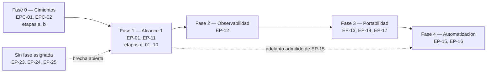
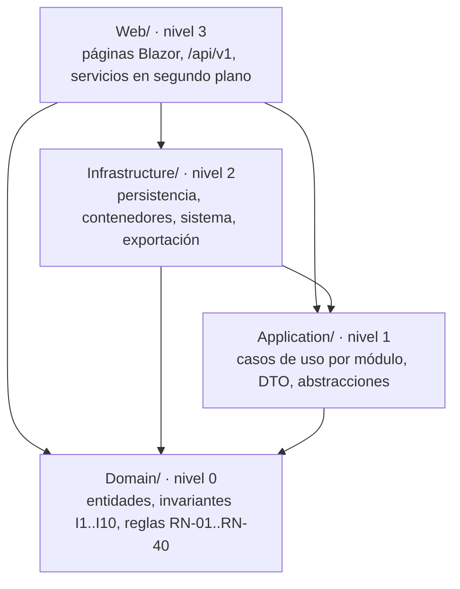

# 01 · Contexto y Producto

> Índice destilado del **porqué, el qué y el hasta dónde** de **SelfHosted Service**: problema, propuesta de valor, actores, alcance incluido y excluido, roadmap por fases, acuerdo de equipo, matriz de plataformas, stack declarado, identidades del producto, restricciones, supuestos y riesgos. Sirve para responder preguntas de alto nivel sin abrir las fuentes y para saber **dónde** está cada detalle.
> **Fuente primaria:** `SDD/Docs/00-Contexto/` (`README.md`, `Vision-Producto.md`, `Alcance-Producto.md`, `Roadmap-Producto.md`, `Acuerdo-Equipo.md`, `Compatibilidad-Plataformas.md`), `SDD/Intake/PRODUCT-INTAKE-SelfHosted-Service.md` y `SDD/Intake/PRODUCT-MANIFEST-SelfHosted-Service.md`. Todo lo que las fuentes no declaran se marca acá como «no declarado en la fuente»; nada se infiere.

---

## 1. Qué es el producto

| Dimensión | Declaración |
| --- | --- |
| Qué es | Aplicación web **autoalojada** para declarar, ver, desplegar y operar la arquitectura de conjuntos de servicios contenedorizados sobre **un único servidor de red local**, e incorporar contenedores ya corriendo sin reinstanciarlos |
| Problema | Parque de **8 contenedores y 18 imágenes** crecido de forma orgánica: definiciones sueltas, variables no versionadas, IP fijas anotadas fuera del sistema, orden de arranque memorizado. No existe un lugar donde se vea la arquitectura completa ni las relaciones |
| Consecuencia de no resolverlo | La configuración real vive sólo en el motor de contenedores y en archivos no versionados; el servidor **no tiene redundancia de disco**; una reinstalación obliga a reconstruir todo sin documentación |
| Disparador | El parque **ya en producción**: la herramienta debe ser adoptable sin exigir empezar de cero |
| Promesa central | Que la arquitectura de un conjunto de servicios sea **objeto de primera clase**, editable en un lienzo, con el despliegue **derivado de lo que se dibuja** y aplicado en lote con un único redespliegue de lo afectado |
| Estado del código | **Proyecto de código no iniciado.** `Compatibilidad-Plataformas` §5 declara «no construido, verificación prevista» para casi todas las filas |

### 1.1 Diferenciadores (`Vision-Producto` §3.2)

| ID | Diferenciador |
| --- | --- |
| DV-01 | Adopción **sin reinstanciar**: se importa la configuración observada y se vincula por identificador |
| DV-02 | Separación **configuración / ejecución**: el nodo es el servicio (permanente); color e insignia reflejan el despliegue (volátil) |
| DV-03 | Edición **transaccional**: changeset con informe de impacto, aplicado en lote |
| DV-04 | Conflicto de direcciones de red como **regla de negocio verificada antes de arrancar**, con resoluciones ofrecidas |
| DV-05 | Diseñado para **servidor chico**: decenas de nodos, < 50 contenedores, sin degradarse con 30 nodos |

### 1.2 Actores (`Vision-Producto` §2.1; `README` §4)

| Rol | Categoría | Nota |
| --- | --- | --- |
| Dueño del problema y administrador único | Propietario | Aprueba intake, opera el producto, valida puntos de control |
| Agente humano del proyecto (validación técnica) | Propietario | Único con autoridad para fusionar ramas y aprobar puntos de control |
| Equipo de desarrollo (2 desarrolladores) | Implementador | Trabaja en **etapas en serie** |
| Agente IA de codificación (orquestador SDD + subagentes) | Implementador | **No fusiona ramas ni aprueba puntos de control** |
| Usuario final: administrador del producto | Beneficiario | Único usuario con credenciales |
| Automatismo de integración continua | Beneficiario | Dispara despliegues con credencial de máquina de ámbito mínimo |

Los seis se identifican **por rol y nunca por nombre propio** (supuesto S-06, cerrado el 2026-07-27): propietario, lead técnico, Product Owner y usuario final **son la misma persona**. No hay financiador externo, área a la que rendir resultados, ni actores de auditoría o legales.

---

## 2. Alcance

### 2.1 Capacidades incluidas (`Alcance-Producto` §4.1; intake §4)

20 capacidades `F-XX`. La etiqueta MoSCoW traduce la pertenencia al alcance incremental; **el Alcance 1 es el conjunto Must Have**.

| Alcance | Capacidades | MoSCoW |
| --- | --- | --- |
| **Alcance 1 — núcleo operable** | `F-01` administrador único y sesión · `F-02` proyectos SelfHosted · `F-03` alta y configuración de servicios · `F-04` lienzo visual · `F-05` despliegue desde imagen pública · `F-06` arranque/parada con autoarranque y orden del grafo · `F-07` changeset con informe de impacto · `F-08` rango de direcciones y bloqueo por conflicto · `F-09` escalado horizontal y vertical manual · `F-10` despliegue construyendo la imagen · `F-11` descubrimiento y adopción | Must Have (11) |
| **Alcance 2 — observabilidad** | `F-12` tablero en tres capas (servidor / proyecto / contenedor) | Should Have |
| **Alcance 3 — portabilidad y reutilización** | `F-13` exportación e importación con manifiesto propio · `F-14` catálogo de plantillas · `F-17` exportación programada a destino externo | Should / Could Have |
| **Alcance 4 — automatización** | `F-15` tokens de API con ámbitos y revocación (adelanto admitido al Alcance 1) · `F-16` disparo de despliegue desde automatismo | Should / Could Have |
| **Sin alcance asignado** | `F-23` variables compartidas del proyecto · `F-24` referencias entre variables · `F-25` higiene del modelo | Should / Should / Could — **brecha abierta** |

Precisiones que condicionan la especificación funcional: el catálogo es una **vía de alta y no un origen**, arranca vacío y sus ítems son definiciones en reposo (D-7, D-16); el carácter de secreto **se declara, no se infiere** (D-2); un **despliegue parcial es un estado legítimo** del modelo (D-1).

> **Deriva declarada entre fuentes.** `Alcance-Producto` 2.0 se emitió contra el intake 2.2/2.3; el intake vigente es **3.7** y amplió tres capacidades: `F-03` pasa a declarar **dos ejes** —siete vías de alta y cinco orígenes—, más un tercer eje (disparador del despliegue) y **alta unificada** (2026-07-31); `F-10` quedó **acotada el 2026-08-01**, retirándole la construcción desde repositorio remoto; `F-14` pasa a ser «una de las siete vías de alta» y lo instanciado queda **desvinculado** de la plantilla (D-14). El detalle vive en intake §4 y en `SDD/Estado/Redefinicion-Servicio.md`, fuera del recorte de este índice.

### 2.2 Alcance excluido (`Alcance-Producto` §5; intake §9)

Siete exclusiones declaradas por el cliente, cinco de ellas con capacidad `Won't Have v1` correlativa:

| Exclusión | Capacidad correlativa | Consecuencia asumida |
| --- | --- | --- |
| Multiinquilino y orquestación de clúster | — | **Sin incorporación futura contemplada** (única exclusión con horizonte declarado) |
| Proxies, proxies inversos y dominios públicos | `F-19` | Reemplazar versión = detener y arrancar, con ventana de indisponibilidad advertida |
| Balanceo de carga entre réplicas | `F-20` | Escalado horizontal útil sólo para procesos sin tráfico entrante (inconsistencia IC-04 aceptada) |
| Exposición del servicio a internet | — | Sólo red local; reincorporable el día que exista capa de protección adicional |
| Gestión de usuarios, roles y permisos | `F-21` (+ `F-18` 2FA) | Un solo administrador; la decisión de autenticación no bloquea sumar 2FA más adelante |
| Monitoreo por peticiones contra los servicios | — | Motivo de **topología de red**, no temporal: la verdad del estado es el motor de contenedores |
| Recuperación de contraseñas | `F-22` | Superficie de ataque sin problema real que resolver |

Salvo la primera, la **versión futura tentativa está «no declarada por la fuente»**. Las cinco `Won't Have v1` no generan necesidad de negocio ni caso de uso.

### 2.3 Entregables y ambientes

- **Entregables** `EN-01` a `EN-07`: aplicación desplegable · especificación bajo `SDD/Docs/` · informe de cierre por etapa (13 secciones) · guion de demostración por etapa · materializaciones de PT-01 y PT-02 · juego de datos de siembra del parque de referencia · registro de cambios.
- **Ambientes**: sólo **Desarrollo** (entorno contenedorizado declarativo) y **Producción** (el producto como un contenedor más en el servidor). **No hay preproducción ni ambiente de pruebas**: el punto de control cumple esa función, por decisión declarada.
- **Criterios de aceptación** `CA-01` a `CA-10` (`Alcance-Producto` §8), convertidos en verificaciones ejecutables por 08-Calidad-Y-Pruebas. `CA-10` es el que prohíbe especificar una etapa alcanzada por una brecha abierta.

---

## 3. Roadmap (`Roadmap-Producto`)

Unidad de gestión: **la etapa, no el sprint**. Sin fechas de calendario (RE-02), sin paralelización (RE-04). De la etapa `c` en adelante **toda etapa es hito demostrable**.

| Fase | Objetivo | Etapas | Entrega objetivo |
| --- | --- | --- | --- |
| 0 — Cimientos | Producto compilando y navegable, con **PT-02 verificada** antes de que ninguna capacidad dependa del motor | 2 declaradas (`a`, `b`) | Etiqueta de `b`, serie 0.x |
| 1 — Alcance 1 | Mínimo sin el cual el producto no resuelve el problema | 11 declaradas (`c`, `01`–`10`) | Etiqueta de `10`, serie 0.x |
| 2 — Alcance 2 | Tablero en tres capas | 1 estimada | Etiqueta de cierre de fase |
| 3 — Alcance 3 | Arquitectura reproducible fuera del servidor y alta reutilizable | 3 estimadas | Etiqueta de cierre de fase |
| 4 — Alcance 4 | Automatismo que despliega sin conocer la contraseña | 2 estimadas (1 si EP-15 se adelanta) | **Primera entrega completa**: sale de la serie 0.x |

Las 13 etapas de las fases 0 y 1 **están declaradas por el cliente**; las de las fases 2 a 4 son estimación de piso (una por épica). Pueden reordenarse o subdividirse, **nunca fusionarse** hasta perder demostrabilidad intermedia.

### 3.1 Puertas técnicas

| Puerta | Verifica | Condiciona | Cuándo |
| --- | --- | --- | --- |
| **PT-01** | Fluidez del lienzo con **30 nodos y 40 aristas**, actualización de estado cada 2 s, sin retraso perceptible en el arrastre, consumo estable tras 15 min | Etapa `03` / EP-04. Su falla obliga a cambiar la herramienta del lienzo | Antes de comprometer el corte del lienzo |
| **PT-02** | Motor de contenedores desde desarrollo: listar, crear, arrancar, detener, eliminar, construir imagen y alcanzarla por red | Todo corte de despliegue, desde la etapa `04` | Etapa `a`, dentro de la Fase 0 |

### 3.2 Criterios de transición

**29 criterios** en total, transcriptos de intake §22.4 sin agregados, expresados como listas de verificación: inicio→F0 (2), F0→F1 (6), F1→F2 (7), F2→F3 (4), F3→F4 (5), F4→cierre (5). Regla común: **ninguna etapa se considera terminada sin su informe de cierre publicado antes del punto de control**. Detalle en `Roadmap-Producto` §5.1 a §5.7.

Dependencias funcionales de la Fase 1 (grafo acíclico, orden topológico = secuencia de etapas): `EP-01 → EP-02 → EP-03`, de donde salen `EP-04` (+PT-01) y `EP-05` (+PT-02); `EP-06` depende de `EP-05` y `EP-04`; `EP-07` y `EP-10` de `EP-05`; `EP-08` de `EP-06`; `EP-09` y `EP-11` de `EP-08`.

---

## 4. Acuerdo de equipo (`Acuerdo-Equipo`)

El modelo de gestión **no es Scrum**: sin sprints de duración fija, sin estimación por puntos, sin ceremonias de cadencia fija. Toda ceremonia se dispara por un **evento del ciclo de la etapa**.

| Conjunto | Cantidad | Contenido, en una línea |
| --- | --- | --- |
| **Roles** | 4 | Agente humano del proyecto · equipo de desarrollo · agente IA de codificación · administrador del producto. Regla de separación: **la fusión la hace el agente humano, nunca el agente IA** |
| **Ceremonias** | 6 | Especificación de etapa · verificación de puerta técnica · publicación del informe · punto de control · fusión y etiquetado · revisión de alcance. **Ninguna con duración comprometida** |
| **Acuerdos `AT-01`…`AT-28`** | 28 | Ramas y punto de control (AT-01–08) · commits, versionado y migraciones (AT-10–13, AT-20) · documentación de etapa (AT-09, AT-14–19) · secretos (AT-21–23) · comunicación (AT-24–28). Cada uno con su forma de verificación |
| **`DoD-01`…`DoD-12`** | 12 | 11 bloqueantes + 1 no bloqueante (inventario de componentes). Incluye cobertura por capa, pruebas de reglas nuevas, no-regresión, informe publicado, OK explícito y el test de arquitectura |
| **`DoR-01`…`DoR-12`** | 12 | Todas bloqueantes. Tipo de etapa, alcance, entregable, guion, criterios verificables, **corte vertical obligatorio**, demostrabilidad desde `c`, puerta técnica medida y **ningún supuesto abierto pendiente** (DoR-11) |

Umbrales de cobertura de `DoD-03` (supuesto S-02, confirmado, **gate bloqueante**): `Domain` 90 % líneas / 85 % ramas · `Application` 80 / 70 · `Web` 60 / 50 · `Infrastructure` 55 / 45.

Ausencias declaradas explícitamente, para que no se lean como omisión: **no hay acuerdo de nivel de servicio de reloj** (AT-26, AT-28) y **no hay ceremonia de revisión de código separada** del punto de control; el pull request concentra revisión, demostración y aprobación.

Herramientas: GitHub como remoto · repositorio de documentación separado para los informes · GitHub Actions con **ejecutor autoalojado en el propio servidor** · entorno de desarrollo contenedorizado declarativo · guiones del repositorio · `dotnet-ef` local, no global.

---

## 5. Compatibilidad de plataformas (`Compatibilidad-Plataformas`)

Una **única combinación soportada, sin matriz de variantes**. Toda combinación no listada se considera no soportada: sin guiones alternativos, sin detección de entorno, sin verificación asociada.

Tres ejes independientes, y **sólo uno es Windows**:

| Eje | Plataforma |
| --- | --- |
| **Ejecución** | Linux **Debian 13**, kernel 6.12, dentro de un contenedor sobre el servidor de referencia |
| **Desarrollo** | Linux, dentro de un entorno contenedorizado declarativo sobre el equipo del desarrollador |
| **Cliente** | **Windows Server 2022 21H2** (build 20348.5256), la máquina desde la que se opera el panel |

| Elemento | Mínimo declarado |
| --- | --- |
| Entorno de ejecución | **.NET 10** (sin compatibilidad hacia atrás) |
| Motor de contenedores | **Docker 26.x** con `compose` v5 y `buildx`; el cliente declara soporte de la API del motor v29.4.1 |
| Almacenamiento | **SQLite** embebido en el proveedor de .NET 10, con diario de escritura anticipada (WAL) |
| Formato de exportación | **Docker Compose**, versión correspondiente a `compose` v5 |
| Navegador | **Google Chrome de escritorio, canal estable, ≥ 150.0.7871.186**. Única familia soportada; Firefox, Safari, Edge y derivados **no soportados**. El piso sube y nunca baja |
| Red | **Red local**; el servicio no se publica a internet |

Restricciones de plataforma `CP-01` a `CP-10`: sin matriz de variantes (CP-01) · sin herramientas de construcción en el equipo (CP-02) · misma ruta absoluta del directorio de datos (CP-03) · contenedores **hermanos** del entorno de desarrollo (CP-04) · sin otros motores (CP-05) ni otros almacenamientos (CP-06) · sin publicación a internet (CP-07) · `Domain` y `Application` sin superficie de plataforma, **control bloqueante** (CP-08) · el entorno de desarrollo no condiciona la imagen de producción (CP-09) · una única familia de navegador con piso creciente (CP-10).

Sin alternativa dentro del alcance: Windows/macOS como ejecución o desarrollo, otras familias de navegador, navegadores sin canal permanente, navegadores móviles y pantallas pequeñas, otros almacenamientos, acceso fuera de la red local, y **dos instancias sobre el mismo almacenamiento**.

---

## 6. Stack técnico y flags del producto

### 6.1 Stack declarado (intake §17.P.1, §17.P.2)

| Componente | Valor |
| --- | --- |
| Lenguaje y plataforma | C# sobre **.NET 10** |
| Interfaz | **Blazor Interactive Server** (circuito SignalR sobre WebSockets) |
| Sistema visual | **MudBlazor 9.7.0** (MIT) |
| Lienzo | **Z.Blazor.Diagrams 3.0.4.1** (MIT), sujeta a PT-01; contingencia declarada: Excubo, y maxGraph con interoperabilidad de grano grueso |
| Autenticación | **ASP.NET Core Identity** por cookie (interfaz) + tokens de API con ámbitos (automatismos). **ROPC descartado** |
| Persistencia | **EF Core con proveedor SQLite**, archivo único con WAL, migraciones aplicadas al arrancar |
| Cliente del motor | **Docker.DotNet.Enhanced 4.3.3** (MIT), confinado a `Infrastructure/Contenedores/` detrás de `IContenedorEngine` |
| API | Controladores REST bajo `/api/v1`; minimal APIs admitidas sólo para sondeo de estado y métricas |
| Herramienta de migración | `dotnet-ef` **local** del repositorio, no global |
| Estilo | **Clean Architecture por módulos**, despliegue monolítico, un único proceso y un único ensamblado |

### 6.2 Flags de `Master-Prompt` §4 (`PRODUCT-MANIFEST` §2, versión 2.3)

| Flag | Valor | Fundamento declarado |
| --- | --- | --- |
| `equipo_n` | **2** | Intake §2 y §10. Al ser > 1, la categoría 07 produce sprint plan completo y no `Mini-Plan.md` |
| `usa_llm` | **false** | La categoría 04 (Prompts-AI) queda **excluida por gating** |
| `tiene_ui_final` | **true** | `web-monolith` con interfaz Blazor Interactive Server |
| `multi_tenant` | **false** | Un único administrador y una única instancia |
| `tiene_auth` | **true** | Cookie de Identity + JWT HS256 con seis ámbitos |
| `tiene_portal_developers` | **false** | Sin SDK público ni documentación para integradores |
| `tiene_extensibilidad` | **true** | Punto de extensión: el adaptador del motor detrás de `IContenedorEngine` |
| `tiene_persistencia` | **true** | SQLite con WAL, esquema relacional en el anexo E-9 |
| `requiere_compliance` | **false** | Sin GDPR, PCI, HIPAA, SOC2 ni ISO 27001 |
| `tiene_observabilidad_critica` | **true** | Por **p99 ≤ 300 ms** de lectura (supuesto S-03 cerrado). **No hay SLO**: la ausencia es deliberada |
| `requiere_maqueta` | **true** | Confirmado por el agente humano el **2026-08-02**; habilita la Fase B2 (`Maqueta-Rules`, `Deriva-Rules`) |

Los flags son **inmutables una vez confirmados**: cambiar uno obliga a retroceder a la fase más temprana afectada.

### 6.3 Umbrales no funcionales destacados (intake §17.P.10)

Escala objetivo 10–30 nodos por lienzo y < 50 contenedores · huella de memoria de **cientos de MB, nunca GB** · **cero escrituras durante el arrastre** (una sola al finalizar, antirrebote 400 ms) · validación de conflicto de direcciones ≤ 50 ms en aplicación y ≤ 10 ms en dominio · sondeo de métricas cada 3–5 s **sólo con vistas abiertas** · reconciliación con el motor cada 30 s · batería de dominio ≤ 5 s · **cero dependencias externas** en `Domain`.

---

## 7. Identidades del producto y capas internas (`PRODUCT-MANIFEST` §1, §2)

| Campo | Valor | Cómo se obtiene |
| --- | --- | --- |
| `Nombre-Producto` | **SelfHosted Service** | Declarado en la cabecera del intake |
| `Slug-Producto` | `SelfHosted-Service` | **Derivado** del nombre de producto |
| `Raiz-Codigo` | `SelfHosted.Service.Core` | **Declarado** en el perfil de §13, no derivado (el algoritmo daría `SelfHostedServiceCore`) |
| `Artefacto-Agrupacion` | `SelfHosted.Service.Core.sln` | Derivado como `<Raiz-Codigo>.sln` |
| `Nombre-Proyecto-Codigo` | `SelfHosted-Service` | Coincide con `Slug-Producto` **por construcción** (caso degenerado) |
| `Identidad-Codigo` | `SelfHosted.Service.Core` | Sin sufijo de rol: **desviación declarada** de `Master-Prompt` §3.2 |
| Cantidad de proyectos de código | **1** (`web-monolith`, `redistribuible: false`) | **Caso degenerado del framework**: las 12 categorías se generan planas bajo `SDD/Docs/`, sin `Proyectos/` ni `Producto/` |

Las **cuatro capas** no son proyectos: son carpetas y espacios de nombres dentro del único proyecto, con seis aristas y cuatro niveles estrictos.

`Program.cs` es la **raíz de composición** y queda exento de la regla de dependencia. Quien hace cumplir el grafo ya no es el compilador sino el **test de arquitectura**, gate bloqueante del pipeline: la violación se detecta como test rojo y no como error de compilación, **degradación asumida y declarada**. Los tres proyectos de prueba (`*.Domain.Tests`, `*.Application.Tests`, `*.Integration.Tests`) viven bajo `/tests` y no son parte de la composición.

---

## 8. Restricciones, supuestos y riesgos

### 8.1 Restricciones del cliente `RE-01`…`RE-12` (`Vision-Producto` §7)

| ID | Restricción | Efecto sobre el alcance |
| --- | --- | --- |
| RE-01 / RE-04 | Dos desarrolladores; etapas en serie con el punto de control como cuello por diseño | Cada etapa debe ser recorrible por una persona en una sesión de demostración |
| RE-02 | Sin fecha objetivo | El alcance se recorta contra **demostrabilidad**, no contra calendario |
| RE-03 | Sin presupuesto monetario | Toda dependencia de **licencia abierta y permisiva** (descarta Syncfusion y MindFusion) |
| RE-05 | El motor de contenedores es el sustrato, por socket local | Ninguna capacidad puede prometer lo que el motor no permite |
| RE-06 | Servidor modesto, sin redundancia de disco | Producto liviano, sin sondeo agresivo de métricas |
| RE-07 | Sólo red local | Ninguna capacidad de acceso remoto entra al alcance |
| RE-08 | Ciclo de desarrollo dentro de entorno contenedorizado | Ningún guion asume herramientas en el equipo del desarrollador |
| RE-09 | Ningún marco normativo aplicable | **Sin efecto sobre el alcance, declarado explícitamente** |
| RE-10 / RE-11 | Una rama y un PR por etapa, sin secretos; informe de cierre obligatorio | Son parte del alcance, no convenciones opcionales |
| RE-12 | Sin horario core ni plazo máximo de respuesta | El bloqueo del punto de control **no vence** |

### 8.2 Supuestos y material revisable (`Alcance-Producto` §6)

- **`S-01` a `S-06`: los seis resueltos el 2026-07-27.** Cuatro confirmados sin cambios (métricas de negocio, cobertura, umbrales NFR, versionado), uno resuelto con evidencia (URL del remoto) y uno cerrado por identificación de rol.
- Dos marcadores sin número **cerrados el 2026-07-28**: matriz de navegadores, y verificación de contenedor ya adoptado (D-3). **No queda ningún `[S]` abierto en el intake.**
- **`DI-01` a `DI-16`**: especificaciones de integración derivadas por el orquestador. **DI-01 y DI-03 revisadas; las otras catorce se consumen declarándolas revisables**, nunca como requisito cerrado del cliente.
- Todo el material marcado `[FA]` (Fase A previa, Parte E del intake) se consume como **propuesta**, salvo donde la Parte E declare que el agente humano se pronunció.

### 8.3 Riesgos de negocio `RG-01`…`RG-10` (`Vision-Producto` §8.1)

| ID | Riesgo (resumen) | P / I |
| --- | --- | --- |
| RG-01 | Latencia del lienzo con arrastre resuelto del lado del servidor | Media / Alto |
| RG-02 | Autenticación por intercambio directo de usuario y contraseña | Media / Alto |
| RG-03 | El socket del motor equivale a **control total del host** | Alta (inherente) / **Muy alto** |
| RG-04 | Monitoreo inviable por red con contenedores de dirección propia | Alta / Medio |
| RG-05 | Cliente del motor desactualizado frente al motor instalado | Media / Medio |
| RG-06 | Concurrencia de escritura sobre el almacenamiento local | Media / Medio |
| RG-07 | Sin redundancia de disco en el servidor | Alta / Alto para el usuario |
| RG-08 | Deriva entre estado registrado y motor (operación por fuera) | Alta / Medio |
| RG-09 | Secretos importados en la adopción que queden visibles | Media / Alto |
| RG-10 | Alcance creciente del lienzo (disposición automática, deshacer/rehacer) | Media / Medio |

La columna `Responsable` de esta matriz es material `[FA]`, **no evidencia del intake**, y su confirmación está abierta como brecha.

**Riesgos abiertos de plataforma `RP-01` a `RP-03`** (identificadores emitidos por `Vision-Producto` §8.2; el intake los enuncia sin identificador): suspensión de la pestaña en segundo plano · capacidades gráficas del motor de renderizado para el lienzo · crecimiento de memoria del canal tras uso continuo. **Probabilidad, impacto y responsable: sin evaluar en las fuentes.** Sus mediciones están asignadas a PT-01 y a 08-Calidad-Y-Pruebas.

**Supuesto crítico**: que un lienzo de 30 nodos sea fluido en red local con el modelo de interfaz elegido. Es exactamente lo que mide PT-01; su falla no invalida el producto pero obliga a cambiar la herramienta del lienzo y replanificar ese corte.

### 8.4 Brechas abiertas consolidadas (`README` §6; `Alcance-Producto` §6.3; `Roadmap-Producto` §2.6)

| # | Brecha | Destinatario |
| --- | --- | --- |
| 1 | Confirmación de **OBJ-05** (escala operable sin degradación) | Agente humano, próximo punto de control |
| 2 | Asignación de **EP-23/EP-24/EP-25** (F-23/F-24/F-25) a fase y corte vertical | 07-Plan-Sprint, con decisión del agente humano |
| 3 | Reparto de **EP-12, EP-14, EP-17** entre fases 2 y 3, y adelanto de **EP-15** a la Fase 1 | Agente humano, próximo punto de control |
| 4 | Detección de un literal que duplica un valor provisto por el sistema | 03-UX-UI-DX y 02-Especificacion-Funcional |
| 5 | Distinción visual entre aristas que declaran espera y las que no | 03-UX-UI-DX y maqueta de validación visual |
| 6 | Maquetado de la clasificación de variables y de las variables compartidas | 03-UX-UI-DX |
| 7 | Modelado de los **tres objetos declarados y no diseñados**: secreto, red del proyecto, volumen/directorio de montaje | 05-Arquitectura-Tecnica (recibe la prueba, no la decisión) |
| 8 | Revisión de las **catorce** especificaciones `DI-02`, `DI-04`…`DI-16` | Agente humano; consumidas como revisables por 02, 05 y 08 |
| 9 | Medición de **RP-01, RP-02, RP-03** | 08-Calidad-Y-Pruebas y PT-01 |
| 10 | Confirmación del **responsable** de `RG-01`…`RG-10` | Agente humano en su rol de Product Owner |
| 11 | **Evaluación** de RP-01 a RP-03 (probabilidad, impacto, responsable) | Agente humano en su rol de Product Owner |

Una brecha abierta **no impide avanzar en general, pero impide iniciar o especificar la etapa que la necesita** (`DoR-11` + `CA-10`).

---

## 9. Objetivos y métricas

Cinco objetivos `OBJ-01` a `OBJ-05` y cinco métricas de éxito. **Las cuatro primeras son dato cerrado** (S-01, confirmado el 2026-07-27) y sus targets se transcriben de intake §8 sin modificación; la quinta corresponde a `OBJ-05`, que **no figura entre las métricas de negocio del intake** y sigue pendiente de confirmación.

| ID | Target | Plazo |
| --- | --- | --- |
| OBJ-01 · Incorporar el parque sin reinstanciar | ≥ 6 de 8 contenedores (≥ 75 %) | 3 meses desde el cierre del Alcance 1 |
| OBJ-02 · Reemplazar el alta manual | ≥ 90 % de las altas nuevas | 6 meses desde el cierre del Alcance 1 |
| OBJ-03 · Arquitectura reproducible | 100 % con exportación < 7 días | 3 meses desde el cierre del Alcance 3 |
| OBJ-04 · Entrega por etapas sin regresión | 100 % de las etapas | Durante toda la construcción |
| OBJ-05 · Escala operable sin degradación | 30 nodos, 40 aristas, < 50 contenedores | Verificado en PT-01 — **pendiente de confirmación** |

Siete objetivos de producto `OP-01` a `OP-07` (`Alcance-Producto` §3) mapean uno o más `OBJ-XX`. **El avance no se mide por fechas** sino por etapas cerradas con su punto de control aprobado.

---

## 10. Convenciones que esta categoría fija para toda la cadena (`README` §5)

1. **Desambiguación de «proyecto»**, con tres referentes disjuntos: *proyecto SelfHosted* (objeto del dominio), *proyecto de código* (unidad de compilación, una sola, siempre escrita completa) y *proyecto* a secas (el emprendimiento). En contexto de proceso, dejarlo sin calificar es la forma correcta.
2. **Uso de las identidades**: la prosa de negocio nombra al producto `SelfHosted Service`; `Raiz-Codigo` sólo aparece donde hay que nombrar estructura de repositorio o capas.
3. **Material heredado**: `[FA]` se consume como propuesta, `[D-i]` como revisable, y toda pendiente se declara como brecha con destinatario.
4. **Frontera de autoridad**: esta categoría **formaliza, no arbitra**. Ninguna prioridad MoSCoW, exclusión, fecha, target ni criterio de transición se origina acá; donde la fuente calla, se declara la ausencia.

El **glosario raíz de toda la cadena** es `Vision-Producto` §9 (~30 términos: proyecto SelfHosted, conjunto de servicios, servicio, despliegue, adopción, lienzo, arista, changeset, modo pendiente, catálogo, subgrafo parametrizado, variable compartida, referencia de variable, objeto con identidad, higiene del modelo, huérfano, etapa, hito demostrable/interno, puerta técnica, informe de cierre, punto de control, brecha…). Las categorías aguas abajo lo **referencian y no lo redefinen**. El intake §12 tiene su propio glosario del cliente, más extenso (**46 términos**).

---

## Fuentes

| Archivo | Qué contiene | Líneas aprox. |
| --- | --- | --- |
| `SDD/Docs/00-Contexto/README.md` | Punto de entrada de la categoría: orden de lectura de los 5 documentos, decisiones de inclusión, stakeholders, las 4 convenciones para toda la cadena y las **11 brechas abiertas consolidadas** | 134 |
| `SDD/Docs/00-Contexto/Vision-Producto.md` | Problema, stakeholders, propuesta de valor y diferenciadores `DV-XX`, visión a 3 años, objetivos `OBJ-01..05`, métricas, restricciones `RE-01..12`, riesgos `RG-01..10` y `RP-01..03`, y el **glosario raíz del dominio** | 328 |
| `SDD/Docs/00-Contexto/Alcance-Producto.md` | Capacidades `F-XX` con MoSCoW y alcance, exclusiones (7 + 5 `Won't Have v1`), entregables `EN-XX`, ambientes, supuestos `S-XX`, material revisable `DI-XX`, brechas y criterios de aceptación `CA-01..10` | 323 |
| `SDD/Docs/00-Contexto/Roadmap-Producto.md` | Cinco fases con sus épicas `EPC-XX`/`EP-XX`, matriz fase–épica–etapa, puertas técnicas PT-01 y PT-02, dependencias y los **29 criterios de transición** | 295 |
| `SDD/Docs/00-Contexto/Acuerdo-Equipo.md` | Roles y autoridad, 6 ceremonias, **28 acuerdos `AT-XX`**, **12 `DoD-XX`** con umbrales de cobertura, **12 `DoR-XX`** y herramientas | 230 |
| `SDD/Docs/00-Contexto/Compatibilidad-Plataformas.md` | Tres ejes de plataforma, matriz por eje y por componente, restricciones `CP-01..10`, riesgos que la matriz no elimina, alternativas y estado de implementación | 193 |
| `SDD/Intake/PRODUCT-INTAKE-SelfHosted-Service.md` | Fuente normativa completa (v3.7): identidad del producto, decisiones `D-1..D-17`, supuestos, Parte A negocio (§1–§12), Parte B composición (§13–§16), Parte C técnica (§17.P.1–P.12, §18), Parte D con 23 anexos `E-1..E-23`, Parte E consolidado de la Fase A (§22–§24) y checklist §19 | 5590 |
| `SDD/Intake/PRODUCT-MANIFEST-SelfHosted-Service.md` | Artefacto derivado (v2.3): las 4 identidades del producto, procedencia del framework (conjunto **6.0**), tabla del único proyecto de código, **bloque de flags de `Master-Prompt` §4**, las 4 capas internas, grafo trivial y validaciones bloqueantes | 249 |

**No leído deliberadamente** (cubierto por otros índices): `_legacy/` de todas las carpetas, y las categorías `01`, `02`, `03`, `Audit`, `Estado` y `Maquetas`.
