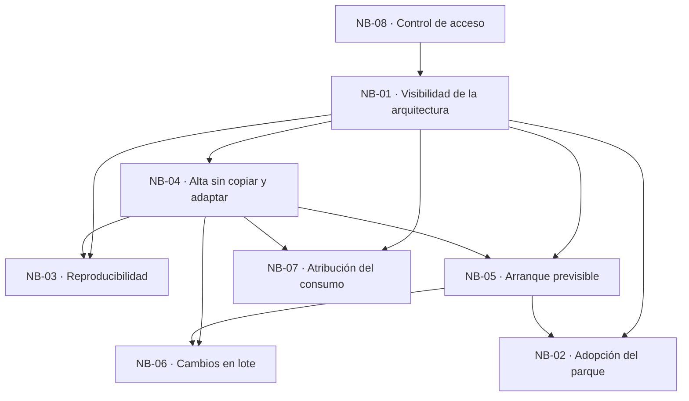

# 02 · Necesidades de negocio

> Índice destilado del catálogo de necesidades de negocio (NB) de **SelfHosted Service**: qué NB existe, qué dolor resuelve, con qué criterios se verifica y qué casos de uso la satisfacen. Sirve para ubicar la NB correcta sin abrir los diez archivos de la categoría.
> **Fuente primaria:** `SDD/Docs/01-Necesidades-Negocio/README.md`, `SDD/Docs/01-Necesidades-Negocio/Necesidades-Negocio.md` y los ocho archivos de `SDD/Docs/01-Necesidades-Negocio/Necesidades-De-Negocio/`.
> El detalle de cada CU vive en el índice hermano [`03_Casos-De-Uso.md`](03_Casos-De-Uso.md); acá sólo figura la asignación NB→CU.

---

## 1. Qué es esta categoría

- **8 necesidades de negocio**, una por archivo, con numeración `NB-01` a `NB-08` estable y no reutilizable.
- Estado de las ocho: `Propuesto`, versión `2.0`, fecha `2026-07-30`, autor «Analista de Negocio Senior (AG-01)».
- **Ninguna está aprobada por el cliente**: las ocho provienen de la Fase A previa (material marcado `[FA]` en el intake §23) y se consumen como propuesta, no como requisito cerrado. Es la primera brecha declarada en `Necesidades-Negocio.md` §7.
- **Las NB no definen flujos**: enuncian dolor, criterios y prioridad. Los flujos son de la categoría 02.
- Cobertura: **20 capacidades** del alcance (`F-01` a `F-17`, `F-23` a `F-25`) tienen exactamente una NB responsable. `F-18` a `F-22` están fuera de la primera versión por decisión del cliente y no generan NB.

## 2. Catálogo NB-01 a NB-08

| ID | Necesidad | Problema que resuelve | Criterios de éxito (conteo) | CU que la satisfacen |
| --- | --- | --- | --- | --- |
| NB-01 | Visibilidad unificada de la arquitectura de un conjunto de servicios | La arquitectura no existe como objeto: vive repartida entre definiciones sueltas, variables no versionadas y el estado que el motor ejecuta. Sin inventario, la dependencia se infiere leyendo archivos, la divergencia no se señala, renombrar rompe en silencio y el registro acumula restos (8 problemas enumerados en su §4) | **8** (2 con target derivado pendiente de confirmación) | CU-01, CU-02, CU-03, CU-04, CU-05, CU-36 |
| NB-02 | Adoptabilidad del parque existente sin reinstanciar lo que ya está en producción | Incorporar un servicio en uso exige recrearlo con su ventana de indisponibilidad; la configuración real sólo se conoce inspeccionando a mano; no se sabe qué contenedores ya están gobernados; hay contenedores que no deben gobernarse; las variables en producción traen credenciales que una importación ingenua dejaría legibles (5) | **5** | CU-06, CU-07, CU-08 |
| NB-03 | Reproducibilidad de la arquitectura ante la pérdida del servidor | No existe representación de la arquitectura fuera del propio servidor; la reconstrucción depende de la memoria de una persona; los archivos parciales no están versionados y traen credenciales; la disposición se perdería; el respaldo depende de una acción manual (5) | **5** | CU-09, CU-10, CU-11, CU-12 |
| NB-04 | El alta de un servicio deja de ser un ejercicio de copiar y adaptar | Cada alta parte de otro servicio y arrastra decisiones viejas; las dimensiones que el parque exige no están en un formulario único; no hay reutilización sin copiar; un valor compartido se escribe una vez por servicio y se sincroniza a mano; llevar lo declarado a un contenedor es manual y distinto según el origen; construir una imagen propia ocurre fuera de todo registro (6) | **6** | CU-13, CU-14, CU-15, CU-16, CU-17, CU-34, CU-35 |
| NB-05 | Arranque previsible: orden declarado y conflictos de dirección detectados antes de fallar | El orden de arranque se recuerda de memoria y no hay dónde asentar qué dependencia obliga a esperar; las direcciones fijas se anotan fuera del sistema; el conflicto se descubre cuando el motor falla, sin identificar al ocupante ni ofrecer salida; un arranque parcial no queda registrado; reasignar una dirección deja consumidores apuntando a un valor obsoleto (5) | **5** | CU-18, CU-19, CU-20, CU-21 |
| NB-06 | Cambios de configuración revisados antes de aplicarse y aplicados en un solo lote | Cada cambio provoca su propio reemplazo de contenedor y su ventana de indisponibilidad; nada declara antes de ejecutar qué servicios quedan afectados; un cambio por error no se puede descartar antes de tener consecuencias; los ajustes de recursos y réplicas se aplican sin mostrar su consecuencia; nada distingue un cambio visual de uno de configuración (5) | **5** | CU-22, CU-23, CU-24, CU-25 |
| NB-07 | Atribución del consumo del servidor a un servicio concreto | No hay una vista donde el estado del equipo, del conjunto y del contenedor se lean igual; la correspondencia contenedor↔conjunto se hace de memoria; los servicios con dirección propia no se pueden observar preguntándoles; un contenedor eliminado por fuera seguiría figurando activo; toda observación agrega carga sin política declarada de cuánto puede costar mirar (5) | **5** | CU-26, CU-27, CU-28 |
| NB-08 | Control de acceso al panel que gobierna el host y credenciales de máquina acotadas | Un panel con control total no puede quedar accesible sin credencial; no hay credencial de administrador establecida ni el primer arranque resuelto; un automatismo tendría que conocer la credencial humana; no hay forma de acotar ni revocar lo de un automatismo sin afectar al administrador; no queda registro de quién ejecutó qué (5) | **5** | CU-29, CU-30, CU-31, CU-32, CU-33 |

**Total: 44 criterios de éxito y 36 CU previstas.**

> ⚠ **Desajuste vigente.** La categoría 02 emitió **39** CU: `CU-37`, `CU-38` y `CU-39` no están previstos en el §7 de ninguna NB. Es la brecha `B-20` del índice maestro de 02, con asignación propuesta CU-37→NB-07, CU-38→NB-04, CU-39→NB-04. **Las NB no la incorporaron**: la trazabilidad cierra CU→NB pero no NB→CU. Ver [`03_Casos-De-Uso.md`](03_Casos-De-Uso.md) §7.2.

## 3. Prioridad, procedencia y capacidades

| ID | MoSCoW | Capacidades que agrupa (intake §4) | Métrica de negocio adoptada |
| --- | --- | --- | --- |
| NB-01 | Must Have | F-02, F-03, F-04 (Must); F-25 (Could) | OBJ-05 (escala sin degradación), **pendiente de confirmación**, en su 3.º criterio |
| NB-02 | Must Have | F-11 (Must) | OBJ-01 adopción del parque existente, 1.º criterio |
| NB-03 | Should Have | F-13 (Should), F-17 (Could) | OBJ-03 reproducibilidad, 1.º criterio |
| NB-04 | Must Have | F-05, F-10 (Must); F-14, F-23, F-24 (Should) | OBJ-02 reemplazo del método manual, 1.º criterio |
| NB-05 | Must Have | F-06, F-08 (Must) | — |
| NB-06 | Must Have | F-07, F-09 (Must) | — |
| NB-07 | Should Have | F-12 (Should) | — |
| NB-08 | Must Have | F-01 (Must), F-15 (Should), F-16 (Could) | — |

- La prioridad de una NB es el **máximo** de las prioridades MoSCoW de las capacidades que agrupa. La regla de agregación está declarada explícitamente sólo para NB-03 (intake §23.4); para NB-01, NB-04 y NB-08 el intake registra el resultado ya agregado.
- **Ninguna de las ocho prioridades se originó en la categoría 01.** Igual que los 44 criterios: el inventario de procedencia de `Necesidades-Negocio.md` §2.2 clasifica los **132 componentes** (métrica, target y plazo de cada criterio) en **120 derivados, 12 `[FA]`, 0 originados**.
- `OBJ-04` (continuidad de la entrega) es **transversal** a las ocho: se verifica como no-regresión acumulativa, no como criterio de una NB.

## 4. Los 44 criterios de éxito, por NB

Nombre del criterio y hito al que ancla su plazo. **Ninguno usa fecha de calendario.** El target concreto vive en el §5 del archivo de cada NB; acá va sólo para NB-01, que es el único con targets pendientes de confirmación. `EP-xx` son épicas de `Roadmap-Producto.md`.

| NB | Criterio | Ancla del plazo |
| --- | --- | --- |
| NB-01 | Cobertura del parque en el registro — *target `5 de 5 conjuntos`, **pendiente de confirmación*** | 3 meses desde el cierre del Alcance 1 |
| NB-01 | Autosuficiencia de la consulta de dependencias — *target `0 archivos`, **pendiente de confirmación*** | Cierre de la etapa `03` (EP-04, lienzo) |
| NB-01 | Escala legible sin degradación — *target `30 nodos y 40 aristas`* | Medición de la puerta técnica PT-01 |
| NB-01 | Conservación de la disposición — *target `100 %`* | Cierre de la etapa `03` |
| NB-01 | Estabilidad de la sesión — *umbral **cualitativo por decisión**, ventana de 15 minutos* | Medición de PT-01 |
| NB-01 | Previsibilidad del arranque leyendo el lienzo — *target `100 %`* | Cierre de la etapa `03` |
| NB-01 | Integridad ante un renombrado — *target `100 %`* | Cierre de la etapa `03` |
| NB-01 | Señalamiento de la degradación del registro — *`5 de 5` condiciones, `0` bloqueos* | EP-25, **sin fase asignada** |
| NB-02 | Adopción del parque existente (métrica de negocio OBJ-01) | Intake §8 |
| NB-02 | Continuidad del servicio durante la incorporación | EP-11, etapa `10` |
| NB-02 | Fidelidad de la configuración importada (seis dimensiones) | EP-11, etapa `10` |
| NB-02 | Salvaguardas de aislamiento activas (cinco enumeradas) | EP-11, etapa `10` |
| NB-02 | Clasificación de las credenciales importadas | EP-11, etapa `10` |
| NB-03 | Reproducibilidad de la arquitectura (métrica de negocio OBJ-03) | Intake §8 |
| NB-03 | Fidelidad de la reimportación | EP-13, Fase 3 |
| NB-03 | Ausencia de credenciales en la salida | EP-13, Fase 3 |
| NB-03 | Cobertura de la traducción sobre el parque real | EP-13, Fase 3 |
| NB-03 | Automatismo del respaldo (antigüedad menor a 7 días) | EP-17, Fase 3 |
| NB-04 | Reemplazo del método manual (métrica de negocio OBJ-02) | Intake §8 |
| NB-04 | Cobertura de las dimensiones del alta (ocho dimensiones del parque real) | EP-03, etapa `02` |
| NB-04 | Vías de alta soportadas (tres orígenes más el catálogo) | EP-14, Fase 3 |
| NB-04 | Autosuficiencia de la instanciación | EP-14, Fase 3 |
| NB-04 | Fidelidad del conjunto instanciado | EP-14, Fase 3 |
| NB-04 | Valor compartido declarado una sola vez | EP-23 y EP-24, **sin fase asignada** |
| NB-05 | Anticipación del conflicto (bloquear en lugar de fallar en el motor) | EP-08, etapa `07` |
| NB-05 | Inmediatez del informe | EP-08, etapa `07` |
| NB-05 | Resoluciones ofrecidas (las tres de CL-01) | EP-08, etapa `07` |
| NB-05 | Orden de arranque respetado (orden topológico) | EP-06, etapa `05` |
| NB-05 | Gobierno del rango de direcciones | EP-08, etapa `07` |
| NB-06 | Reemplazos por sesión de edición («se redespliega una sola vez») | EP-07, etapa `06` |
| NB-06 | Revisión previa obligatoria (informe de impacto) | EP-07, etapa `06` |
| NB-06 | Precisión del alcance declarado | EP-07, etapa `06` |
| NB-06 | Cambios de escalado con consecuencia declarada | EP-09, etapa `08` |
| NB-06 | Advertencia de la ventana de indisponibilidad | EP-07, etapa `06` |
| NB-07 | Atribución de la presión de memoria | EP-12, Fase 2 |
| NB-07 | Niveles de lectura disponibles (tablero en tres capas) | EP-12, Fase 2 |
| NB-07 | Costo de observar con las pantallas cerradas | EP-12, Fase 2 |
| NB-07 | Frescura del estado mostrado | EP-12, Fase 2 |
| NB-07 | Huella del propio administrador | Fase 0 |
| NB-08 | Superficie accesible sin credencial | EP-01, etapa `c` |
| NB-08 | Automatismos que conocen la credencial humana | Fase 4 |
| NB-08 | Acotamiento de las credenciales de máquina (ámbito mínimo) | EP-15, **anclaje abierto** |
| NB-08 | Efecto de la revocación | Fase 4 |
| NB-08 | Registro de las operaciones con consecuencias (retención 90 días, DA-07) | EP-01, etapa `c` |

Procedencia de los **132 componentes** (métrica + target + plazo de cada criterio):

| Componente | Derivado | `[FA]` Fase A previa | Originado en la categoría |
| --- | --- | --- | --- |
| Métrica | 40 | 4 | **0** |
| Target | 36 | 8 | **0** |
| Plazo | 44 | 0 | **0** |
| **Total** | **120** | **12** | **0** |

De los 44 plazos, **6 son derivados de forma directa** (4 toman el horizonte del intake §8, 2 anclan a la medición de PT-01) y **38 lo son por composición** (criterio → capacidad → NB → épica → etapa). De esos 38, la categoría eligió la **forma** —24 puntuales y 14 continuos— dentro de las tres admisibles; es lo único que emitió y queda registrado como brecha.

## 5. Actores y roles

Los actores se identifican **por rol y nunca por nombre propio** (decisión cerrada del 2026-07-27; propietario, lead técnico y usuario final son la misma persona). Ningún artefacto downstream debe pedir un nombre propio.

| Rol | Función en la categoría | Quién valida como beneficiario |
| --- | --- | --- |
| Analista de Negocio Senior (AG-01) | **R** — redacta y mantiene las ocho NB, sus criterios y su trazabilidad. Propietario del contenido | — |
| Agente humano del proyecto | **A** — aprueba las ocho y da el OK explícito de cada punto de control. El bloqueo **no vence** | — |
| Equipo de desarrollo (dos desarrolladores) | **R** — implementa las capacidades; **I** — recibe el catálogo como insumo | — |
| Agente IA de codificación | **R** — genera especificación y, más adelante, código de cada corte vertical | — |
| Product Manager (AG-00) | **C** — verifica alineación con visión y alcance | — |
| Analista Funcional (AG-02) | **C** — desarrolla los CU que cada NB declara previstos | — |
| Usuario final: administrador del producto | **I** — beneficiario | NB-01, NB-04, NB-05, NB-06 |
| Usuario final + automatismo de integración continua | **I** — beneficiario | NB-08 (la capacidad de credenciales de máquina existe para el segundo) |
| Propietario del servidor de referencia | **I** — beneficiario | NB-02, NB-03, NB-07 |

La aprobación es **siempre** del agente humano del proyecto. Los roles consultados aportan revisión, no autoría compartida.

## 6. Grafo de dependencias

El grafo es **acíclico** y ninguna NB depende de más de dos otras.

**Orden topológico, que es también el orden de lectura sugerido:**

`NB-08 → NB-01 → NB-04 → NB-05 → NB-02 → NB-06 → NB-03 → NB-07`

Recorridos parciales que la fuente declara:

| Objetivo del lector | Qué leer |
| --- | --- |
| Entender por qué existe el producto | NB-01, NB-02 y NB-05 |
| Especificar casos de uso | `Necesidades-Negocio.md` §4.2 primero, después el §4 de cada NB (los dolores de los que cada CU deriva) |
| Derivar criterios de prueba | El §5 de cada NB, más §6 del índice maestro (reglas que los 44 criterios respetan) |

## 7. Anatomía de un documento NB

Los ocho archivos son estructuralmente idénticos: cabecera en tabla `Campo | Valor` + tabla de contenido + **diez secciones obligatorias**.

| Sección | Qué trae | Formato |
| --- | --- | --- |
| Cabecera | `Producto`, `Documento`, `Versión`, `Estado`, `Fecha`, `Autor`, `Trazabilidad upstream` (secciones concretas del intake y de 00-Contexto), `Trazabilidad downstream` (las CU previstas) | Tabla `Campo \| Valor` |
| §1 Descripción de la necesidad | Enunciado del dolor en prosa, con por qué es permanente y no puntual | Prosa, 3 párrafos típicos |
| §2 Ejemplo de uso desde la perspectiva del negocio | Escena concreta del propietario del servidor, con el contraste «lo que querría» | Prosa |
| §3 Impacto | Qué cambia si se resuelve y qué pasa si no | Viñetas |
| §4 Problema específico que resuelve | Lista cerrada de problemas atómicos. Es **la fuente de la que cada CU deriva** | Viñetas (5 a 8) |
| §5 Criterios de éxito | Tabla `Criterio \| Métrica \| Target \| Plazo`, más notas numeradas que declaran lo pendiente en lugar de resolverlo | Tabla + notas |
| §6 Stakeholders involucrados | `Rol \| Nivel \| Qué pide o aporta`. Niveles: Propietario, Propietario del contenido, Implementador, Beneficiario, Consultado | Tabla |
| §7 Trazabilidad a CU | `NB \| CU prevista \| Estado`. La capa del proyecto de código que la implementa va **dentro de la celda del CU** | Tabla, estado `a generar` |
| §8 Dependencias con otras NB | «Depende de» / «Es prerequisito de», con el argumento | Viñetas |
| §9 Prioridad MoSCoW | Valor + justificación de una línea. **No elige el valor**, explica por qué es el que es | Prosa breve |
| §10 Control de cambios | `Versión \| Fecha \| Cambios`. Las filas históricas **no se reescriben** | Tabla |

Reglas de forma que la categoría aplica:

1. **Ningún criterio usa fecha de calendario.** Los plazos anclan a meses desde el cierre de un alcance, al cierre de la etapa/fase que entrega la capacidad, o se declaran continuos.
2. **Ningún criterio se mide antes de que exista la capacidad que evalúa.**
3. Todos llevan número y unidad, con **una excepción declarada**: la estabilidad de la sesión de NB-01, cuyo umbral es cualitativo y lo fija la puerta técnica PT-01 al medir.
4. El archivo vivo **no lleva sufijo de versión** en el nombre; el sufijo `-v<X.Y>.md` es sólo de la copia archivada en `_legacy/`.
5. La categoría **no acuña vocabulario propio**: el glosario raíz de la cadena es `00-Contexto/Vision-Producto.md` §9.

## 8. Decisiones de recorte del catálogo

Siete decisiones de partición heredadas de la Fase A, conservadas sin refutar ninguna (`Necesidades-Negocio.md` §5):

| Decisión | Motivo declarado |
| --- | --- |
| F-06 (arranque y parada) va a NB-05, no a NB-01 | Orden de arranque y conflicto de direcciones se manifiestan en el mismo acto, público y momento de verificación |
| F-09 (escalado manual) va a NB-06, no a NB-07 | Cambiar réplicas o límites es una edición que entra al conjunto de cambios pendientes y comparte circuito de revisión e indisponibilidad |
| NB-07 queda con una sola capacidad | Dolor con público y métrica propios; es acotada, no un recorte excesivo |
| NB-03 agrupa F-13 y F-17 de prioridades distintas | Mismo dolor: exportar es la mitigación, programarla la vuelve confiable. Toma la prioridad más alta |
| F-23 y F-24 van juntas a NB-04 | Mismo dolor de copiar y adaptar, aplicado a un dato en vez de a una configuración entera |
| F-25 va a NB-01 y no abre NB propia | Mismo público y métrica; una NB de una sola capacidad Could Have informativa sería la más delgada del catálogo |
| NB-08 agrupa F-01, F-15 y F-16 de prioridades distintas | Mismo dolor: un panel que gobierna el equipo necesita control de acceso y los automatismos no deben conocer la credencial humana |

Decisión adicional registrada: **«renombrar no rompe lo que apunta al servicio» se ubicó en NB-01 y no en NB-04**, con el criterio de cuál promesa quedaría falsa sin ello.

> **Imprecisión señalada y no corregida.** El argumento de la primera fila invoca «una dependencia mutua entre NB-01 y NB-04» cuando el recorte que decide es entre NB-05 y NB-01. La imprecisión está en el intake §23.4, de donde la fila es transcripción literal; se eleva como observación y no se reescribe.

## 9. Brechas abiertas declaradas

Nueve brechas en `Necesidades-Negocio.md` §7. Ninguna se resuelve en la categoría.

| Brecha | Destinatario |
| --- | --- |
| Las ocho NB vienen de la Fase A `[FA]` y **no están aprobadas** por el cliente | Agente humano, próximo punto de control |
| Los dos targets derivados de NB-01 (cobertura del parque, autosuficiencia de la consulta) siguen pendientes de confirmación | Agente humano |
| El umbral numérico de estabilidad de sesión lo fija PT-01 al medir; hoy es cualitativo | PT-01 y 08-Calidad-Y-Pruebas |
| El plazo del criterio de higiene de NB-01 y el del valor compartido de NB-04 dependen de asignar EP-23, EP-24 y EP-25 a una fase | 07-Plan-Sprint + agente humano |
| Los plazos de tres criterios de NB-03 anclan a una etapa de Fase 3 cuyo orden no está declarado | Agente humano |
| El plazo del acotamiento de credenciales de NB-08 depende del adelanto no decidido de EP-15 a Fase 1 | Agente humano |
| La confirmación de OBJ-05, que sostiene el criterio de escala de NB-01 | Agente humano |
| La imprecisión del argumento de recorte de F-06 (heredada del intake §23.4) | Agente humano, como observación sobre el intake |
| La **forma del plazo** (puntual o continuo) de los 38 criterios que anclan por composición: es lo único que esta categoría eligió | 08-Calidad-Y-Pruebas |

## 10. Consumo downstream

| Categoría | Qué consume de las NB |
| --- | --- |
| 02-Especificacion-Funcional | Los 36 CU previstos con su NB de origen, y los dolores del §4 de cada NB, que son la razón por la que cada CU existe |
| 03-UX-UI-DX | Los dolores de NB-01, NB-04 y NB-06: qué debe ser visible en el lienzo y en el flujo de cambios pendientes |
| 06-Backlog-Tecnico | La prioridad MoSCoW de cada NB, que ordena el backlog junto con las épicas del roadmap |
| 07-Plan-Sprint | El orden topológico y el grafo de dependencias, que condicionan la secuencia de etapas |
| 08-Calidad-Y-Pruebas | Los 44 criterios de éxito, input directo de sus criterios de aceptación verificables |

## Fuentes

| Archivo | Qué contiene |
| --- | --- |
| `SDD/Docs/01-Necesidades-Negocio/README.md` | Índice navegable de la categoría (148 líneas): tabla de las 8 NB con impacto, MoSCoW, versión y estado; mapa de dependencias; orden de lectura y recorridos parciales; RACI y quién valida como beneficiario; las 4 convenciones de la categoría |
| `SDD/Docs/01-Necesidades-Negocio/Necesidades-Negocio.md` | Índice maestro (337 líneas): tabla resumen NB→CU; §2.1 procedencia de las 8 prioridades MoSCoW; §2.2 inventario de procedencia de los 132 componentes de los 44 criterios; §3 grafo y orden topológico; §4 trazabilidad capacidad→NB, NB→CU y métrica→NB; §5 las 7 decisiones de recorte; §6 criterios en agregado; §7 las 9 brechas abiertas |
| `SDD/Docs/01-Necesidades-Negocio/Necesidades-De-Negocio/NB-01-Visibilidad-Unificada-De-La-Arquitectura.md` | Registro declarado de la arquitectura, lienzo, disposición persistida, previsibilidad del arranque, integridad ante renombrado, higiene del registro. 8 criterios. Raíz del grafo tras NB-08 |
| `SDD/Docs/01-Necesidades-Negocio/Necesidades-De-Negocio/NB-02-Adoptabilidad-Del-Parque-Existente.md` | Incorporación de contenedores en producción sin recrearlos ni cortar servicio; salvaguardas de aislamiento; clasificación de credenciales importadas. 5 criterios |
| `SDD/Docs/01-Necesidades-Negocio/Necesidades-De-Negocio/NB-03-Reproducibilidad-De-La-Arquitectura.md` | Exportación e importación de la arquitectura, ausencia de credenciales en la salida, respaldo automatizado a destino externo. 5 criterios |
| `SDD/Docs/01-Necesidades-Negocio/Necesidades-De-Negocio/NB-04-Alta-De-Servicio-Sin-Copiar-Y-Adaptar.md` | Alta declarativa con las 8 dimensiones del parque real, vías de alta, catálogo de plantillas, variables compartidas y referencias. 6 criterios |
| `SDD/Docs/01-Necesidades-Negocio/Necesidades-De-Negocio/NB-05-Arranque-Previsible-Y-Conflictos-Anticipados.md` | Orden topológico del grafo de arranque, rango gestionado de direcciones, anticipación del conflicto con resoluciones ofrecidas. 5 criterios |
| `SDD/Docs/01-Necesidades-Negocio/Necesidades-De-Negocio/NB-06-Cambios-Revisados-Y-Aplicados-En-Lote.md` | Conjunto de cambios pendientes, informe de impacto previo, una ventana de indisponibilidad por sesión de edición, escalado con consecuencia declarada. 5 criterios |
| `SDD/Docs/01-Necesidades-Negocio/Necesidades-De-Negocio/NB-07-Atribucion-Del-Consumo-Del-Servidor.md` | Tablero de estado en tres capas (servidor, proyecto, contenedor), costo acotado de observar, frescura del estado, huella del propio administrador. 5 criterios |
| `SDD/Docs/01-Necesidades-Negocio/Necesidades-De-Negocio/NB-08-Control-De-Acceso-Y-Credenciales-De-Maquina.md` | Autenticación del panel, alta del administrador en el primer arranque, tokens de ámbito mínimo con revocación, auditoría con retención de 90 días. 5 criterios |
