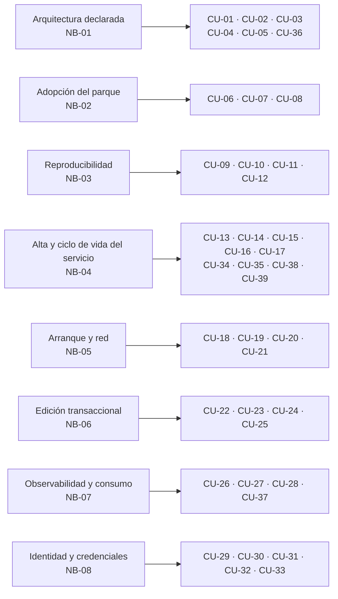

# 03 · Casos de uso y trazabilidad funcional

> Índice destilado de la especificación funcional de **SelfHosted Service**: los 39 casos de uso con su actor primario, su necesidad de origen y las reglas que los restringen, más la anatomía de un documento CU y el resumen de la matriz `NB → CU → RN → US`. Sirve para ubicar el CU correcto sin abrir los 40 archivos de la carpeta.
> **Fuente primaria:** `SDD/Docs/02-Especificacion-Funcional/README.md`, `SDD/Docs/02-Especificacion-Funcional/Especificacion-Funcional.md` (índice maestro con la matriz) y los 39 archivos de `SDD/Docs/02-Especificacion-Funcional/Casos-De-Uso/`.
> El catálogo de necesidades y sus criterios de éxito vive en el índice hermano [`02_Necesidades-De-Negocio.md`](02_Necesidades-De-Negocio.md).
> Las **40 RN**, el modelo conceptual y las **19 RC** tienen índice propio y acá sólo se los referencia por identificador.

---

## 1. Composición de la categoría

| Artefacto | Cantidad | Ubicación |
| --- | --- | --- |
| Casos de uso | **39** (`CU-01` a `CU-39`, contiguos y únicos) | `Casos-De-Uso/` |
| Reglas de negocio | **40** (`RN-01` a `RN-40`) | `Reglas-De-Negocio/` |
| Reglas conceptuales del modelo | **19** (`RC-01` a `RC-19`) | `Modelo-Datos/reglas-conceptuales-de-modelo/` |
| Modelo conceptual | 1 (15 entidades conceptuales sobre 11 tablas) | `Modelo-Datos/Modelo-Conceptual.md` |
| Glosario funcional | 1 (120 términos, 9 familias polisémicas, 18 referenciados) | `Glosario-Funcional.md` |
| Historias de usuario **previstas** | **156** sobre 39 CU, provisionales | matriz §6 del índice maestro |
| Brechas abiertas | **32**, tres de ellas cerradas con su fila conservada | §9 del índice maestro |

- Tipo de proyecto de código (`D8`): `web-monolith`. Especialidad asignada: Analista Funcional Senior (AG-02), con AG-03 (UX) y AG-08 (QA) **como delegación acotada, no coautoría**.
- Un único proyecto de código, `SelfHosted.Service.Core`, con cuatro capas internas (`Domain`, `Application`, `Infrastructure`, `Web`). La categoría se genera **plana**, no repartida por capa.
- Estado de los 39 CU: `Propuesto`. La mayoría en versión `2.0`; excepciones vigentes: `CU-03` 3.3; `CU-13`, `CU-15`, `CU-37`, `CU-38` 2.2; `CU-07`, `CU-08`, `CU-09`, `CU-11`, `CU-16`, `CU-17`, `CU-18`, `CU-33` 2.1; `CU-39` 1.2.
- **La categoría no origina decisiones de producto: formaliza y traza.** Donde una fuente no declara un dato, el CU lo declara como brecha con su destinatario en lugar de completarlo.

## 2. Catálogo CU-01 a CU-39

Leyenda de la columna «Superficie UX»: la titularidad de las superficies es de `03-UX-UI-DX`. **Sólo dos CU declaran un identificador `SUP-` en su propio texto**; para el resto la superficie **no está declarada en la fuente leída** y se marca `—`.

| ID | Caso de uso | Actor primario | NB origen | Superficie UX | RN clave |
| --- | --- | --- | --- | --- | --- |
| CU-01 | Alta de proyecto SelfHosted con su modo de red y su persistencia | Administrador del producto | NB-01 | — | RN-17, RN-35 |
| CU-02 | Listado, renombrado y eliminación de proyectos SelfHosted | Administrador del producto | NB-01 | — | RN-10, RN-17, RN-33, RN-35 |
| CU-03 | Alta y configuración completa de un servicio (alta unificada, origen como campo) | Administrador del producto | NB-01 | `SUP-17` (citada; pasa a tener el origen como campo — brecha B-29) | RN-01, RN-02, RN-06, RN-07, RN-08, RN-10, RN-12, RN-17, RN-19, RN-27, RN-28, RN-32, RN-33, RN-35, RN-38 |
| CU-04 | Composición del lienzo: nodos, aristas y dependencias | Administrador del producto | NB-01 | — | RN-04, RN-05, RN-12, RN-14, RN-17, RN-21, RN-32, RN-33, RN-34, RN-35 |
| CU-05 | Persistencia y recuperación de la disposición del lienzo | Administrador del producto | NB-01 | — | RN-12, RN-17 |
| CU-06 | Descubrimiento de contenedores, con motivo de no incorporabilidad | Administrador del producto | NB-02 | — | RN-11, RN-15, RN-29, RN-38 |
| CU-07 | Incorporación de un contenedor existente con confirmación explícita | Administrador del producto | NB-02 | — | RN-01, RN-02, RN-11, RN-15, RN-17, RN-29 |
| CU-08 | Traducción de la configuración observada al modelo de servicio | **Módulo de traducción** (sistema, acuñado) | NB-02 | — | RN-01, RN-07, RN-08, RN-15, RN-26, RN-29, RN-34, RN-38 |
| CU-09 | Exportación en formato estándar de composición | Administrador del producto | NB-03 | — | RN-15, RN-23, RN-25 |
| CU-10 | Exportación del manifiesto propio, que preserva la disposición | Administrador del producto | NB-03 | — | RN-15, RN-23, RN-25 |
| CU-11 | Importación como proyecto SelfHosted nuevo | Administrador del producto | NB-03 | — | RN-01, RN-02, RN-05, RN-07, RN-17, RN-21, RN-26, RN-34 |
| CU-12 | Ejecución programada de la exportación hacia un destino externo | Administrador del producto | NB-03 | — | RN-15, RN-17, RN-25 |
| CU-13 | Despliegue de un servicio desde imagen ya publicada (registro o almacén local) | Administrador del producto | NB-04 | — | RN-08, RN-13, RN-17, RN-21, RN-23, RN-24, RN-31, RN-38 |
| CU-14 | Consulta del registro del contenedor | Administrador del producto | NB-04 | — | RN-15 (única; el resto es brecha B-08) |
| CU-15 | Despliegue construyendo la imagen, acotado al archivo declarado | Administrador del producto | NB-04 | — | RN-08, RN-17, RN-21, RN-24, RN-31, RN-38, RN-40 |
| CU-16 | Alta desde plantilla del catálogo, con creación del conjunto completo | Administrador del producto | NB-04 | — | RN-01, RN-02, RN-15, RN-17, RN-21, RN-22, RN-24, RN-30, RN-34, RN-36, RN-37, RN-39 |
| CU-17 | Mantenimiento del catálogo de plantillas | Administrador del producto | NB-04 | — | RN-15, RN-17, RN-30, RN-39 |
| CU-18 | Arranque y parada, con autoarranque | Administrador del producto | NB-05 | — | RN-03, RN-04, RN-05, RN-09, RN-14, RN-17, RN-20, RN-24, RN-31, RN-40 |
| CU-19 | Rango gestionado y reserva de dirección por servicio | Administrador del producto | NB-05 | — | RN-03, RN-06, RN-17, RN-18 |
| CU-20 | Validación de conflicto contra los servicios activos, sin acceso al motor | **Módulo de validación de red** (sistema, acuñado) | NB-05 | — | RN-03, RN-06, RN-20 |
| CU-21 | Informe de conflicto y aplicación de la resolución elegida | Administrador del producto | NB-05 | — | RN-03, RN-06, RN-13, RN-17, RN-20 |
| CU-22 | Acumulación de cambios pendientes, con distinción de los visuales | Administrador del producto | NB-06 | — | RN-12, RN-13, RN-17, RN-27, RN-33 |
| CU-23 | Descarte de un cambio individual del conjunto pendiente | Administrador del producto | NB-06 | — | RN-12, RN-13, RN-17 |
| CU-24 | Aplicación en lote del conjunto de cambios pendientes | Administrador del producto | NB-06 | — | RN-03, RN-04, RN-09, RN-13, RN-17, RN-20, RN-21, RN-22, RN-24, RN-31 |
| CU-25 | Cálculo del informe de impacto | **Módulo de impacto** (sistema, acuñado) | NB-06 | — | RN-12, RN-13, RN-27, RN-33 |
| CU-26 | Lectura del estado del servidor | Administrador del producto | NB-07 | — | **Ninguna RN**: sus restricciones son requisitos no funcionales del intake §17.P.10 |
| CU-27 | Vista por proyecto SelfHosted y por contenedor | Administrador del producto | NB-07 | — | RN-20, RN-31 |
| CU-28 | Reconciliación con el motor de contenedores y señalización del huérfano | **Sincronizador de estado** (declarado) | NB-07 | — | RN-20, RN-31 |
| CU-29 | Alta del administrador en el primer arranque | Administrador del producto | NB-08 | — | RN-17 |
| CU-30 | Inicio y cierre de sesión | Administrador del producto | NB-08 | — | RN-17 |
| CU-31 | Cambio de contraseña | Administrador del producto | NB-08 | — | RN-17 |
| CU-32 | Emisión, listado y revocación de credenciales de máquina | Administrador del producto | NB-08 | — | RN-15, RN-16, RN-17 |
| CU-33 | Disparo de despliegue con credencial de ámbito mínimo | **Automatismo de integración continua** (declarado) | NB-08 | — | RN-13, RN-16, RN-17, RN-21, RN-24, RN-31 |
| CU-34 | Variables compartidas del proyecto SelfHosted | Administrador del producto | NB-04 | — | RN-15, RN-17, RN-21, RN-22, RN-23, RN-27, RN-28, RN-33, RN-35, RN-37 |
| CU-35 | Valor expresado como referencia a otra variable | Administrador del producto | NB-04 | — | RN-15, RN-17, RN-21, RN-22, RN-23, RN-24, RN-25, RN-27, RN-28, RN-32, RN-33, RN-34, RN-35, RN-37 |
| CU-36 | Revisión de higiene del registro | Administrador del producto | NB-01 | — | RN-28, RN-35, RN-37 |
| CU-37 | Higiene de imágenes: listar, conservar, limpiar e instanciar desde el almacén | Administrador del producto | NB-07 *(no previsto por ninguna NB)* | — | RN-17, RN-40 |
| CU-38 | Vuelta a un despliegue anterior | Administrador del producto | NB-04 *(no previsto por ninguna NB)* | — | RN-13, RN-17, RN-20, RN-24, RN-31, RN-40 |
| CU-39 | Exploración del registro de imágenes | Administrador del producto | NB-04 *(no previsto por ninguna NB)* | **`SUP-19` emitida** (`03-UX-UI-DX/Wireframes/Wireframes-Exploracion-De-Registro-De-Imagenes.md` 1.0) | RN-08, RN-15, RN-17 (RN-17 **sin producir eventos**: la exploración es de sólo lectura) |

## 3. Agrupación por área funcional

El agrupamiento canónico de la categoría es **por necesidad de negocio de origen**, y así lo hace el README §3.

| Área funcional | NB | CU | Qué resuelve el bloque |
| --- | --- | --- | --- |
| Registro y lienzo de la arquitectura | NB-01 | CU-01, CU-02, CU-03, CU-04, CU-05, CU-36 | Declarar proyectos y servicios, componer el lienzo con sus aristas, conservar la disposición y advertir la degradación del registro |
| Adopción del parque existente | NB-02 | CU-06, CU-07, CU-08 | Descubrir candidatos con motivo de no incorporabilidad, incorporarlos sin recrearlos y traducir su configuración observada |
| Exportación, importación y respaldo | NB-03 | CU-09, CU-10, CU-11, CU-12 | Salida en formato estándar y en manifiesto propio, importación como proyecto nuevo, exportación programada a destino externo |
| Alta y ciclo de vida del servicio | NB-04 | CU-13, CU-14, CU-15, CU-16, CU-17, CU-34, CU-35, CU-38, CU-39 | Los tres orígenes de imagen, el catálogo de plantillas, las variables compartidas y sus referencias, la vuelta a un despliegue anterior y la exploración del registro remoto |
| Arranque previsible y direcciones | NB-05 | CU-18, CU-19, CU-20, CU-21 | Orden topológico del grafo, rango gestionado, validación de conflicto sin tocar el motor e informe con resolución |
| Edición transaccional | NB-06 | CU-22, CU-23, CU-24, CU-25 | Acumular cambios distinguiendo los visuales, descartar uno, calcular el impacto y aplicar el lote redesplegando sólo lo afectado |
| Observabilidad e higiene de disco | NB-07 | CU-26, CU-27, CU-28, CU-37 | Estado en tres capas, reconciliación con el motor, servicio huérfano y ciclo de vida de las imágenes |
| Identidad, sesión y credenciales | NB-08 | CU-29, CU-30, CU-31, CU-32, CU-33 | Primer arranque, sesión, contraseña, tokens de API de ámbito mínimo y disparo automatizado de despliegue |

**Recorrido mínimo para entender el producto** (declarado en el README §1): `CU-01` y `CU-03` (proyecto y servicio) → `CU-04` (mecanismo de vínculo) → `CU-22` y `CU-24` (edición transaccional) → `CU-07` (flujo diferencial).

## 4. Anatomía de un documento CU

Los 39 archivos comparten estructura: cabecera en negritas (no en tabla, a diferencia de los NB) + tabla de contenido + **once secciones numeradas**, más una **§13 opcional**.

| Sección | Qué trae | Formato |
| --- | --- | --- |
| Cabecera | `Proyecto de código`, `Producto`, `Documento`, `Versión`, `Estado`, `Fecha`, `Autor`, **`Necesidad de negocio upstream`** (enlace a la NB) y `Trazabilidad upstream` (secciones y anexos concretos del intake) | Líneas `**Campo:** valor` |
| §1 Propósito | Qué permite el caso de uso y para qué, en un párrafo | Prosa |
| §2 Actores | `Actor \| Tipo \| Rol`. Tipos: `Primario`, `Sistema`. Cierra con la salvedad de que los nombres no humanos son denominaciones acuñadas | Tabla + nota fija |
| §3 Precondiciones | Estado del sistema exigido, con el CU que lo produce entre paréntesis | Viñetas |
| §4 Flujo principal | Pasos numerados alternando administrador y sistema, con la RN o RC citada por identificador en el paso que la aplica | Lista numerada |
| §5 Flujos alternativos | Bloques `FA-nn` con **Disparador / Pasos / Punto de retorno** | Bloques rotulados |
| §6 Excepciones y errores | `Código \| Causa \| Respuesta del sistema`. Los códigos son constantes en mayúsculas; la política general es `422` datos inválidos / `409` conflictos (CL-05) | Tabla |
| §7 Postcondiciones | Dos párrafos rotulados: **En caso de éxito** / **En caso de fallo** | Prosa rotulada |
| §8 Criterios de aceptación | `ID \| Given \| When \| Then`, con `CA-nn`. Valores concretos, anclados al anexo E-22 cuando existe | Tabla |
| §9 Trazabilidad | `Dimensión \| Referencia`, con **cinco dimensiones fijas**: Necesidad de negocio · Reglas de negocio aplicables (y RC) · Historias de usuario a generar en 06 · Componentes esperados en 05 · Tests previstos en 08. `CU-39` suma una sexta: **Superficie en 03** | Tabla |
| §10 Notas y supuestos | Datos declarados que podrían leerse como brecha, y **brechas declaradas con su destinatario**. Es donde vive la mayoría de las brechas del catálogo | Viñetas |
| §11 Control de cambios | `Versión \| Fecha \| Cambios`. Filas históricas **nunca reescritas** | Tabla |
| §13 Interacción multiusuario y concurrencia | Opcional, admitida por la regla para `web-monolith`. **La numeración salta del 11 al 13 por construcción de la regla**, no por omisión | Prosa |

Convenciones transversales que conviene conocer antes de leer un CU:

1. **Actores no humanos: 23 nombres distintos, 6 trazan a una fuente y 17 están acuñados por la categoría.** Los declarados son `Motor de contenedores` (11 CU), `Destino externo`, `Automatismo de integración continua`, `Sincronizador de estado`, `Módulo de descubrimiento` y `Resolutor de referencias`. **No son componentes declarados y no condicionan la descomposición**: la correspondencia con los 7 módulos que el intake §17.P.2 sí declara la fija `05-Arquitectura-Tecnica`. Tres acuñados son además **actor primario** de su CU: CU-08, CU-20 y CU-25.
2. **La dimensión «Componentes esperados en 05» es referencia tentativa** en los 39 CU.
3. **Los identificadores `US-CU-XX-n` son provisionales** (brecha B-19); la numeración definitiva es de `06-Backlog-Tecnico`. `US-CU-15-2` está **retirada** y su identificador **no se reasigna**.
4. **Los tres ejes del alta y del despliegue**, declarados a nivel categoría porque la atraviesan: la **vía de alta** (no se persiste), el **origen** (variante discriminada de **seis** valores, sí se persiste) y el **disparador del despliegue** (tres valores: administrador, orquestador del proyecto, automatismo externo; persistido y **gobierna comportamiento, no sólo auditoría**; lo consumen CU-13, CU-18, CU-24, CU-33 y CU-38). Los tres son independientes.
5. **Invariante léxica:** «construir la imagen» ≠ «crear el contenedor». Crear el contenedor **nunca sale del producto**; lo único que puede vivir afuera es construir la imagen.
6. **Vocabulario:** los CU evitan nombres de productos comerciales, protocolos y librerías; refieren por función («motor de contenedores», «formato estándar de composición», «punto de acceso del motor»). El glosario de la categoría tiene **9 familias polisémicas**, y «registro» tiene **cinco** referentes.

## 5. Los 23 actores no humanos y su procedencia

Advertencia dirigida a `05-Arquitectura-Tecnica`: **los 17 acuñados no son componentes declarados y no condicionan la descomposición.** Lo declarado son los **7 módulos de la capa de aplicación** del intake §17.P.2 (proyectos; servicios y despliegues; descubrimiento y adopción; red y conflictos de IP; catálogo; observabilidad; identidad y tokens), que son otros y menos.

| Actor no humano | Tipo | CU donde aparece | Procedencia |
| --- | --- | --- | --- |
| `Motor de contenedores` | Sistema | 11: CU-06, CU-07, CU-08, CU-13, CU-14, CU-15, CU-18, CU-24, CU-28, CU-37, CU-38 | **Declarado** (intake §10, §17.P.3, anexos E-7, E-11, E-17) |
| `Destino externo` | Sistema | CU-12 | **Declarado** (§17.P.11 DA-08, §7 CL-10) |
| `Automatismo de integración continua` | **Primario** | CU-33 | **Declarado** (§2, audiencia y stakeholders) |
| `Sincronizador de estado` | **Primario** | CU-28 | **Declarado** (§7 CL-02, anexo E-17) |
| `Módulo de descubrimiento` | Sistema | CU-06 | **Declarado** (§6, flujo 2) |
| `Resolutor de referencias` | Sistema | CU-35 | **Declarado** (§17.P.5, anexo E-4) |
| `Registro del producto` | Sistema | 15 CU | Acuñado |
| `Módulo de despliegue` | Sistema | 5 CU | Acuñado |
| `Módulo de red`, `Módulo de exportación`, `Módulo de catálogo`, `Recolector de métricas` | Sistema | 2 CU cada uno | Acuñados |
| `Módulo de incorporación`, `Módulo de importación`, `Módulo de observación`, `Servicio en segundo plano` | Sistema | 1 CU cada uno | Acuñados |
| `Verificador de origen` | Sistema | CU-03 | Acuñado (Fase B2) |
| `Módulo de higiene de imágenes` | Sistema | CU-37 | Acuñado (Fase B2) |
| `Módulo de servicios y despliegues` | Sistema | CU-38 | Acuñado (Fase B2). **Único cuyo nombre coincide con uno de los 7 módulos declarados**; la coincidencia se declara y no cambia la clasificación |
| `Explorador de registro de imágenes` | Sistema | CU-39 | Acuñado el 2026-07-30. **El registro de imágenes no figura como actor** |
| `Módulo de traducción`, `Módulo de validación de red`, `Módulo de impacto` | **Primario** | CU-08, CU-20, CU-25 | Acuñados. Son actor primario de un CU **sin intervención humana directa** |

El único actor humano es **`Administrador del producto`**, primario en 36 de los 39 CU.

## 6. Índice inverso: dónde buscar por tema

| Si buscás… | Mirá |
| --- | --- |
| Crear/renombrar/borrar un proyecto SelfHosted | CU-01, CU-02 |
| Declarar un servicio y sus 8 dimensiones; el campo **origen** | CU-03 (el CU más extenso y más versionado) |
| Aristas, dependencias, orden de arranque en el dibujo | CU-04 (+ RN-04, RN-05, RN-14, RN-34) |
| Posición de los nodos, zoom, agrupación | CU-05 (cambio **visual**, excluido del changeset por RN-12) |
| Adoptar un contenedor que ya corre | CU-06 → CU-07 → CU-08 |
| Sacar la arquitectura del servidor / meterla en otro | CU-09, CU-10, CU-11, CU-12 |
| Desplegar: imagen ya publicada vs. construir | CU-13 vs. CU-15 (invariante «construir la imagen» ≠ «crear el contenedor») |
| Logs del contenedor | CU-14 |
| Plantillas y catálogo | CU-16 (instanciar), CU-17 (mantener) |
| Encender/apagar, autoarranque, cuarentena | CU-18 (+ RN-20, política de fallo al arrancar, B-31) |
| Direcciones IP, rango gestionado, conflictos | CU-19, CU-20, CU-21 |
| Cambios pendientes, informe de impacto, aplicar en lote | CU-22, CU-23, CU-25, CU-24 |
| CPU/memoria/disco por servidor, proyecto o contenedor | CU-26, CU-27 |
| Servicio huérfano, divergencia con el motor | CU-28 |
| Login, contraseña, primer arranque | CU-29, CU-30, CU-31 |
| Tokens de API, ámbito mínimo, revocación | CU-32, CU-33 |
| Variables compartidas y referencias entre variables | CU-34, CU-35 (+ RN-21 a RN-28, RN-32) |
| Advertencias de higiene del registro (no bloquean) | CU-36 (+ RN-37) |
| Espacio en disco por imágenes, limpieza, conservar | CU-37 (+ RN-40) |
| Volver a la versión anterior de un despliegue | CU-38 |
| Buscar una imagen sin conocer su dirección | CU-39 (+ `SUP-19`) |

## 7. Matriz de trazabilidad NB → CU → RN → US: resumen

La matriz completa está en `Especificacion-Funcional.md` §6 (una fila por CU, con sus RN aplicables y sus US previstas). Acá van sólo los conteos y los huecos declarados.

### 7.1 Conteos

| Eje | Conteo | Observación |
| --- | --- | --- |
| NB → CU | 8 NB → **39 CU** | Cada CU declara **exactamente una** NB upstream; ninguna NB tiene menos de 3 CU |
| CU → RN | 39 CU ↔ **40 RN** | **37 CU** citan al menos una RN; **2 no citan ninguna** y lo declaran explícitamente |
| CU → US | 39 CU → **156 US** previstas | Provisionales. 146 al 2026-07-30, +11 y −1 el 2026-08-01 |
| CU → RC | — | Las RC se citan dentro de la dimensión «Reglas de negocio aplicables» del §9 de cada CU |
| CU → capas | 39 CU → 4 capas | Referencia tentativa, titularidad de `05-Arquitectura-Tecnica` |

Distribución NB→CU **según lo previsto por las NB** (cierra 36/36, sin faltantes ni sobrantes):

| NB | CU previstas | Generadas | Faltantes | Sobrantes |
| --- | --- | --- | --- | --- |
| NB-01 | CU-01, CU-02, CU-03, CU-04, CU-05, CU-36 | 6 | 0 | 0 |
| NB-02 | CU-06, CU-07, CU-08 | 3 | 0 | 0 |
| NB-03 | CU-09, CU-10, CU-11, CU-12 | 4 | 0 | 0 |
| NB-04 | CU-13, CU-14, CU-15, CU-16, CU-17, CU-34, CU-35 | 7 | 0 | 0 |
| NB-05 | CU-18, CU-19, CU-20, CU-21 | 4 | 0 | 0 |
| NB-06 | CU-22, CU-23, CU-24, CU-25 | 4 | 0 | 0 |
| NB-07 | CU-26, CU-27, CU-28 | 3 | 0 | 0 |
| NB-08 | CU-29, CU-30, CU-31, CU-32, CU-33 | 5 | 0 | 0 |
| **Total** | **36** | **36** | **0** | **0** |

RN más transversales, por número de CU afectados (fuente: §4 del índice maestro):

| RN | CU afectados | Qué restringe |
| --- | --- | --- |
| RN-17 Registro de auditoría de toda escritura | **25** | Toda operación de escritura |
| RN-15 Prohibición de devolver secretos en claro | **12** | Secretos, ampliada a la plantilla del catálogo |
| RN-21 Validez del ámbito de una referencia | 9 | Variables y referencias |
| RN-13 Redespliegue acotado a lo afectado | 7 | Edición transaccional y despliegue |
| RN-20 Arranque parcial como estado declarado | 7 | Arranque y estado |
| RN-24 Resolución de la referencia antes de crear el contenedor | 7 | Variables y despliegue |
| RN-31 Resultado del despliegue por contenedor | 7 | Despliegue |
| RN-33 Invariancia de las referencias ante el renombrado | 7 | Identidad del modelo |
| RN-35 Vínculo por identidad y nunca por nombre | 7 | Identidad del modelo |

### 7.2 Huecos y desajustes declarados

| # | Hueco | Estado declarado |
| --- | --- | --- |
| **B-20** | `CU-37`, `CU-38` y `CU-39` **no están previstos en el §7 de ninguna NB**. La verificación bidireccional cierra `CU → NB` y **no cierra `NB → CU`** | Abierta. Destinatarios: `01-Necesidades-Negocio` y agente humano. No se toca desde 02: invertiría la dirección de la cadena. Motivos: el ciclo de vida de las imágenes y la vuelta a un despliegue anterior **no existían en el intake** cuando se emitió la categoría 01; `CU-39` nace de la decisión `Q-27` del 2026-07-30, posterior a esa emisión |
| — | **CU-14 y CU-26 no declaran RN del catálogo E-16** | Declarado explícitamente en lugar de dejar la celda vacía. CU-14: su única regla alcanzada es RN-15 y el alcance sobre el registro del contenedor es brecha B-08. CU-26: sus restricciones son requisitos no funcionales del intake §17.P.10 |
| **B-19** | Los 156 identificadores `US-CU-XX-n` son **provisionales** | Abierta. Destinatario: `06-Backlog-Tecnico` |
| **B-01** | **19 de las 24 especificaciones de integración `[D-i]` siguen sin revisar** | Abierta. Toda parte de regla marcada `[D-i]` se consume **declarándola revisable**, nunca como requisito cerrado. Salen `RN-38` y `RN-40` enteras y el reparto por variante de `RN-08` |
| **B-05** | **6 RN sin caso ejecutable propio** en el anexo E-22: RN-02, RN-08, RN-10, RN-38, RN-39, RN-40; más media RN-28 sin cubrir. La brecha de RN-08 pasa de 6 casos a **8** | Abierta. Destinatarios: `08-Calidad-Y-Pruebas` y agente humano |
| **B-31** | La **política de fallo al arrancar** tiene **6 puntos abiertos** — tres los declara la fuente (recuperación automática u ofrecida; qué marca apaga la cuarentena; dónde se avisa) y tres los levanta la categoría (qué levanta la cuarentena; si entra al conjunto de cambios pendientes; cómo se representa en el lienzo) | Abierta. Alcanza CU-13 FA-06, CU-18 FA-06/CA-07, CU-38 FA-05, RN-20 §5 |
| **B-23 / B-24** | Decisiones abiertas sobre imágenes (`Q-16`, `Q-18`, `Q-20`, `Q-21`) y sobre el origen por repositorio y archivo de construcción (`Q-7`, `Q-8`, `Q-10` a `Q-13`; `Q-5` **sin objeto**) | Abiertas. `Q-8` y `Q-12` son de **seguridad**: construir ejecuta código en el mismo servidor que administra el motor |
| **B-25** | `SUP-19` no existía cuando `CU-39` la propuso | **CERRADA** el 2026-07-30: `03-UX-UI-DX` la emitió el mismo día y pasa a 19 superficies |
| **B-22** | `Q-27`: si existe alguna forma de explorar un registro de imágenes | **CERRADA** el 2026-07-30 en positivo. Origina `CU-39` |
| **B-09** | Si una plantilla del catálogo puede contener material secreto | **CERRADA** el 2026-07-29 por RN-15 v1.1; la confirmación de `DI-21` sigue pendiente |

### 7.3 Estado de los tres CU del final

| CU | Estado de consumo |
| --- | --- |
| CU-37 Higiene de imágenes | **Especificable.** `Q-15` cerró en positivo (el despliegue registra el digesto) y `Q-17` declaró el disparo de la limpieza **sugerido**. Siguen abiertas `Q-16`, `Q-18` y `Q-21`; el **criterio de descarte** queda sin identificador de pendiente (brecha B-26) |
| CU-38 Vuelta a un despliegue anterior | **Capacidad comprometida desde el 2026-07-31.** `Q-19` decidida en positivo por decisión propia, con el argumento de que **la política de fallo al arrancar la exige**. Siguen abiertas `Q-20` y `Q-21`, que condicionan tramos y no la existencia |
| CU-39 Exploración del registro de imágenes | **Nace de una decisión cerrada**, `Q-27`, y su superficie `SUP-19` ya está emitida. Sigue abierto dónde se configura el registro explorable y si la exploración tiene ámbito de credencial propio (brecha B-27) |

## 8. Verificaciones que la categoría declara cerradas

- **Identificadores.** Los 39 CU son únicos y contiguos `CU-01`–`CU-39`; las 40 RN y las 19 RC son únicas; los `US-CU-XX-n` no colisionan con la numeración de 06.
- **CU ↔ RN bidireccional.** Cada RN enumera sus CU afectados y cada CU enumera sus RN. Las dos listas se verificaron una contra otra y **coinciden en las 40 reglas**.
- **RN vs. anexo E-16.** Las 40 declaradas están generadas con la misma numeración; sin faltantes ni sobrantes.
- **CU ↔ NB.** Cierra en la dirección `CU → NB` (ningún CU huérfano) y **no cierra** en `NB → CU` por los tres sobrantes.

## 9. Consumo downstream

| Categoría | Qué consume de los CU |
| --- | --- |
| 03-UX-UI-DX | Flujos principales y alternativos sin detalle visual; el glosario funcional (a referenciar, no duplicar); las brechas de maquetado B-07, B-26 y B-29 |
| 05-Arquitectura-Tecnica | Modelo conceptual + 19 RC; la dimensión «Componentes esperados» de cada CU (tentativa); los 17 nombres de actor acuñados (no son componentes); las 7 brechas de diseño B-06, B-08, B-10, B-14, B-15, B-16, B-17 |
| 06-Backlog-Tecnico | Las 156 US previstas de la matriz §6, con su numeración provisional (B-19) |
| 07-Plan-Sprint | El orden de dependencia entre CU que las precondiciones declaran, y los anclajes de épica abiertos (B-18) |
| 08-Calidad-Y-Pruebas | Los criterios de aceptación de los 39 CU, las 40 RN con su caso del anexo E-22 y las 6 reglas sin caso ejecutable propio (B-05) |

## Fuentes

| Archivo | Qué contiene |
| --- | --- |
| `SDD/Docs/02-Especificacion-Funcional/README.md` | Punto de entrada navegable (130 líneas): por dónde empezar, estructura de la carpeta con conteos, los 39 CU agrupados por NB con una línea cada uno, las 40 RN agrupadas por lo que restringen, estado del modelo y del glosario, y qué consume cada categoría downstream |
| `SDD/Docs/02-Especificacion-Funcional/Especificacion-Funcional.md` | Índice maestro (458 líneas). §1 conteos y los tres ejes del alta; §2 especialidad asignada; §3 catálogo de los 39 CU con su NB; §4 catálogo de las 40 RN con autoría `[E]`/`[D]`/`[D-i]` y CU afectados; §5 modelo conceptual y las 19 RC; **§6 matriz NB→CU→RN→US completa**; §7 cobertura y verificación bidireccional; §8 convenciones, incluida la tabla de procedencia de los 23 actores no humanos; §9 las 32 brechas; §10 ambigüedades; §11 glosario |
| `SDD/Docs/02-Especificacion-Funcional/Casos-De-Uso/CU-01…CU-05, CU-36` | Bloque NB-01: alta y gestión de proyectos SelfHosted, alta y configuración de servicio (CU-03 es el más extenso, 234 líneas y versión 3.3), composición y persistencia del lienzo, revisión de higiene del registro |
| `SDD/Docs/02-Especificacion-Funcional/Casos-De-Uso/CU-06…CU-08` | Bloque NB-02: descubrimiento con motivo de no incorporabilidad, incorporación con confirmación explícita, traducción de la configuración observada (actor primario no humano) |
| `SDD/Docs/02-Especificacion-Funcional/Casos-De-Uso/CU-09…CU-12` | Bloque NB-03: exportación en formato de composición y en manifiesto propio, importación como proyecto nuevo, exportación programada a destino externo |
| `SDD/Docs/02-Especificacion-Funcional/Casos-De-Uso/CU-13…CU-17, CU-34, CU-35, CU-38, CU-39` | Bloque NB-04: los orígenes de imagen y la construcción, consulta del registro del contenedor, catálogo de plantillas, variables compartidas y referencias, vuelta a un despliegue anterior, exploración del registro remoto |
| `SDD/Docs/02-Especificacion-Funcional/Casos-De-Uso/CU-18…CU-21` | Bloque NB-05: arranque y parada con autoarranque, rango gestionado y reservas, validación de conflicto sin acceso al motor, informe de conflicto y resolución |
| `SDD/Docs/02-Especificacion-Funcional/Casos-De-Uso/CU-22…CU-25` | Bloque NB-06: acumulación de cambios pendientes, descarte individual, aplicación en lote, cálculo del informe de impacto |
| `SDD/Docs/02-Especificacion-Funcional/Casos-De-Uso/CU-26…CU-28, CU-37` | Bloque NB-07: estado del servidor, vista por proyecto y por contenedor, reconciliación con el motor, higiene de imágenes |
| `SDD/Docs/02-Especificacion-Funcional/Casos-De-Uso/CU-29…CU-33` | Bloque NB-08: alta del administrador en el primer arranque, sesión, cambio de contraseña, credenciales de máquina, disparo de despliegue con ámbito mínimo |
