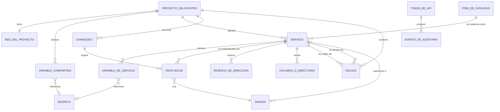

# 05 · Modelo de datos y reglas conceptuales

> Índice destilado del **modelo conceptual** de SelfHosted Service —entidades, atributos clave, relaciones y cardinalidades— y del catálogo de **reglas conceptuales del modelo (RC-01 a RC-19)**, con su correspondencia hacia las reglas de negocio.
>
> **Fuente primaria:** `SDD/Docs/02-Especificacion-Funcional/Modelo-Datos/Modelo-Conceptual.md` (v2.2, `Propuesto`, 2026-08-02) y `SDD/Docs/02-Especificacion-Funcional/Modelo-Datos/reglas-conceptuales-de-modelo/` (19 archivos, uno por regla). Las copias de `_legacy/` quedan fuera.
>
> **Complemento:** los enunciados operativos y sus consecuencias viven en las reglas de negocio, indexadas en [`04_Reglas-De-Negocio.md`](04_Reglas-De-Negocio.md). Este índice no los repite: sólo declara qué RC se apoya en qué RN.
>
> **Alcance declarado en la fuente:** el modelo es **conceptual**. Nombra entidades, atributos y relaciones; **no declara tipos físicos, claves ni índices**. La forma persistida vive en el anexo E-9 del intake y el modelo lógico es materia de `05-Arquitectura-Tecnica`.

---

## 1. Conteo de entidades

El conteo es el dato del que depende la obligatoriedad de las reglas conceptuales: al superar las diez entidades por las dos vías, las `RC-XX` pasan a ser obligatorias.

| Origen | Cantidad | Detalle |
| --- | --- | --- |
| Tablas declaradas en el anexo E-9 | 11 | `proyectos`, `variables_proyecto`, `enlaces`, `servicios`, `variables`, `changesets`, `despliegues`, `reservas_ip`, `catalogo_items`, `tokens_api`, `eventos_auditoria` |
| Objetos con identidad que E-9 declara y **no diseña** (D-12) | 3 | Secreto, Red del proyecto e **Imagen** (esta última incorporada en el intake v2.4, anexo E-23) |
| Objeto con identidad que el intake §24.3 declara y no diseña | 1 | Volumen o directorio al que apunta un montaje |
| **Total conceptual** | **15** | |

**Declarados explícitamente como atributo y no como entidad**, por la prueba de tres condiciones de D-12: recursos, verificación de salud, montajes y disposición del lienzo.

**Prueba de tres condiciones (D-12)** — una cosa es entidad si: es referenciada por varios (relación muchos a uno que un atributo no puede representar), **sobrevive** a lo que la contiene, y tiene **ciclo de vida propio**. La entidad Imagen es el caso donde la fuente la aplica condición por condición.

---

## 2. Entidades

Quince entidades conceptuales, más la **Variable provista por el sistema**, que la fuente declara en §1.6 pero aclara que **no es entidad persistida propia**: es una proyección derivada del servicio.

| # | Entidad | Qué es | Traza declarada |
| --- | --- | --- | --- |
| 1 | **Proyecto SelfHosted** | Unidad de agrupación: la arquitectura completa de servicios contenedorizados, con su red y su lienzo. Lo que el usuario crea desde el portal | E-9 `proyectos`; glosario §12; invariante I1 |
| 2 | **Red del proyecto** | Red en la que viven los servicios del proyecto, con modo, subred, pasarela e interfaz padre. Objeto con identidad: la comparten todos los servicios, se crea antes que los contenedores y les sobrevive | E-9 bloque de identidad de objeto; §24.3 |
| 3 | **Variable compartida del proyecto** | Valor declarado una vez a nivel proyecto, referenciable desde cualquier servicio suyo. Puede ser secreta | E-9 `variables_proyecto` (D-5); F-23 |
| 4 | **Servicio** | La configuración de un contenedor dentro de un proyecto. **No tiene estado de encendido** | E-9 `servicios`; E-2; invariantes I2, I3 |
| 5 | **Variable de servicio** | Par clave/valor que recibe el proceso del contenedor; el valor puede ser literal o referencia sin resolver. Puede ser secreta | E-9 `variables`; E-2; E-4 |
| 6 | *Variable provista por el sistema* | De sólo lectura, no declarada ni editada por el usuario. El conjunto es **exactamente dos**: host interno y nombre del servicio. **Proyección, no entidad persistida** | RN-32; E-4 |
| 7 | **Enlace** | Arista de dependencia entre dos servicios del mismo proyecto, con **dos ejes independientes**: declarar espera al destino, y referenciar el host del destino | E-9 `enlaces`; E-4; RN-04, RN-05, RN-14, RN-34 |
| 8 | **Changeset** | Cambios de configuración acumulados y pendientes de aplicar en lote sobre un proyecto, con su informe de impacto | E-9 `changesets`; E-5; invariante I9 |
| 9 | **Despliegue** | Intento concreto de materializar la configuración de un servicio en un contenedor, con su ciclo de vida | E-9 `despliegues`; E-3; E-17; I4, I5; RN-31 |
| 10 | **Reserva de dirección** | Dirección de la red local reservada por una réplica, con su interfaz padre. **Es el único dato que se consulta entre proyectos** | E-9 `reservas_ip`; E-8; §17.P.4 |
| 11 | **Ítem del catálogo** | Plantilla parametrizada en reposo: subgrafo de uno o varios servicios con enlaces y variables compartidas. **Nada del catálogo corre** | E-9 `catalogo_items`; E-6; F-14 (D-7); RN-30 |
| 12 | **Token de API** | Credencial de máquina con ámbitos, vigencia y estado de revocación | E-9 `tokens_api`; E-12; RN-16; §17.P.5 |
| 13 | **Evento de auditoría** | Registro de una operación con actor, acción, entidad, detalle y resultado. Retención declarada en DA-07 | E-9 `eventos_auditoria`; RN-17; §17.P.10 |
| 14 | **Secreto** | Material sensible que una variable referencia en lugar de contenerlo. Se comparte, se rota y tiene historia | E-9 bloque de identidad de objeto; §24.3 |
| 15 | **Volumen o directorio de montaje** | Recurso de almacenamiento al que apunta un montaje; sobrevive al servicio | Intake §24.3; invariante I6; RN-09, RN-10 |
| 16 | **Imagen** | La imagen de contenedor de la que un despliegue materializa un contenedor, tratada como objeto y no como cadena dentro del origen. **Su identidad es el digesto**; la etiqueta es un nombre reasignable que no identifica nada | E-23; E-9; RN-40; CU-37, CU-38 |

---

## 3. Diagrama entidad-relación

**Dos omisiones deliberadas declaradas en la fuente:**

- La **variable provista por el sistema** no aparece: es proyección derivada del servicio, no entidad persistida.
- **No existe relación entre Imagen e Ítem del catálogo.** Un ítem declara una referencia de imagen como texto dentro de su plantilla; sólo al instanciarse y desplegarse aparece una imagen concreta. Dibujarla sugeriría que el catálogo tiene imágenes, y **nada del catálogo corre**.

---

## 4. Atributos clave

Sin tipos físicos: sólo nombre, semántica y restricción conceptual. Se recogen los atributos cuya restricción es load-bearing.

### 4.1 Proyecto SelfHosted y su red

| Atributo | Restricción conceptual |
| --- | --- |
| Identidad | Toda relación se establece por ella, nunca por el nombre (RC-17) |
| Nombre | **No exige unicidad**: D-12 consecuencia 2 cierra la lista de nombres únicos del modelo en dos lugares, y éste no es uno |
| Identificador legible | **Único en la instalación** (RC-01) |
| Autoarranque | Booleana: el proyecto se levanta al iniciar el administrador |
| Disposición del lienzo | Atributo, no entidad (D-12). **No entra al changeset** (RN-12) |
| Red · Modo | `bridge` o `macvlan`; bridge es el valor por defecto de un proyecto nuevo (DA-03) |
| Red · Subred, pasarela, interfaz padre | Presentes según el modo |

### 4.2 Servicio

| Atributo | Restricción conceptual |
| --- | --- |
| Identidad | Toda referencia usa la identidad y no el nombre (RC-17, RN-33) |
| Nombre | Denominación **y a la vez alias DNS** en la red del proyecto. Único en el proyecto, minúsculas, guiones, 1–32 (RC-02, RN-01) |
| **Origen** | **Variante discriminada de seis valores**: imagen de registro público, imagen de registro privado, repositorio remoto, archivo de construcción en línea, sin origen, e **imagen del almacén local** (desde 2026-07-31). Cada variante exige sus datos y **ninguno de otra** (RN-08). No confundir con la **vía de alta** (no se persiste) ni con el **disparador del despliegue**. **Dos variantes viven en el modelo sin superficie que las produzca**: `ninguno` y `repositorio` |
| **Reproducibilidad** | **Derivado del origen y no editable.** Falso **sólo** con origen `imagen-local`. La exportación lo advierte antes (CU-09); la importación declara qué servicios no van a levantar (CU-11). Se retira cambiando el origen |
| Comando de arranque | Nulo hereda el de la imagen |
| **Estado de configuración** | `borrador`, `pendiente-de-aplicar` o `aplicado`. **Ortogonal al estado del despliegue.** Un borrador no entra al conjunto de cambios pendientes |
| Procedencia | Huella de auditoría de la **vía de alta** (adopción o instanciación). Cuando viene del catálogo es una **copia** del identificador, nombre y versión de contenido, nunca una referencia (RN-39) |
| Verificaciones | **Dos operaciones distintas** —verificación del origen y validación de la configuración— con informes distintos. Ninguna bloquea guardar; **las dos bloquean el paso a pendiente de aplicar** |
| Disparo externo | Propiedad **transversal**, no un origen: cualquier variante puede tenerlo |
| Modo de red y dirección | En macvlan no publica puertos (RN-07) |
| Réplicas | Cada réplica necesita su propia dirección cuando la dirección es fija (RN-18) |
| Puertos, montajes, dispositivos, recursos, verificación de salud | Atributos, **no entidades** (D-12) |
| Marca de efímero, traza de adopción | Booleana; y datos de la adopción con la clasificación de variables confirmada |

### 4.3 Variables, enlaces y secretos

| Entidad · Atributo | Restricción conceptual |
| --- | --- |
| Variable compartida · Clave | **No** exige unicidad en el proyecto (RC-04, RN-28); sí respeta el formato |
| Variable compartida · Valor | Literal, ausente cuando es secreta. **Nunca una referencia** (RC-05, RN-22) |
| Variable compartida · Marca de secreta | Cuando es verdadera, el valor está ausente (RC-16) |
| Variable de servicio · Clave | **Única dentro de su servicio** (RC-03, RN-28); no puede empezar con el prefijo reservado (RN-32) |
| Variable de servicio · Referencia | Expresión sin resolver en forma vinculada; **fuente de verdad cuando está presente** |
| Variable de servicio · Último valor resuelto y momento | Sólo hay momento de resolución si hay referencia (RC-11) |
| Variable de servicio · Marca de secreta | Se propaga por la referencia (RN-23) |
| Variable de servicio · Forma de creación | Manual, por enlace, por catálogo, por adopción o por referencia escrita. **Registro, no clase distinta de variable** |
| Enlace · Servicio origen y destino | Distintos entre sí (RC-06) |
| Enlace · Clave de origen y clave del destino | **Van las dos o ninguna** (RC-07) |
| Enlace · Puerto de destino | Registro de dependencia, **no mecanismo de resolución** |
| Enlace · Espera al destino | Declarada por el usuario; el sistema la propone y el usuario la cambia (RN-34) |
| Secreto · Identidad y material | Nunca se devuelve en claro ni se escribe en una exportación (RN-15) |

### 4.4 Changeset, despliegue e imagen

| Entidad · Atributo | Restricción conceptual |
| --- | --- |
| Changeset · Estado | Pendiente, aplicado o descartado. Un cambio visual nunca entra (RN-12) |
| Changeset · Cambios | Antes, después y servicios que obligan a redesplegar. La entidad de un cambio puede ser servicio, proyecto o lienzo |
| Changeset · Informe de impacto | Servicios a redesplegar, sin impacto y conflictos de dirección; se presenta antes de ejecutar (RN-13) |
| Despliegue · Servicio y número de réplica | **Un despliegue activo por réplica** (I5) |
| Despliegue · Estado y código de salida | Punto de la máquina de estados de E-17. Se resuelve siempre en un estado, nunca en «no se sabe» (RN-31) |
| Despliegue · **Solicitante** | **Tercer eje**, declarado el 2026-07-31: interfaz, API, autoarranque o política. Independiente de la vía de alta y del origen, y **gobierna comportamiento, no sólo auditoría**: la recuperación automática de CU-38 se registra como el sistema y por eso no pide confirmación previa |
| Despliegue · **Imagen usada** | **Digesto** y referencia legible de la imagen con que se creó el contenedor. Campo escrito por el despliegue (`Q-15` decidida en positivo el 2026-07-30) |
| Imagen · Digesto | Identidad real, calculada sobre el contenido. **La etiqueta no identifica** |
| Imagen · Procedencia y pertenencia | Descargada, construida por el producto, construida por un automatismo externo, o **ajena**. La ajena **no se toca** (RN-40) |
| Imagen · Marca de conservada | Protege de la limpieza aunque ningún despliegue activo la referencie (RN-40). **Quién puede ponerla sigue abierto** (`Q-21`) |
| Imagen · Tamaño y momento de creación | Vuelven accionable la atribución del consumo de disco |
| Reserva · Dirección e interfaz padre | Debe pertenecer al rango gestionado y no estar excluida (RN-06) |
| Reserva · Servicio y réplica | **Una reserva por réplica** (RC-12, RN-18) |
| Ítem · Subgrafo parametrizado | Al instanciarse crea N servicios y N contenedores (RN-30) |
| Ítem · Versión de contenido y de formato | El formato admite **exactamente dos valores** (RC-14) |
| Token · Nombre, prefijo y resumen | Sólo se persiste el resumen; el valor se muestra una vez (RC-13, RN-16) |
| Token · Ámbitos, vigencia, revocación | El conjunto de ámbitos es **cerrado** (§17.P.5) |
| Evento de auditoría · Los cinco campos | Momento, actor, acción, entidad, detalle y resultado. **Toda escritura genera uno** (RN-17) |

---

## 5. Relaciones y cardinalidades

Notación de la fuente: `1`, `N`, `0..1`, `1..N`.

| Relación verbalizada | Cardinalidad |
| --- | --- |
| Un proyecto **agrupa** servicios; un servicio **pertenece a** exactamente un proyecto (I1, RN-02) | Proyecto (1) — (0..N) Servicio |
| Un proyecto **tiene** una red que **da conectividad a** todos sus servicios | Proyecto (1) — (1) Red |
| Un proyecto **declara** variables compartidas | Proyecto (1) — (0..N) Variable compartida |
| Un servicio **declara** variables de servicio | Servicio (1) — (0..N) Variable de servicio |
| Un servicio **expone** variables provistas por el sistema, que no declara nadie | Servicio (1) — (2) Variable provista |
| Una variable **referencia** a otra —propia, compartida, o de otro servicio del mismo proyecto—, por identidad y no por nombre (RN-21, RN-33, RN-35) | Variable (1) — (0..N) Enlace, una fila por clave referenciada |
| Un servicio **depende de** otro del mismo proyecto por un enlace, que **sostiene** la referencia o **declara** sólo la espera (RN-34) | Servicio (1) — (0..N) Enlace como origen; ídem como destino |
| Un proyecto **acumula** cambios en un changeset, que **alcanza a** los servicios de su informe (RN-13) | Proyecto (1) — (0..N) Changeset |
| Un servicio **es materializado por** despliegues (I4, RN-31) | Servicio (1) — (0..N) Despliegue, máximo 1 activo por réplica |
| Un despliegue **puede originarse en** un changeset | Changeset (0..1) — (0..N) Despliegue |
| Una réplica **reserva** una dirección (RN-18) | Servicio (1) — (0..N) Reserva, una por réplica |
| Un ítem **se instancia en** un proyecto produciendo N servicios, N contenedores y sus enlaces (RN-30) | Ítem (1) — (0..N) Servicio |
| Una variable **referencia a** un secreto cuando es secreta | Variable (0..N) — (0..1) Secreto |
| Un montaje **apunta a** un volumen, que **sobrevive a** la detención (I6, RN-09, RN-10) | Servicio (1) — (0..N) Volumen o directorio |
| Un actor —administrador o token— **produce** eventos de auditoría (RN-17) | Actor (1) — (0..N) Evento |
| Un servicio adoptado **queda vinculado a** un contenedor preexistente por su identificador, sin recrearlo (RA-02, RA-03) | Servicio (1) — (1) Contenedor; un contenedor pertenece a un solo proyecto (I10, RN-11) |
| Un despliegue **usa** exactamente una imagen; una imagen **es usada por** varios despliegues, incluso de servicios distintos | Despliegue (0..N) — (1) Imagen. Es `0..N` porque una imagen puede existir en el almacén sin que ningún despliegue la use |
| Una imagen **puede pertenecer a** un servicio, o **a ninguno** | Imagen (0..N) — (0..1) Servicio. El `0..1` es la **imagen ajena** |
| Un servicio instanciado **declara su procedencia** copiando identificador, nombre y versión del ítem; el ítem **no queda referenciado** (RN-39) | Ítem (0..1) — (0..N) Servicio, **por copia y no por referencia**: el `0..1` admite que el ítem ya no exista |

---

## 6. Catálogo RC-01 a RC-19

Diecinueve reglas conceptuales, una por archivo. **Ninguna se origina en esta categoría**: todas derivan de una restricción del anexo E-9, de su bloque de identidad de objeto, o del catálogo de reglas del anexo E-16.

Anatomía de un documento RC (seis secciones): §1 Enunciado · §2 Entidades involucradas · §3 Tipo de restricción · §4 Mecanismo de verificación conceptual · §5 RN o CU que la justifican · §6 Control de cambios.

| ID | Invariante | Entidades afectadas | Tipo de restricción | RN que la justifican |
| --- | --- | --- | --- | --- |
| RC-01 | Dos proyectos SelfHosted distintos no pueden compartir su identificador legible dentro de una instalación | Proyecto SelfHosted | Identidad | **Ninguna.** La fuente declara que ninguna RN del anexo E-16 la enuncia: es restricción del modelo persistido. CU-01, CU-02 |
| RC-02 | El nombre del servicio es único dentro de su proyecto SelfHosted | Servicio, Proyecto | Identidad, acotada al ámbito del proyecto | RN-01, RN-36 |
| RC-03 | La clave de una variable de servicio es única dentro de su servicio | Variable de servicio, Servicio | Identidad, acotada al ámbito del servicio | RN-28, RN-32 |
| RC-04 | La clave de una variable compartida **no** exige unicidad dentro del proyecto | Variable compartida | Identidad, **por ausencia deliberada de restricción** | RN-28, RN-37 |
| RC-05 | Una variable compartida contiene un literal o material secreto, **nunca una referencia** | Variable compartida | Valor permitido | RN-22 |
| RC-06 | Un enlace no puede tener el mismo servicio como origen y como destino | Enlace, Servicio | Referencial | RN-34 |
| RC-07 | Las dos claves de referencia de un enlace están **las dos presentes o las dos ausentes** | Enlace | Valor permitido, como dependencia entre dos atributos | RN-34 |
| RC-08 | Todo enlace referencia una variable, declara espera, o las dos cosas | Enlace | Valor permitido | RN-34 |
| RC-09 | No hay dos enlaces con el mismo origen, destino y par de claves | Enlace | Identidad | RN-34 |
| RC-10 | Entre dos servicios hay como máximo **un** enlace de espera sin variable | Enlace | Cardinalidad | RN-34 |
| RC-11 | Sólo una variable con referencia tiene momento de resolución | Variable de servicio | Derivación | RN-24 |
| RC-12 | Cada réplica de un servicio reserva como máximo una dirección | Reserva de dirección, Servicio | Cardinalidad | RN-18, RN-03 |
| RC-13 | El resumen del valor de un token de API es único y es **lo único que se conserva** | Token de API | Identidad | RN-16 |
| RC-14 | El formato de un ítem del catálogo admite **exactamente dos valores** | Ítem del catálogo | Valor permitido | RN-30 |
| RC-15 | Un servicio, sus variables, sus enlaces y sus reservas dependen **existencialmente** de su proyecto | Proyecto, Servicio, Variable de servicio, Enlace, Reserva | Referencial, con propagación en cascada | RN-02 |
| RC-16 | Una variable secreta no lleva valor en claro: lleva referencia a secreto | Variable de servicio, Variable compartida, Secreto | Valor permitido, como exclusión entre dos atributos | RN-15, RN-23 |
| RC-17 | Toda relación entre objetos del modelo se establece **por identidad y nunca por nombre** | Todas | Identidad | RN-33, RN-35 |
| RC-18 | El despliegue no se borra: es historial con política de retención declarada | Despliegue | Derivación, como política de conservación | RN-31 |
| RC-19 | Un puerto del host lo publica como máximo un servicio | Servicio | Identidad, acotada al ámbito de **la instalación** y no al del proyecto | RN-38, y RN-07 que acota su alcance |

**Precisión que la fuente hace sobre RC-19 y su par RC-12/RN-03:** son el mismo tipo y el mismo ámbito, porque **el recurso escaso es del host y se administra a nivel instalación**. La diferencia es el estado que las activa: la dirección se exige exclusiva entre servicios **activos**; el puerto, entre servicios **declarados**, incluidos los pendientes de aplicar — porque dos cambios del mismo conjunto pendiente pueden colisionar antes de desplegarse.

---

## 7. Correspondencia RN ↔ RC

Leída de la §5 «RN o CU que la justifican» de cada documento RC. **Sólo dieciséis de las cuarenta RN aparecen citadas**; las demás son reglas de comportamiento sin contraparte estructural declarada.

| RN | RC que se apoyan en ella |
| --- | --- |
| RN-01 | RC-02 |
| RN-02 | RC-15 |
| RN-03 | RC-12, y comparte tipo y ámbito con RC-19 |
| RN-07 | RC-19 (acota su alcance) |
| RN-15 | RC-16 |
| RN-16 | RC-13 |
| RN-18 | RC-12 |
| RN-22 | RC-05 |
| RN-23 | RC-16 |
| RN-24 | RC-11 |
| RN-28 | RC-03, RC-04 |
| RN-30 | RC-14 |
| RN-31 | RC-18 |
| RN-32 | RC-03 |
| RN-33 | RC-17 |
| RN-34 | RC-06, RC-07, RC-08, RC-09, RC-10 |
| RN-35 | RC-17 |
| RN-36 | RC-02 |
| RN-37 | RC-04 |
| RN-38 | RC-19 |
| — | **RC-01 no tiene RN**: la fuente lo declara explícitamente |

---

## 8. Trazabilidad entidad → CU y RN

Tabla §8 del modelo conceptual. Incluye una fila —**Registro del sistema**— que no es entidad del §1 pero sí consumidor trazado.

| Entidad | CU que la consumen | RN que la restringen |
| --- | --- | --- |
| Proyecto SelfHosted | CU-01, CU-02, CU-04, CU-05, CU-09, CU-10, CU-11, CU-12, CU-18, CU-20, CU-21, CU-22, CU-24, CU-27, CU-34, CU-36 | RN-02, RN-03, RN-12, RN-20, RN-35 |
| Red del proyecto | CU-01, CU-03, CU-19, CU-20 | RN-03, RN-06, RN-07, RN-35 |
| Variable compartida del proyecto | CU-09, CU-11, CU-16, CU-22, CU-25, CU-34, CU-35, CU-36 | RN-15, RN-22, RN-23, RN-27, RN-28, RN-37 |
| Servicio | CU-03, CU-04, CU-07, CU-08, CU-13, CU-15, CU-16, CU-18, CU-22, CU-24, CU-27, CU-28 | RN-01, RN-02, RN-06, RN-07, RN-08, RN-09, RN-10, RN-18, RN-19, RN-33, RN-36 |
| Variable de servicio | CU-03, CU-04, CU-07, CU-22, CU-25, CU-34, CU-35 | RN-21, RN-22, RN-23, RN-24, RN-27, RN-28, RN-32, RN-33 |
| Variable provista por el sistema | CU-04, CU-35 | RN-32, RN-04 |
| Registro del sistema | CU-01, CU-02, CU-11, CU-20, CU-26, CU-36 | RN-13, RN-17 |
| Enlace | CU-04, CU-11, CU-16, CU-18, CU-22, CU-25 | RN-04, RN-05, RN-14, RN-34 |
| Changeset | CU-22, CU-23, CU-24, CU-25, CU-34 | RN-12, RN-13 |
| Despliegue | CU-13, CU-15, CU-18, CU-24, CU-27, CU-28, CU-33 | RN-13, RN-20, RN-24, RN-31 |
| Reserva de dirección | CU-19, CU-20, CU-21 | RN-03, RN-06, RN-18 |
| Ítem del catálogo | CU-16, CU-17 | RN-30, RN-36, RN-37 |
| Token de API | CU-32, CU-33 | RN-15, RN-16, RN-17 |
| Evento de auditoría | CU-32, CU-33, y toda operación de escritura | RN-17 |
| Secreto | CU-07, CU-09, CU-34, CU-35 | RN-15, RN-23, RN-25 |
| Volumen o directorio de montaje | CU-03, CU-08, CU-18 | RN-09, RN-10 |
| Imagen | CU-13, CU-15, CU-37, CU-38, CU-39 | RN-40 |

---

## 9. Brechas declaradas en el modelo

Nueve brechas que el modelo **declara y no resuelve**, con su destinatario. No inferir cierre de ninguna.

| Brecha | Destinatario |
| --- | --- |
| El **modelo lógico** del Secreto, la Red del proyecto y el Volumen o directorio **no está diseñado**: el intake los declara objetos con identidad y su mapeo es de Fase C | 05-Arquitectura-Tecnica |
| **El modelo lógico de la Imagen tampoco está diseñado**: el anexo E-23 emite su modelo conceptual y declara explícitamente que no diseña sus columnas | 05-Arquitectura-Tecnica |
| Un **volumen conservado** tras eliminar su servicio queda hoy **sin ninguna entidad que lo represente** | 05-Arquitectura-Tecnica |
| El intake **no declara si un proyecto admite más de un changeset pendiente** a la vez; E-9 no impone unicidad sobre `changesets` | 05-Arquitectura-Tecnica |
| El intake **no declara política de purga** para las reservas de dirección de servicios eliminados o inactivos | 05-Arquitectura-Tecnica |
| **Cuatro decisiones abiertas** sobre la entidad Imagen: `Q-16` (pertenencia de lo construido), `Q-18` (ámbito de credencial de la limpieza), `Q-20` (política de actualización al volver), `Q-21` (quién marca conservada). Cerradas: `Q-15`, `Q-17` (2026-07-30) y `Q-19` (2026-07-31) | Agente humano del proyecto |
| **La imagen que sostiene a un servicio no reproducible no tiene protección declarada** frente a la limpieza: un origen `imagen-local` referencia una imagen del almacén local y **no hay de dónde volver a traerla** | Agente humano del proyecto |
| **`Q-28`: no está declarado si el origen de un servicio es editable después del alta.** El atributo es editable en el modelo y **ningún flujo lo ejerce** | Agente humano del proyecto |
| **Cinco especificaciones de integración sin revisar**: `DI-20` a `DI-24` (archivo de construcción en línea, conversión de secretos al guardar como plantilla, tipos de parámetro, puertos publicados del descubrimiento, importación como copia). `DI-17`, `DI-18` y `DI-19` quedaron confirmadas el 2026-07-30 y pasan a `[D]`. Catorce de las dieciséis `[D-i]` que sostienen el modelo siguen sin revisar | Agente humano del proyecto |

---

## 10. Vocabulario

El glosario **no vive en el modelo conceptual**: desde `Rules-Especificacion-Funcional` 4.0 es artefacto propio, `SDD/Docs/02-Especificacion-Funcional/Glosario-Funcional.md`. El modelo conserva sólo el puntero y la lista de treinta y dos términos, separada por la regla de no duplicación:

- **Catorce acuñados o precisados por la categoría 02**: registro (polisémico, cuatro referentes), variable provista por el sistema, bridge, macvlan, efímero, verificación de salud, vía de alta, origen, plantilla, versión de contenido, versión de formato, imagen, digesto, borrador.
- **Dieciocho referenciados** de `SDD/Docs/00-Contexto/Vision-Producto.md` §9 —glosario raíz de la cadena— y no redefinidos: proyecto SelfHosted, proyecto de código, capa, servicio, despliegue, arista o enlace, changeset, adopción, huérfano, referencia de variable, variable compartida del proyecto, objeto con identidad, catálogo, subgrafo parametrizado, modo pendiente, higiene del modelo, token de API, ámbito.

---

## 11. Fuentes

Rutas relativas al repositorio indexado.

| Archivo | Qué contiene |
| --- | --- |
| `SDD/Docs/02-Especificacion-Funcional/Modelo-Datos/Modelo-Conceptual.md` | Conteo de entidades, las 15+1 entidades con su traza, tabla de atributos clave, 19 relaciones verbalizadas, 20 cardinalidades, tabla resumen de RC, referencia al glosario, diagrama `erDiagram`, trazabilidad entidad→CU/RN, 9 brechas y control de cambios |
| `SDD/Docs/02-Especificacion-Funcional/Modelo-Datos/reglas-conceptuales-de-modelo/RC-01-Unicidad-Del-Identificador-Legible-Del-Proyecto.md` | Identificador legible único en la instalación; única RC sin RN que la enuncie |
| `.../reglas-conceptuales-de-modelo/RC-02-Unicidad-Del-Nombre-De-Servicio-En-Su-Proyecto.md` | Unicidad del nombre de servicio acotada al proyecto |
| `.../reglas-conceptuales-de-modelo/RC-03-Unicidad-De-La-Clave-De-Variable-En-Su-Servicio.md` | Unicidad de la clave de variable dentro del servicio |
| `.../reglas-conceptuales-de-modelo/RC-04-Ausencia-De-Unicidad-De-La-Clave-Compartida.md` | Ausencia deliberada de unicidad en la clave compartida |
| `.../reglas-conceptuales-de-modelo/RC-05-Ausencia-De-Referencia-En-La-Variable-Compartida.md` | La variable compartida nunca contiene una referencia |
| `.../reglas-conceptuales-de-modelo/RC-06-Irreflexividad-Del-Enlace.md` | Irreflexividad del enlace |
| `.../reglas-conceptuales-de-modelo/RC-07-Solidaridad-De-Las-Claves-Del-Enlace.md` | Las dos claves del enlace van juntas o ninguna |
| `.../reglas-conceptuales-de-modelo/RC-08-Aporte-Minimo-Del-Enlace.md` | Aporte mínimo del enlace: referencia, espera, o ambas |
| `.../reglas-conceptuales-de-modelo/RC-09-Unicidad-Del-Enlace-Por-Par-Y-Claves.md` | Unicidad del enlace por par de servicios y par de claves |
| `.../reglas-conceptuales-de-modelo/RC-10-Unicidad-Del-Enlace-De-Espera-Sin-Variable.md` | Un solo enlace de espera sin variable entre dos servicios |
| `.../reglas-conceptuales-de-modelo/RC-11-Coherencia-Entre-Referencia-Y-Resolucion.md` | Sólo con referencia hay momento de resolución |
| `.../reglas-conceptuales-de-modelo/RC-12-Unicidad-De-La-Reserva-Por-Replica.md` | Una reserva de dirección por réplica |
| `.../reglas-conceptuales-de-modelo/RC-13-Unicidad-Del-Resumen-Del-Token.md` | El resumen del token es único y es lo único conservado |
| `.../reglas-conceptuales-de-modelo/RC-14-Valores-Admitidos-Del-Formato-Del-Item.md` | El formato del ítem admite exactamente dos valores |
| `.../reglas-conceptuales-de-modelo/RC-15-Dependencia-Existencial-Del-Servicio.md` | Cascada existencial desde el proyecto |
| `.../reglas-conceptuales-de-modelo/RC-16-Exclusion-Entre-Valor-Y-Marca-De-Secreta.md` | Exclusión entre valor en claro y marca de secreta |
| `.../reglas-conceptuales-de-modelo/RC-17-Vinculo-Por-Identidad-Del-Modelo.md` | Vínculo por identidad en todo el modelo |
| `.../reglas-conceptuales-de-modelo/RC-18-Conservacion-Del-Historial-De-Despliegues.md` | El despliegue es historial y no se borra |
| `.../reglas-conceptuales-de-modelo/RC-19-Unicidad-Del-Puerto-Publicado-Por-Host.md` | Puerto único por host, a nivel instalación, incluidos los pendientes |
