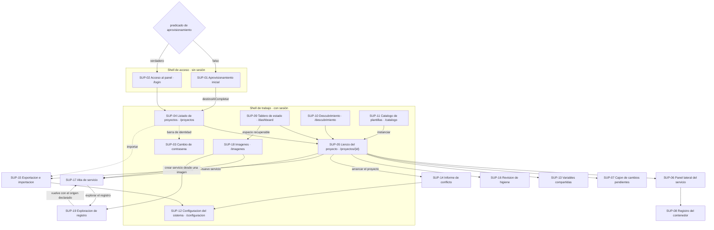

# 06 · UX / UI / DX

> Índice destilado de la especificación de experiencia del producto **SelfHosted Service**: qué superficies existen, qué wireframe las especifica, qué caso de uso materializan, cómo se navegan entre sí y con qué vocabulario visual se describen. Sirve para ubicar el documento correcto sin abrir los 23 artefactos de la categoría.
>
> **Fuente primaria:** `SDD/Docs/03-UX-UI-DX/` — `README.md`, `Experiencia-De-Uso.md`, `Glosario-UX.md`, `Wireframes/` (19 archivos) y `Representaciones/` (4 archivos).
>
> **Alcance:** esta categoría es especificación, no código. La materialización navegable de todo lo de acá está indexada aparte en [`07_Maqueta-De-Validacion.md`](07_Maqueta-De-Validacion.md).

---

## 1. Qué contiene la categoría

| Dimensión | Valor declarado por `README.md` §4 |
| --- | --- |
| Artefactos vigentes | **26**: el índice, el marco de experiencia, el glosario, **19** wireframes y **4** representaciones |
| Estado de todos | `Propuesto` |
| Variante aplicada | **UX/UI** (UX/UI Designer + Frontend Lead, AG-03), asignada por `Rules-UX-UI-DX.md` §1.2 al tipo `web-monolith` |
| Rama DX | **No se produce ningún artefacto de DX.** `tiene_portal_developers` es falso y no hay integradores externos |
| Tokens visuales propios | **Ninguno.** Todo se hereda del catálogo `Devs/References/Design/` |
| Fecha de la última ronda | 2026-08-02 (índice y marco en 2.4) |

**Reparto de versiones** (`README.md` §4, contado en disco): 2.4 → índice y marco · 2.3 → glosario · 2.2 → wireframes de `SUP-06`, `SUP-09`, `SUP-11`, `SUP-17`, `SUP-18` · 2.1 → `SUP-04`, `SUP-05`, `SUP-10`, `SUP-12`, `SUP-15` y las representaciones de nodo y de estados · 2.0 → los ocho wireframes restantes y las representaciones de banda y de sello · 1.0 → `SUP-19`.

**Catálogo de diseño aplicado** (`README.md` §5 / `Experiencia-De-Uso.md` §2.1), siete documentos bajo `Index-Design-Rules.md`: `Design-Rules-Web-Generico` (base), `Design-Rules-Blazor-Mudblazor` (stack .NET 10 + Blazor Interactive Server + MudBlazor 9.7.0), y cuatro extensiones por capacidad que cargan a la vez —`Config-Esquema`, `Primer-Arranque`, `Acceso-Monousuario`, `Identidad-De-Version`—, que es el arquetipo de «panel de control monolítico de un servicio específico».

---

## 2. Catálogo de superficies

Diecinueve superficies, `SUP-01` a `SUP-19`. Las once primeras corresponden a nodos del mapa de navegación del anexo E-18 del intake; las ocho últimas declaran de dónde salen porque ese anexo no las maqueta. La fuente única de la correspondencia superficie ↔ caso de uso es `Experiencia-De-Uso.md` §9.2 (la columna «CU» de abajo la reproduce).

| Superficie | Wireframe (archivo) | Propósito | CU que materializa | Página de maqueta |
| --- | --- | --- | --- | --- |
| `SUP-01` Aprovisionamiento inicial | `Wireframes-Aprovisionamiento-Inicial.md` | Crear la identidad del administrador único en una instancia recién desplegada. Después deja de existir para siempre en esa instancia | CU-29 | `Aprovisionamiento-Inicial.html` |
| `SUP-02` Acceso al panel | `Wireframes-Acceso-Al-Panel.md` | Puerta de entrada de todos los arranques posteriores al primero (`/login`). Aloja el sello de versión | CU-30 | `Acceso-Al-Panel.html` |
| `SUP-03` Cambio de contraseña | `Wireframes-Cambio-De-Contrasena.md` | Única operación de identidad del ciclo de vida normal; exige la contraseña actual y declara qué pasa con la sesión | CU-31 | `Cambio-De-Contrasena.html` |
| `SUP-04` Listado de proyectos | `Wireframes-Listado-De-Proyectos.md` | Portada del shell de trabajo (`/proyectos`): estado agregado de todos los proyectos SelfHosted, y punto de creación, renombrado, eliminación y apertura | CU-01, CU-02, CU-11 | `Listado-De-Proyectos.html` |
| `SUP-05` Lienzo del proyecto | `Wireframes-Lienzo-Del-Proyecto.md` | **Pantalla principal** (`/proyectos/{id}`): leer de un vistazo la arquitectura completa, editarla, y arrancar o detener el conjunto | CU-03, CU-04, CU-05, CU-13, CU-15, CU-16, CU-18, CU-22, CU-28 | `Lienzo-Del-Proyecto.html` |
| `SUP-06` Panel lateral del servicio | `Wireframes-Panel-Lateral-Del-Servicio.md` | Superficie de configuración más densa: las ocho dimensiones del servicio en siete pestañas, con la garantía de que guardar no despliega | CU-03, CU-13, CU-15, CU-18, CU-19, CU-35, CU-38 | `Panel-Lateral-Del-Servicio.html` |
| `SUP-07` Cajón de cambios pendientes | `Wireframes-Cajon-De-Cambios-Pendientes.md` | Edición transaccional (diferenciador DV-03): revisar el lote con la consecuencia delante, descartar y aplicar con un único redespliegue de lo afectado | CU-22, CU-23, CU-24, CU-25 | `Cajon-De-Cambios-Pendientes.html` |
| `SUP-08` Registro del contenedor | `Wireframes-Registro-Del-Contenedor.md` | Leer lo que dice el proceso de adentro del contenedor, con seguimiento continuo opcional (`/proyectos/{id}/servicios/{sid}/logs`) | CU-14 | `Registro-Del-Contenedor.html` |
| `SUP-09` Tablero de estado | `Wireframes-Tablero-De-Estado.md` | Responder si la presión de memoria del servidor viene de un servicio concreto, en tres capas: servidor, proyectos y contenedores (`/dashboard`) | CU-26, CU-27, CU-28 | `Tablero-De-Estado.html` |
| `SUP-10` Descubrimiento e incorporación | `Wireframes-Descubrimiento-E-Incorporacion.md` | **Flujo diferencial**: incorporar contenedores que ya corren sin recrearlos ni cortar el servicio (`/descubrimiento`). Cuatro pasos, con clasificación de variables obligatoria | CU-06, CU-07, CU-08 | `Descubrimiento-E-Incorporacion.html` |
| `SUP-11` Catálogo de plantillas | `Wireframes-Catalogo-De-Plantillas.md` | Convertir en activo reutilizable algo ya resuelto e instanciarlo con parámetros (`/catalogo`). Único punto de entrada de la instanciación desde el 2026-08-01 | CU-16, CU-17, CU-36 | `Catalogo-De-Plantillas.html` |
| `SUP-12` Configuración del sistema | `Wireframes-Configuracion-Del-Sistema.md` | Lo que la instancia gobierna por encima de todo proyecto: rango de direcciones, credenciales de máquina, respaldo programado, retención y umbral de limpieza (`/configuracion`). Aloja el detalle de diagnóstico | CU-12, CU-19, CU-32 | `Configuracion-Del-Sistema.html` |
| `SUP-13` Variables compartidas del proyecto | `Wireframes-Variables-Compartidas-Del-Proyecto.md` | Declarar una sola vez un valor que varios servicios usan, para que rotarlo sea editar un único valor | CU-34, CU-35, CU-36 | `Variables-Compartidas-Del-Proyecto.html` |
| `SUP-14` Informe de conflicto de direcciones | `Wireframes-Informe-De-Conflicto-De-Direcciones.md` | Enterarse antes de romper algo que funciona (diferenciador DV-04): identifica al ocupante y ofrece tres resoluciones accionables | CU-18, CU-20, CU-21, CU-24 | `Informe-De-Conflicto-De-Direcciones.html` |
| `SUP-15` Exportación e importación | `Wireframes-Exportacion-E-Importacion.md` | Reproducir la arquitectura fuera del servidor —estrategia de respaldo declarada— sin perder nada en silencio al traerla de vuelta | CU-09, CU-10, CU-11, CU-12 | `Exportacion-E-Importacion.html` |
| `SUP-16` Revisión de higiene | `Wireframes-Revision-De-Higiene.md` | Inventario de condiciones que el registro acumuló sin que nadie las viera: variables huérfanas, nombres repetidos, referencias sin uso. Informa, nunca bloquea | CU-36 | `Revision-De-Higiene.html` |
| `SUP-17` Alta de servicio | `Wireframes-Alta-De-Servicio.md` | Declarar un servicio completo: nombre y luego **campo de origen de tres valores** (imagen de registro, imagen del almacén local, definición local). Una sola entrada, sin menú de vías | CU-03, CU-13, CU-15, CU-37 | `Alta-De-Servicio.html` |
| `SUP-18` Imágenes | `Wireframes-Imagenes.md` | Ver qué imágenes ocupan el servidor, cuáles administra el producto, cuáles están en uso, y liberar espacio sin destruir nada necesario (`/imagenes`) | CU-03, CU-37, CU-38 | `Imagenes.html` |
| `SUP-19` Exploración de registro de imágenes | `Wireframes-Exploracion-De-Registro-De-Imagenes.md` | Encontrar la imagen recorriendo un registro configurado en lugar de escribir de memoria una dirección, y volver con el origen ya declarado | CU-39, CU-03 | `Exploracion-De-Registro-De-Imagenes.html` |

**Cobertura.** Los **39** casos de uso de `02-Especificacion-Funcional` tienen superficie, con una excepción declarada: **CU-33** (disparo de despliegue con credencial de ámbito mínimo), cuyo actor es el automatismo de integración continua y cuya superficie es la API REST. La inversión CU → SUP está en `Experiencia-De-Uso.md` §9.3, y es **derivada**: si difiere de §9.2, manda §9.2.

### 2.1 Anatomía común de un wireframe

Los diecinueve archivos tienen la misma estructura de nueve secciones, verificada en disco: `1. Pantalla y propósito` (con el nombre canónico y el `SUP-XX`) · `2. Layout` · `3. Componentes principales` · `4. Interacciones` · `5. Estados` · `6. Versión responsive` · `7. Notas de implementación` (con bloque de performance percibida) · `8. Trazabilidad` · `9. Control de cambios`.

La **tabla de estados de §5 es la lista que la maqueta tiene que demostrar**: un estado no declarado no se maqueta y por lo tanto no se valida. Cantidades declaradas por wireframe: 11 (`SUP-01`), 13 (`SUP-02`), 11 (`SUP-03`), 12 (`SUP-04`), 16 (`SUP-07`), 18 (`SUP-10`), 17 (`SUP-11`), 20 (`SUP-12`), 15 (`SUP-13`), 13 (`SUP-14`), 16 (`SUP-15`), 11 (`SUP-16`). Las de `SUP-05`, `SUP-06`, `SUP-08`, `SUP-09`, `SUP-17`, `SUP-18` y `SUP-19` no se enuncian en letras en el control de cambios de la versión vigente («no declarado en la fuente» con esa forma).

---

## 3. Mapa de navegación

Reconstruido de las rutas y puntos de entrada que `Experiencia-De-Uso.md` §9.2 y la §1 de cada wireframe declaran. El **shell partido** es la propiedad de gobierno: dos composiciones, y la frontera entre ellas es la sesión; cruzarla es una navegación completa, no un cambio de estado.

Notas de trazabilidad del mapa:

| Hecho | Fuente |
| --- | --- |
| `SUP-13`, `SUP-14`, `SUP-15`, `SUP-16`, `SUP-17`, `SUP-18` y `SUP-19` **no figuran** en el mapa de navegación del anexo E-18 | `Experiencia-De-Uso.md` §9.2, columna «Origen del maquetado» |
| La ausencia de ruta de exportación/importación y de higiene en E-18 es la brecha `B-UX-17`; su ubicación en el mapa **queda por confirmar** | `Wireframes-Exportacion-E-Importacion.md` §1; `Wireframes-Revision-De-Higiene.md` §1 |
| La ubicación de `SUP-13` dentro del proyecto (y no en configuración del sistema) es el supuesto `S-UX-02` | `Wireframes-Variables-Compartidas-Del-Proyecto.md` §1 |
| Desde el 2026-08-01 **adoptar** es acción de `SUP-10` y **usar el catálogo** es acción de `SUP-11`; ninguna de las dos pasa por el alta | `Experiencia-De-Uso.md` §3.4 y §9.2 |
| `SUP-03` se alcanza desde la barra de identidad; el cierre de sesión está **siempre visible** y a un clic (contradicción `C-UX-05` resuelta a favor del catálogo) | `Experiencia-De-Uso.md` §1.4 |

---

## 4. Las cuatro representaciones

Elementos reutilizados entre superficies, especificados una sola vez para que ninguna los reinterprete. Cada archivo tiene siete secciones: concepto, apariencia esquemática, variantes, datos que consume, restricciones de accesibilidad, reutilización, control de cambios.

| Representación (archivo) | Qué resuelve | Superficies que la invocan |
| --- | --- | --- |
| **Lenguaje visual de estados** · `Representacion-Lenguaje-Visual-De-Estados.md` (2.1) | Que el **par de estado** (insignia + etiqueta textual + borde, siempre los tres) se lea igual en todas partes, y que la traducción entre lo que reporta el motor, los estados del anexo E-17 y las filas del contrato de E-18 —que **no es uno a uno**— viva en un solo lugar. No fija colores ni define tokens | `SUP-04`, `SUP-05`, `SUP-06`, `SUP-09`, `SUP-10`, `SUP-17` |
| **Nodo de servicio** · `Representacion-Nodo-De-Servicio.md` (2.1) | La anatomía del nodo del lienzo con el **origen de cada dato**, «que ata la maqueta al modelo». Sostiene el diferenciador DV-02: el nodo **es el servicio** (permanente, posicionable) y el color y la insignia reflejan el **despliegue** (volátil). Es el objeto sobre el que se mide la puerta técnica PT-01. Incluye la **zona de distintivos** | `SUP-05` |
| **Banda de resultado** · `Representacion-Banda-De-Resultado.md` (2.0) | Que el texto del desenlace de un acto de identidad **no se componga en la vista**: se resuelve por código contra el catálogo de `Experiencia-De-Uso.md` §8.2. Hace cumplir en un solo lugar el rechazo indiferenciado y la no exposición de parámetros de la política. Cierra el lazo **en la superficie de destino, no en la de origen** | `SUP-01`, `SUP-02`, `SUP-03`, `SUP-04`, `SUP-14` |
| **Sello de versión** · `Representacion-Sello-De-Version.md` (2.0) | Que una instancia declare qué versión de sí misma corre, en **dos ubicaciones obligatorias** que son dos poblaciones distintas, más el **detalle de diagnóstico** copiable en un gesto. En un producto sin soporte al que derivar, es la única vía de escalamiento | `SUP-02` (antes de autenticarse) y `SUP-12` (operando). **`SUP-01` no lo aloja**, y la exclusión se declara |

### 4.1 Contrato visual de estados

`Experiencia-De-Uso.md` §4.2 — siete filas, adoptadas del anexo E-18 sin modificar, con su estado semántico del catálogo base:

| Estado del nodo | Estado semántico | Borde |
| --- | --- | --- |
| Activo | Éxito | Sólido tenue |
| Activo degradado (verificación de salud fallando) | Atención | Sólido, mismo par |
| Creando o construyendo | Informativo | Punteado animado (insignia animada) |
| Detenido o retirado | Neutro | Sólido, par neutro |
| Caído o fallido | Error | Sólido, par de error |
| **Pendiente de aplicar** | **Sin correspondencia en el catálogo** (`C-UX-01`, `B-UX-05`) | Punteado |
| Huérfano (contenedor incorporado desaparecido) | Composición: neutro + contorno de error + patrón de relleno | Rayado |

Dos reglas sin excepción: **el color nunca es el único canal**, y las insignias son **SVG con `currentColor`** de un único set, nunca glifos ni emoji.

Dos incorporaciones del 2026-08-01 que **no agregan filas**:

- **Distintivos** — «en cuarentena» y «no reproducible» son propiedades del *servicio*, no estados de su despliegue: se exhiben como **rótulo textual que compone sobre el par** sin cambiarle la variante. Su ausencia no se representa.
- **Reposo del contenedor creado** — con las tres fases del despliegue separadas, un contenedor creado y sin arrancar es un **desenlace correcto**: se muestra sobre el **par neutro, sin animación**, con la etiqueta «Desplegado, sin arrancar». Qué campo del modelo lo separa del despliegue en curso es la brecha `B-UX-34`.

### 4.2 Mapa de estados por superficie

Los **seis estados canónicos** de `Design-Rules-Web-Generico.md` §5 —vacío, cargando, con datos, error, éxito y sin permiso— rigen en todas las superficies. «Sin permiso» se declara **no aplicable en el shell de trabajo**: hay una sola identidad y tener sesión es tener todo el alcance; donde sí aplica se resuelve como **corte de ruteo**, no como control deshabilitado.

De `Experiencia-De-Uso.md` §4.1, la columna que más distingue a cada superficie es la del **estado propio adicional**:

| Superficie | Estado propio adicional |
| --- | --- |
| `SUP-01` | Envío fuera de tiempo, con redirección neutra |
| `SUP-02` | Acceso restringido temporalmente; sesión vencida; identidad recién creada; secreto actualizado |
| `SUP-04` | Banda de confirmación entrante desde el aprovisionamiento; **proyecto no reproducible** con su distintivo derivado |
| `SUP-05` | Modo pendiente con contador; parcialmente activo; huérfano; **desplegado y en reposo**; **cuarentena** y **no reproducible** como distintivos |
| `SUP-06` | Requiere redespliegue; desplegado y en reposo; en marcha; **despliegue nuevo fallido con el anterior sirviendo**; cuarentena; no reproducible |
| `SUP-08` | Contenedor inexistente |
| `SUP-09` | Dato con antigüedad declarada; **sugerencia de limpieza vigente** y su ausencia que no se representa; **bloque de servicios en cuarentena**, sin umbral |
| `SUP-10` | No incorporable con motivo; ya incorporado con el proyecto que lo tomó; clasificación pendiente |
| `SUP-12` | Credencial mostrada una única vez; **umbral de la sugerencia sin valor por defecto declarado** |
| `SUP-13` | Variable huérfana, advertida sin bloquear |
| `SUP-14` | Parcialmente activo |
| `SUP-15` | **Exportación con servicios no reproducibles**, advertida **antes** de exportar; importación con servicios que no van a levantar, en una tercera lista |
| `SUP-16` | Ninguna condición bloquea |
| `SUP-17` | Origen sin elegir; origen **indeterminado** por consulta imposible, sin lenguaje de error; origen traído de la exploración o del inventario; variante derivada privada; servicio no reproducible; puertos deshabilitados por modo de red |
| `SUP-18` | Sugerencia vigente; sugerencia descartada; propuesta a la vista; uso no atribuible; **imagen que sostiene a un servicio no reproducible**, contada como referencia y **no marcada como protegida** |
| `SUP-19` | Sin resultados, que es **resultado y no error**; enumeración no admitida por el registro |

Tres estados vacíos merecen nombre propio porque **son situaciones normales y no anomalías**: el listado sin proyectos (primer uso), el **catálogo vacío** (estado inicial de toda instalación nueva) y la exploración **sin ningún registro configurado**, que declara el vacío con su motivo. `SUP-03`, `SUP-07` y `SUP-11` no declaran estado propio adicional.

---

## 5. Principios de diseño

| Eje | Qué fija `Experiencia-De-Uso.md` |
| --- | --- |
| Persona objetivo (§1.1) | **Una sola**: el administrador único. Nivel técnico alto **derivado, no declarado**. La interfaz usa el vocabulario del dominio del cliente y **no enseña el dominio: enseña este producto** |
| Contexto (§1.2) | Chrome de escritorio ≥ 150.0.7871.186 sobre Windows Server 2022, red local, sin plataforma móvil. El navegador es «una pantalla conectada por un canal permanente»: cada clic es un viaje de ida y vuelta |
| Emoción (§1.2) | El producto no compite contra la ansiedad sino contra la **fricción acumulada**. Pero se opera sobre servicios en producción sin redundancia de disco: toda acción que pueda cortar un servicio se declara **antes** de ejecutarse |
| Omisiones de identidad (§1.4) | Registro de cuentas, selector, recuperación de contraseña, «recordarme», roles y segundo factor: **omitidos y no dibujados, ni siquiera deshabilitados** |
| Nielsen (§2.2) | Quince aplicaciones con fuente y verificación. Las más cargadas: banner de cambios pendientes como visibilidad del estado transaccional; validación del conflicto **antes** de tocar el motor; etiquetas que separan «guardar» de «desplegar»; **un único botón primario por pantalla** |
| Leyes UX (§2.3) | Hick → divulgación progresiva de las ocho dimensiones · Fitts → arrancar/detener en la barra superior, tarjeta clicleable entera · Miller → siete pestañas del panel lateral, en el límite superior · Jakob → un concepto se ve igual en todo el producto |
| Accesibilidad (§5) | **WCAG 2.2 AA como piso obligatorio**, no mejora opcional. Objetivos de toque ≥ 24×24 px alcanzan a los puertos del nodo. El **lienzo** se acoge a la excepción explícita del criterio 1.4.10 de reflujo, y se declara para que no se lea como incumplimiento |
| Internacionalización (§6) | Español rioplatense neutro técnico, idioma único, sin selector — **derivación `S-UX-04`, no dato declarado**. Fechas ISO 8601 con desplazamiento. Separador decimal **sin declarar** (`B-UX-21`) |
| Performance percibida (§7) | Umbrales transcriptos de PT-01 y del intake, no fijados acá. **Cero escrituras de disposición durante el arrastre**, una sola al finalizar con antirrebote de 400 ms. Sondeo cada 3-5 s **sólo con vistas abiertas**. Interfaz optimista **sólo donde la operación es reversible**: nunca en un despliegue |
| Tono (§8.3) | Voz activa; el verbo del acuse repite el del botón. Los errores no se disculpan. **No hay handoff humano**: la vía de escalamiento es el detalle de diagnóstico copiable |

### 5.1 Las cuatro capacidades transversales

Cada extensión del catálogo exige un contrato declarado una sola vez en `Experiencia-De-Uso.md` §2.4, que los wireframes consumen por referencia:

| Capacidad | Contrato en este producto |
| --- | --- |
| **Predicado de aprovisionamiento** | `estaAprovisionado` = existe el administrador único. `artefactoMinimo` = usuario + contraseña. `destinoSiFalta` = `SUP-01`, `destinoSiExiste` = `SUP-02`, `destinoAlCompletar` = `SUP-04`. Corte en tres capas: ruteo, superficie y acción |
| **Descriptor de parámetro** | Fuente de verdad única por parámetro; la pantalla lo lee y no lo inventa. El intake declara parámetros y algunos valores admitidos, pero **ninguna leyenda ni ejemplo**: brecha `B-UX-04` |
| **Perfil de operador único** | Omisiones declaradas (§1.4), shell partido (§4.1), catálogo de códigos de resultado (§8.2) |
| **Identidad de versión** | Cuatro campos (`versionLegible`, `identificadorDeConstruccion`, `esPreliminar`, `origenIndeterminado`); sólo el primero es obligatorio y **ninguno tiene productor declarado**: brecha `B-UX-07` |

### 5.2 Los ocho flujos clave

`Experiencia-De-Uso.md` §3. Cada flujo nombra las superficies que recorre, «y ésas son exactamente las rutas que la maqueta va a materializar».

| Flujo | Origen | CU | Superficies que recorre | Fricción anticipada |
| --- | --- | --- | --- | --- |
| **FL-01** Primer arranque y aprovisionamiento | Intake §6 flujo 4 | CU-29 | `SUP-01` → `SUP-04` | El requisito de contraseña no lo declara ninguna fuente (`B-UX-10`); el acto es indivisible e irreversible, **sin acción de cancelar** |
| **FL-02** Acceso en arranques posteriores | Intake §6 flujo 4 | CU-30, CU-31 | `SUP-02` → `SUP-04`; `SUP-03` | Rechazo **indiferenciado**; el vencimiento de sesión devuelve al shell de acceso declarado, no como error arbitrario. Duración sin declarar (`B-UX-11`) |
| **FL-03** Alta de proyecto con API y base | Intake §6 flujo 1 / anexo E-10 | CU-01, CU-16, CU-13, CU-04, CU-03, CU-22, CU-24, CU-18, CU-39 | `SUP-04` → `SUP-05` → `SUP-17` → `SUP-19` → `SUP-06` → `SUP-07` | **«Guardar cambio» no despliega**: es «la fuente más probable de confusión del modelo». Publicar el puerto de la base se **desalienta** por ayuda contextual, no se bloquea |
| **FL-04** Incorporación de un contenedor corriendo | Intake §6 flujo 2 / anexo E-11 | CU-06, CU-07, CU-08 | `SUP-10` → `SUP-05` | **Cuatro pasos, no tres**: descubrir, elegir, **clasificar**, confirmar. La clasificación no se puede saltear ni presentar como aviso descartable. El primer redespliegue posterior **sí implica corte** y hay que advertirlo con esas palabras |
| **FL-05** Arranque bloqueado por conflicto | Intake §6 flujo 3 / anexo E-8 | CU-18, CU-19, CU-20, CU-21 | `SUP-05` → `SUP-14` → `SUP-12` | «Parcialmente activo» es **estado legítimo del modelo**, no una falla a resolver |
| **FL-06** Tarde de ajustes con revisión | NB-06 / anexo E-5 | CU-22, CU-23, CU-24, CU-25 | `SUP-05` → `SUP-07` | Los cambios **puramente visuales no entran** al conjunto. **Un despliegue puede salir bien y no arrancar**: tres fases, recuperación del anterior, y **cuarentena** si tampoco arranca |
| **FL-07** Atribución del consumo del servidor | NB-07 / anexo E-18 | CU-26, CU-27, CU-28, CU-37 | `SUP-09` → `SUP-05` → `SUP-08`; y `SUP-09` → `SUP-18` cuando lo que presiona es el disco | La interfaz no puede ofrecer ningún control que contradiga las restricciones de sondeo. El tablero **no ofrece confirmar** la limpieza: confirmar desde ahí borraría sin la lista delante |
| **FL-08** Reproducibilidad fuera del servidor | NB-03 | CU-09, CU-10, CU-11, CU-12 | `SUP-05` → `SUP-15` → `SUP-12` | El formato estándar no representa la disposición ni el conjunto pendiente: **la asimetría se declara al exportar**, no al reimportar |

Fricciones transversales de §3.9, además de las anteriores: confundir el catálogo de plantillas con servicios corriendo; la caída del canal con un despliegue en curso (el despliegue vive del lado del servidor y el canal sólo observa); un servicio incorporado que un día desaparece del motor; y **un servicio en cuarentena que nadie encuentra** — «dónde se avisa en el momento en que ocurre no está declarado» (`B-UX-31`).

### 5.3 Catálogo de códigos de resultado

`Experiencia-De-Uso.md` §8.2 — nueve códigos estables con texto único, que las superficies de identidad consultan en lugar de redactar: `IDENTIDAD-CREADA`, `CREDENCIAL-RECHAZADA` (indiferenciado), `ACCESO-RESTRINGIDO` (sin umbrales ni cuenta regresiva), `FORMULARIO-VENCIDO`, `SESION-VENCIDA`, `SECRETO-ACTUALIZADO`, `SECRETO-ACTUAL-INCORRECTO`, `REQUISITO-NO-CUMPLIDO`, `CONFIRMACION-NO-COINCIDENTE`. Un código sin entrada cae en un mensaje genérico, **nunca en el código crudo**.

---

## 6. Vocabulario: selección del glosario

`Glosario-UX.md` declara 26 términos de superficie, 28 de estado, 14 de capacidades transversales, los reusados de los dos glosarios upstream, dos familias polisémicas y cuatro elecciones de microcopy. Acá van los que hacen falta para leer cualquier wireframe; **el glosario completo tiene índice propio**.

| Término | Definición operativa |
| --- | --- |
| **Superficie** / `SUP-XX` | Unidad de especificación: una pantalla, un modal con flujo propio, o un panel con estados independientes. Un archivo de wireframe, un nombre canónico y un identificador cada una |
| **Nombre canónico** | Nombre estable en toda la cadena; es el que lleva el archivo de la maqueta y el que registrará la línea de base visual. No cambia entre versiones |
| **Representación** | Elemento visual o estructural reutilizado por varias superficies, especificado una sola vez |
| **Shell partido** | El sistema tiene dos shells —**de acceso** (sin barra lateral, superior ni navegación) y **de trabajo** (completo)— y la frontera es la sesión. Cruzarla es navegación completa: el cambio de shell **es** la señal de que la sesión cambió |
| **Par de estado** | Insignia vectorial + etiqueta textual + tratamiento de borde, **siempre los tres**. El color acompaña; nunca porta solo. Un par sin etiqueta es un defecto, no una variante compacta |
| **Distintivo** | Rótulo **textual** de una propiedad del servicio que no es estado de su despliegue, que compone sobre el par sin reemplazarlo. Sus dos casos: **cuarentena** y **no reproducible**. Su ausencia no se representa |
| **Pendiente de aplicar** | Variante del par que **prevalece sobre el estado del despliegue subyacente**: lo que hay que saber es que lo que se ve no es lo que corre. Se nombra por su nombre semántico y **explícitamente no por su color** |
| **Nodo borrador** | Servicio en estado de configuración `borrador`: visible, incompleto de forma visible, y **no entra al conjunto pendiente**. No tiene señal en el lenguaje visual (`B-UX-24`) |
| **Campo de origen** | El campo del alta con **tres valores** (imagen de registro, imagen del almacén local, definición local). Reemplaza al menú de vías. La variante persistida **se deriva, no se elige** |
| **Frontera de propuesta** | Toda propuesta se previsualiza y se confirma; **la interfaz nunca aplica directo**. Se realiza en el conjunto de cambios pendientes con su informe de impacto |
| **Región de estado** | Forma de anuncio que informa **sin interrumpir**, opuesta a la alerta. Obligatoria para todo aviso que no bloquea: anunciar un aviso de higiene como alerta contradice lo que lo define |
| **Banda de resultado** | Componente de las superficies de identidad; su texto se resuelve desde el catálogo de códigos, no se compone en la vista. Tres variantes: error, confirmación, genérica |
| **Regla de continuidad del lazo** | El lazo de un acto **se cierra en la superficie de destino, no en la de origen** |
| **Estado vacío de primer uso** | Vacío que es situación normal de una instalación nueva, no anomalía. Tres casos: listado sin proyectos, catálogo vacío y exploración sin registro configurado |
| **Resultado indeterminado · consulta imposible** | La consulta a un sistema externo que **no respondió**, frente a la que respondió que no existe. Es resultado y no fallo: no usa lenguaje de error, **no marca ningún campo**, y su acción es reintentar |
| **Desplegado, sin arrancar** | Etiqueta del reposo del contenedor creado, sobre par neutro y sin animación. No se usa «creando o construyendo», que afirmaría una operación en curso |
| **Sugerencia de limpieza** | Aviso de higiene que **propone sin ejecutar**. Región de estado, no roba foco, y descartada **no reaparece hasta que el hecho cambie**. Dos ubicaciones, una sola evaluación |
| **Superficie con flujo propio** | Superficie superpuesta con recorrido y desenlace propios. Tres casos: `SUP-14`, `SUP-15` y `SUP-19` |

**Elecciones de microcopy fijadas** (§6): **guardar** (agregar al conjunto pendiente) frente a **desplegar/redesplegar/aplicar** (tocar contenedores) — los dos conjuntos de verbos **no se cruzan nunca**; **incorporar** (traer al modelo lo que ya existe) frente a **crear**; **detener** (elimina el contenedor y conserva definición, variables y datos) frente a **eliminar**; y el verbo del acuse repite el del botón. Dos prohibiciones: no se usa «proyecto» a secas sin contexto inequívoco, y **no se enuncian roles ni permisos** fuera de la sección de credenciales de máquina.

**Familias polisémicas** (§8): «**resolución**» con cinco referentes (vía de resolución de conflicto · resolución de nombres · cerrar una brecha · evaluar el predicado · sustituir una referencia), resuelta en el primer escalón —esta entrada de glosario— sin calificar ninguna ocurrencia; y «**construir**» con tres (construir la imagen · crear el contenedor · construir una superficie de la maqueta), con segundo escalón acotado: **el verbo nunca se escribe sin el complemento «la imagen»**, y para el contenedor el verbo es **crear**, nunca construir.

**Series de identificadores** (§7): `SUP-XX` (superficies, canónica en §9.2 del marco) · `B-UX-XX` (brechas, canónica en §10.2) · `C-UX-XX` (contradicciones, §10.1) · `S-UX-XX` (supuestos de derivación, §10.3). `CMP-XX`, `EST-XX`, `NAV-XX` y `DM-XX` tienen **cero ocurrencias**: son de la línea de base visual y del contrato de datos, que emite la Fase B2 al aprobarse la maqueta.

---

## 7. Contradicciones y brechas

**Cinco contradicciones declaradas** (`README.md` §6 / `Experiencia-De-Uso.md` §10.1), declaradas en lugar de resolverse en silencio:

| # | Tensión | Criterio aplicado |
| --- | --- | --- |
| `C-UX-01` | «Pendiente de aplicar» tiene color exclusivo en E-18 y no tiene estado semántico en el catálogo, que prohíbe tokens por proyecto | No se define el token; el estado se nombra semánticamente. Escalada como `B-UX-05` |
| `C-UX-02` | La extensión de config-esquema exige modo simulación; ninguna fuente declara uno | No se dibuja indicador. Escalada como `B-UX-08` |
| `C-UX-03` | `Rules-UX-UI-DX` §1.4 obliga a reservar la ranura del asistente; no hay asistencia de LLM en el producto | **Se aplica la regla**: ranura reservada y deshabilitada en `SUP-07`. **Resuelta** |
| `C-UX-04` | E-17 exige distinguir «pausado» y «finalizado»; el contrato de E-18 no tiene fila para ninguno | Se exhiben por **etiqueta textual** sobre el par neutro. Escalada como `B-UX-12`, confirmada como defecto del intake |
| `C-UX-05` | El intake pone el cierre de sesión en un menú de usuario; el catálogo lo exige siempre visible y a un clic | Se aplica el catálogo. **No genera brecha** |

**Brechas:** 29 vigentes sobre 34 identificadores emitidos (`B-UX-01` a `B-UX-34`). Ninguna se resuelve en esta categoría. La **tabla canónica** con ubicación, destinatario y estado de cada una está en `Experiencia-De-Uso.md` §10.2. Las más citadas por los wireframes: `B-UX-01` (distinción visual de aristas), `B-UX-04` (leyendas y ejemplos de descriptores), `B-UX-05` (token de pendiente), `B-UX-07` (producción del dato de versión), `B-UX-10` (política de contraseña), `B-UX-11` (duración de sesión), `B-UX-17` (rutas ausentes del mapa), `B-UX-24` (señal del nodo borrador), `B-UX-28` (valores del umbral de limpieza), `B-UX-29` (registros explorables), `B-UX-31` (cuarentena), `B-UX-32` (variante `repositorio`), `B-UX-33` (imagen que sostiene a un no reproducible), `B-UX-34` (campo que separa despliegue en curso de reposo).

---

## 8. Inconsistencias detectadas entre fuentes

Se declaran acá y **no se resuelven**; toda afirmación de este índice sigue a su fuente.

| Inconsistencia | Detalle |
| --- | --- |
| CU por superficie entre el marco y la maqueta | `Experiencia-De-Uso.md` §9.2 asigna a `SUP-09` los CU-26/27/28 y a `SUP-12` los CU-12/19/32; el README de la maqueta les suma **CU-37** a las dos. A `SUP-17` el marco le da CU-03/13/15/**37** y la maqueta CU-03/13/15/**16**, que §9.3 declara explícitamente retirado. A `SUP-18` el marco le da CU-03/37/38 y la maqueta CU-37/38 |
| Cuenta histórica de wireframes | `Experiencia-De-Uso.md` §9.1 declara y **corrige** que la celda «wireframes asociados» decía 16 (cuenta de la versión 1.0) y hoy son **19**; §9.1 usa además la forma «los dieciséis wireframes» al hablar de la sección §8, que quedó sin actualizar |
| Estructura de carpeta | `README.md` §3 justifica las subcarpetas diciendo que «veintiún archivos en una carpeta plana no son navegables», cuando el conteo vigente de la categoría es de 26 artefactos |

---

## Fuentes

| Archivo | Qué contiene |
| --- | --- |
| `SDD/Docs/03-UX-UI-DX/README.md` | Índice navegable de la categoría: variante aplicada y su justificación, estructura de carpeta, inventario de los 26 artefactos con su versión, insumos normativos de diseño, las cinco contradicciones, el reparto de brechas por destinatario y qué le toca a la Fase B2 |
| `SDD/Docs/03-UX-UI-DX/Experiencia-De-Uso.md` | Marco de la categoría en once secciones: persona objetivo y contexto, principios y capacidades transversales, los ocho flujos clave, mapa de estados por superficie y contrato visual, accesibilidad, internacionalización, performance percibida, taxonomía de errores y catálogo de códigos, trazabilidad `SUP ↔ CU` (§9.2 canónica, §9.3 derivada), contradicciones, brechas y supuestos |
| `SDD/Docs/03-UX-UI-DX/Glosario-UX.md` | Vocabulario de la categoría: términos de superficie y composición, de estado y feedback, de las cuatro capacidades, términos reusados de los dos glosarios upstream, elecciones de microcopy, series de identificadores y las dos familias polisémicas |
| `SDD/Docs/03-UX-UI-DX/Wireframes/` (19 archivos) | Una superficie por archivo, con nueve secciones fijas: propósito, layout, componentes, interacciones, tabla de estados, versión responsive, notas de implementación, trazabilidad y control de cambios |
| `SDD/Docs/03-UX-UI-DX/Representaciones/Representacion-Lenguaje-Visual-De-Estados.md` | Contrato del par de estado, sus siete filas, la correspondencia con lo que reporta el motor, los distintivos y el reposo del contenedor creado |
| `SDD/Docs/03-UX-UI-DX/Representaciones/Representacion-Nodo-De-Servicio.md` | Anatomía del nodo del lienzo con el origen de cada dato, variantes por estado y de red, la arista y su pendencia, y la zona de distintivos |
| `SDD/Docs/03-UX-UI-DX/Representaciones/Representacion-Banda-De-Resultado.md` | Banda de las superficies de identidad: sus tres variantes, las restricciones de contenido de la de error y su correspondencia con el catálogo de códigos |
| `SDD/Docs/03-UX-UI-DX/Representaciones/Representacion-Sello-De-Version.md` | Sello de versión y detalle de diagnóstico, con sus dos ubicaciones obligatorias y la exclusión declarada del aprovisionamiento inicial |
