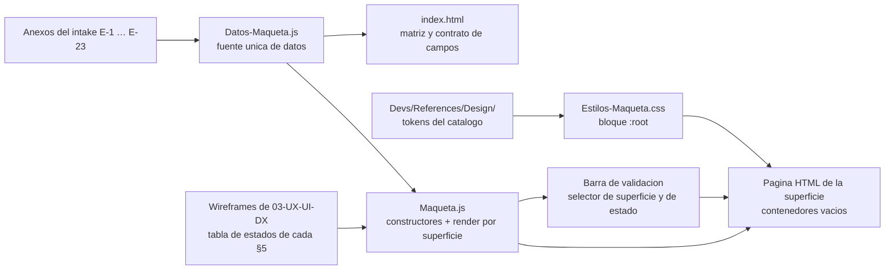

# 07 · Maqueta de validación visual

> Índice de la maqueta navegable de **SelfHosted Service**: qué es, cómo se sirve, qué página materializa qué superficie, cómo está construida y en qué punto del ciclo de corrección de la Fase B2 está. Sirve para operarla y para saber qué se puede y qué no se puede validar sobre ella.
>
> **Fuente primaria:** `SDD/Maquetas/SelfHosted-Service/` — `README.md`, `index.html`, las 19 páginas de superficie y `assets/`.
>
> **Alcance:** la especificación que esta maqueta materializa está indexada aparte en [`06_UX-UI-DX.md`](06_UX-UI-DX.md). Acá no se repite el catálogo de superficies ni el vocabulario visual: se declara la correspondencia página ↔ superficie y lo propio del instrumento.

---

## 1. Qué es y qué no es

| Dimensión | Valor declarado por `README.md` |
| --- | --- |
| Qué es | La **materialización navegable** de la especificación de experiencia de `SDD/Docs/03-UX-UI-DX/`, «para que el agente humano del proyecto vea antes de que se codifique» |
| Qué **no** es | **No es el producto.** Tampoco es especificación: exhibe las brechas declaradas y no elige por el agente humano |
| Fase y norma | Fase **B2 · Validación visual de maqueta**, bajo `Maqueta-Rules.md` **3.1**. La ejecuta AG-03M |
| Modelo UX-UI aplicado | Catálogo base de `Devs/References/Design/`. El catálogo `Modelos-UX-UI/` está **vacío** —sólo índice y plantilla—, así que no se aplica ningún modelo por encima |
| Fecha de la iteración vigente | **2026-08-02** |
| Plataforma de validación | Chrome de escritorio estable ≥ 150.0.7871.186 sobre Windows Server 2022 21H2, en red local. **Familia única: no hay versión móvil especificada** |
| Control de versiones | **La maqueta no está bajo control de versiones en este repositorio.** No hay diff que consultar; el inventario de referencia es la tabla §3 del README y el contrato de campos de `index.html` |

**Las cuatro garantías que la maqueta se impone, y que conviene tener presentes al leerla:**

1. **No decide.** Donde una fuente no declara un valor, exhibe la ranura vacía con su identificador de brecha; donde dos fuentes se contradicen, exhibe las dos con su procedencia y no elige.
2. **No fabrica.** Los casos que ninguna fuente instancia se **componen** con valores declarados en otro contexto y se **rotulan como composición de maqueta** (§5.1).
3. **No inventa valores visuales.** Ningún token ad hoc; el único alias provisional está declarado como tal (§4.1).
4. **No se pisa a sí misma.** Las correcciones manuales se preservan entre iteraciones y un pedido en conflicto detiene al orquestador (§6.1).

**Instrumento propio de la fase, que no se traslada:** la **barra de validación**, rotulada literalmente «Barra de validación de maqueta — no forma parte del producto», arriba de cada superficie. No pasa ni a la especificación ni al código.

---

## 2. Cómo se sirve

Los cuatro métodos sirven exactamente los mismos archivos. **No hay proceso de build, no hay gestor de paquetes y no hay `node_modules`: lo que se edita es lo que se sirve.**

| # | Método | Cuándo se usa | URL |
| --- | --- | --- | --- |
| 1 | Auto-lanzado del orquestador: servidor estático en segundo plano más apertura del navegador | Camino por defecto para la primera mirada. **Adoptado para revisión** | No declarada en la fuente |
| 2 | Servidor liviano del editor (Live Server de VS Code o equivalente), con recarga en cada guardado | Recomendado para corregir a mano. **Adoptado por este proyecto de código para corrección manual** | No declarada en la fuente |
| 3 | Servidor estático de línea de comandos: `python3 -m http.server 8080` desde `SDD/Maquetas/SelfHosted-Service` | **Adoptado para revisión**. No recarga sola, pero la maqueta trae su propio interruptor | `http://localhost:8080` — **puerto 8080** |
| 4 | Abrir `index.html` directamente en el navegador | Mirada rápida. Sobre `file://` la recarga automática **no funciona**: el interruptor se muestra deshabilitado con su motivo | `file://` |

### 2.1 La barra de validación

Tres instrumentos, más las notas:

- **Selector de superficie** — navega a cualquiera de las diecinueve sin volver al índice.
- **Selector de estado** — alterna los estados de la superficie **sin recargar**; cada cambio se anuncia como región activa para lectores de pantalla y queda en el fragmento de la dirección (`#estado=<id>`), de modo que un estado concreto **se comparte por enlace**.
- **Interruptor de recarga automática** — apagado por defecto, persistido en el navegador. Encendido, compara `ETag` o `Last-Modified` por petición `HEAD` (no descarga completa) cada 3 segundos, **suspende el sondeo con la pestaña no visible**, y refresca cuando alguno cambió.
- **Notas de brecha o propuesta**, con borde propio. Desde el 2026-08-02 una superficie puede alojar **más de una** y la barra las lista todas.

| Superficie | Notas que la barra exhibe |
| --- | --- |
| `SUP-05` | `B-UX-01` distinción de aristas · `B-UX-31` cuarentena |
| `SUP-06` | `B-UX-31` cuarentena · `B-UX-32` variante `repositorio` |
| `SUP-09` | `B-UX-31` cuarentena · `B-UX-28` umbral de limpieza |
| `SUP-12` | `B-UX-28` umbral de limpieza |
| `SUP-17` | `B-UX-29` registros explorables · `B-UX-32` variante `repositorio` |
| `SUP-18` | `B-UX-28` umbral de limpieza · `B-UX-33` imagen que sostiene a un servicio no reproducible |
| `SUP-19` | `B-UX-29` registros explorables |

---

## 3. Inventario de páginas

**Veinte archivos HTML: diecinueve superficies más el punto de entrada.** La columna «estados» es la de estados demostrables que declara `README.md` §3, calculada por `index.html` desde `Datos-Maqueta.js`.

| Página HTML | Superficie que materializa | Wireframe origen | Estados |
| --- | --- | --- | --- |
| `index.html` | **Punto de entrada.** Las 19 superficies con su matriz de correspondencia, y el **contrato de campos** completo (tipo, ejemplo, entidad de origen y anexo del intake que lo declara) | — (se genera desde `Datos-Maqueta.js`) | — |
| `Aprovisionamiento-Inicial.html` | `SUP-01` Aprovisionamiento inicial | `Wireframes-Aprovisionamiento-Inicial.md` | 9 |
| `Acceso-Al-Panel.html` | `SUP-02` Acceso al panel | `Wireframes-Acceso-Al-Panel.md` | 11 |
| `Cambio-De-Contrasena.html` | `SUP-03` Cambio de contraseña | `Wireframes-Cambio-De-Contrasena.md` | 9 |
| `Listado-De-Proyectos.html` | `SUP-04` Listado de proyectos | `Wireframes-Listado-De-Proyectos.md` 2.1 | 13 |
| `Lienzo-Del-Proyecto.html` | `SUP-05` Lienzo del proyecto | `Wireframes-Lienzo-Del-Proyecto.md` 2.1 | 21 |
| `Panel-Lateral-Del-Servicio.html` | `SUP-06` Panel lateral del servicio | `Wireframes-Panel-Lateral-Del-Servicio.md` 2.2 | 29 |
| `Cajon-De-Cambios-Pendientes.html` | `SUP-07` Cajón de cambios pendientes | `Wireframes-Cajon-De-Cambios-Pendientes.md` 2.0 | 17 |
| `Registro-Del-Contenedor.html` | `SUP-08` Registro del contenedor | `Wireframes-Registro-Del-Contenedor.md` | 8 |
| `Tablero-De-Estado.html` | `SUP-09` Tablero de estado | `Wireframes-Tablero-De-Estado.md` 2.2 | 17 |
| `Descubrimiento-E-Incorporacion.html` | `SUP-10` Descubrimiento e incorporación | `Wireframes-Descubrimiento-E-Incorporacion.md` 2.1 | 19 |
| `Catalogo-De-Plantillas.html` | `SUP-11` Catálogo de plantillas | `Wireframes-Catalogo-De-Plantillas.md` 2.2 | 23 |
| `Configuracion-Del-Sistema.html` | `SUP-12` Configuración del sistema | `Wireframes-Configuracion-Del-Sistema.md` 2.1 | 20 |
| `Variables-Compartidas-Del-Proyecto.html` | `SUP-13` Variables compartidas del proyecto | `Wireframes-Variables-Compartidas-Del-Proyecto.md` | 14 |
| `Informe-De-Conflicto-De-Direcciones.html` | `SUP-14` Informe de conflicto de direcciones | `Wireframes-Informe-De-Conflicto-De-Direcciones.md` | 11 |
| `Exportacion-E-Importacion.html` | `SUP-15` Exportación e importación | `Wireframes-Exportacion-E-Importacion.md` 2.1 | 16 |
| `Revision-De-Higiene.html` | `SUP-16` Revisión de higiene | `Wireframes-Revision-De-Higiene.md` | 10 |
| `Alta-De-Servicio.html` | `SUP-17` Alta de servicio | `Wireframes-Alta-De-Servicio.md` 2.2 | 22 |
| `Imagenes.html` | `SUP-18` Imágenes | `Wireframes-Imagenes.md` 2.2 | 20 |
| `Exploracion-De-Registro-De-Imagenes.html` | `SUP-19` Exploración de registro de imágenes | `Wireframes-Exploracion-De-Registro-De-Imagenes.md` 1.0 | 13 |

**Total declarado: 302 estados demostrables**, cifra que calcula `index.html` desde `Datos-Maqueta.js` y que no se transcribe a mano. Las cuatro superficies con más estados —`SUP-06` con 29, `SUP-11` con 23, `SUP-17` con 22 y `SUP-05` con 21— concentran **95 de los 302**, y son exactamente las que la ronda del 2026-08-02 rehizo o cambió de forma.

**Cobertura de casos de uso.** Los treinta y nueve casos de uso están cubiertos salvo **CU-33**, y no es una omisión: su actor es el automatismo de integración continua y su superficie es la API REST, no una pantalla.

### 3.1 Cómo se agrupan las páginas

| Grupo | Páginas | Shell que arma `Maqueta.js` |
| --- | --- | --- |
| Superficies de identidad | `Aprovisionamiento-Inicial`, `Acceso-Al-Panel`, `Cambio-De-Contrasena` | `mq-shell-acceso`: sin barra lateral, sin barra superior y sin navegación de módulos |
| Punto de entrada | `index.html` | `mq-shell-acceso` extendido a todo el ancho, sin `h1` de superficie de producto |
| Superficies del shell de trabajo | Las **dieciséis** restantes | `mq-shell-trabajo`: `#nav-lateral`, `#topbar` con la barra de identidad, área de contenido y `#sello-pie` |

Las tres superficies con **flujo propio** —`SUP-14`, `SUP-15` y `SUP-19`— y el panel y el cajón del lienzo —`SUP-06` y `SUP-07`— tienen **página propia** en la maqueta aunque en el producto se superpongan a la superficie que las invoca. El motivo de esa elección **no está declarado en la fuente**; lo verificable es que el selector de superficie de la barra de validación alcanza a las diecinueve sin reproducir el gesto que abre cada una.

**Estados suplementarios.** Algunas superficies demuestran, además de los que su wireframe declara, estados **rotulados como suplementarios** en el selector. Existen porque el wireframe especifica un componente en su §3 y no le da fila en su tabla de estados: son hallazgos de la fase, enumerados en la devolución del paso 3.

**Sobre los conteos.** Los números de esta columna son los de la maqueta, no los de los wireframes: las tablas de estados de `SDD/Docs/03-UX-UI-DX/Wireframes/` declaran cifras propias que no siempre coinciden (ver §7).

---

## 4. Estructura y criterio de construcción

```
SelfHosted-Service/
├── index.html                        punto de entrada + contrato de campos
├── <19 páginas>.html                 una por superficie, nombre = nombre canónico
├── assets/css/Estilos-Maqueta.css    tokens del catálogo como variables CSS
├── assets/js/Datos-Maqueta.js        fuente única de datos, contrato de campos y descriptores
├── assets/js/Maqueta.js              render, navegación y conmutación de estados
└── README.md
```

**No hay `assets/img/`: toda la iconografía es SVG inline con `currentColor`**, sin raster y sin packs de íconos por CDN.

### 4.1 Reglas constructivas que la maqueta respeta

| Regla | Detalle declarado por `README.md` §7 |
| --- | --- |
| Stack | HTML5 semántico, CSS y JavaScript **vanilla**. Bootstrap 5.0 por CDN como grilla y componentes; el CSS propio se carga después y lo sobreescribe |
| **Ningún token visual ad hoc** | Todo valor de color, tipografía y radio vive en el bloque `:root` de `Estilos-Maqueta.css` con el nombre semántico del catálogo. **Fuera de ese bloque no hay literales de ninguno de los tres** |
| Capas del catálogo | Verificadas en disco el 2026-08-02: `Web-Generico` 1.3, `Blazor-Mudblazor` 1.3, `Config-Esquema` 1.2, `Primer-Arranque` 1.1, `Acceso-Monousuario` 1.1, `Identidad-De-Version` 1.1, bajo `Index-Design-Rules` 1.4 |
| El token que falta | «Pendiente de aplicar» no tiene token en el catálogo (`C-UX-01`, `B-UX-05`). La maqueta lo **alias** al token `color.accent.module-b` —violeta, no asignado a ningún módulo en este producto—, conservando la reserva de exclusividad de E-18. **Es un alias provisional, no una promoción de token** |
| Autonomía de red | **Sin llamadas a servicios reales.** Las únicas peticiones propias son las `HEAD` de la recarga automática, contra sus propios archivos |
| **WCAG 2.2 AA como piso** | Landmarks semánticos, un `h1` por vista, `label` asociados, foco visible, recorrido completo por teclado, `role="alert"` en bandas de error y `role="status"` en confirmaciones y anuncios de cambio de estado, contraste 4.5:1, unidades explícitas, cifras tabulares y `prefers-reduced-motion` respetado |
| Sello de versión | Al pie de cada superficie: proyecto de código, modelo UX-UI aplicado y fecha de la iteración vigente |

### 4.2 Cómo está armada una página

Verificado sobre los archivos: cada HTML de superficie pesa entre 32 y 37 líneas y **no contiene datos ni componentes**. Declara su superficie en `<body data-superficie="SUP-XX">`, el enlace de salto al contenido, el contenedor vacío `#barra-validacion`, el shell (`mq-shell-trabajo` o `mq-shell-acceso`) con `#nav-lateral`, `#topbar`, el `h1`, un párrafo sólo para lector de pantalla con superficie / CU / wireframe de origen, el contenedor vacío `#superficie`, el pie `#sello-pie` y la región `#mq-anuncio` con `role="status"`. Todo lo demás lo inyecta `Maqueta.js` desde `Datos-Maqueta.js`.

**El peso está en los tres assets, no en el HTML:** `Maqueta.js` ~4.800 líneas, `Datos-Maqueta.js` ~3.560, `Estilos-Maqueta.css` ~1.725, contra ~700 líneas de HTML sumadas las veinte páginas. `Maqueta.js` está organizado como una biblioteca de constructores reutilizables —`parEstado`, `banda`, `vacio`, `esqueleto`, `barraMagnitud`, `campoDescriptor`, `sello`, `diagnostico`, `ranuraAsistente`, `navLateral`, `barraValidacion`, `nodoServicio`, `svgAristas`, `distintivos`, `origenEnLectura`, `accionesEjecucion`, `bloqueCuarentena`, `celdaDigesto`— y luego un render por superficie.

### 4.3 Cadena de render



**La regla que sostiene la cadena:** el HTML no hardcodea ningún dato, el CSS no lleva ningún literal visual fuera de `:root`, y el contrato de campos y el conteo de estados los calcula `index.html` desde `Datos-Maqueta.js` en lugar de transcribirse a mano.

### 4.4 Qué se puede y qué no se puede validar sobre la maqueta

| Se valida acá | No se valida acá |
| --- | --- |
| Composición, jerarquía visual y peso de cada acción; que haya exactamente una acción primaria donde la especificación la exige | La **matriz de anchos de verificación** del comportamiento responsivo: la norma está declarada (punto de quiebre ~768 px, piso de 320 px), los anchos concretos los fija la etapa `b` |
| El recorrido entre superficies y los dos circuitos nuevos de la ronda | El comportamiento sobre plataformas fuera de la familia declarada: **no hay versión móvil especificada** |
| Los estados que cada wireframe declara, alternables sin recargar y compartibles por enlace | Los estados que ningún wireframe declara: **un estado no declarado no se maqueta y por lo tanto no se valida** |
| El **microcopy** exacto, que la fase fija sobre la maqueta | El tono revisado por `11-Documentacion`, categoría todavía no emitida |
| Que los campos exhibidos sean los que el sistema tiene que mostrar, contra el contrato de `index.html` | Cualquier dato que ninguna fuente declare: la maqueta exhibe la **ranura vacía** con su identificador de brecha en lugar de inventarlo |
| El piso de accesibilidad WCAG 2.2 AA por inspección heurística | La suite de accesibilidad automatizada y los snapshots por estado, que son de `08-Calidad-Y-Pruebas` |
| La **forma** de las materializaciones cuyo valor está sin decidir (umbral, cuarentena, aristas) | La **decisión** de fondo de esas seis brechas: la maqueta no cerró ninguna |

---

## 5. De dónde salen los datos

Viven **exclusivamente** en `assets/js/Datos-Maqueta.js`; ningún HTML los hardcodea. `index.html` exhibe el contrato de campos completo con tipo, ejemplo, entidad de origen y anexo del intake que lo declara.

Fuente: `PRODUCT-INTAKE-SelfHosted-Service.md`, **vigente v3.7**; los conjuntos de esta ronda vienen de la **v3.4** (alta unificada, tercer eje, sexta variante de origen) y de la **v3.5** (tres fases del despliegue y política ante un despliegue que no arranca).

| Conjunto | Anexo |
| --- | --- |
| Proyecto SelfHosted, red, disposición del lienzo, variables compartidas, aristas | E-1 |
| Servicio con sus ocho dimensiones, sus cinco variantes discriminadas de origen y la variante macvlan | E-2 |
| Despliegue con línea de tiempo, métricas y despliegue fallido | E-3 |
| Changeset con sus cambios y su informe de impacto | E-5 |
| Ítems del catálogo, simple y multi-servicio, con parámetros y cuatro tipos | E-6 |
| Candidatos del descubrimiento, con el no incorporable y el ya incorporado | E-7 |
| Rango gestionado, reservas e informe de conflicto con sus tres resoluciones | E-8 |
| Paso obligatorio de clasificación de variables | E-11 |
| Credencial de máquina con sus ámbitos y su vigencia | E-12 |
| Tablero en tres capas, contrato visual de estados y conteo de imágenes del host | E-18 |
| Parque de contenedores de referencia | E-19 |
| Configuraciones reales ofuscadas (C-1 a C-6) | E-20 |
| La imagen como objeto con identidad: digesto, pertenencia, marca de conservada, valor `ajena`, bloque `imagen` del despliegue | E-23 |
| La sexta variante de origen `imagen-local`, con digesto, referencia del almacén y prohibición de política flotante | E-2 §20.2.3 |

Los valores son verosímiles del dominio y **no son datos reales del cliente**: E-19 y E-20 vienen ofuscados en origen.

### 5.1 Los dos casos que ninguna fuente instancia

Ni el intake, ni los casos de uso, ni el modelo conceptual declaran un servicio concreto con origen `imagen-local` ni uno en cuarentena: declaran la **variante** y la **política**, no una instancia. Los wireframes exigen demostrar los dos en cinco superficies. La maqueta **compone** el caso con valores que alguna fuente sí declara en otro contexto y lo **rotula como composición de maqueta**; no fabrica nombres, imágenes ni identificadores nuevos.

| Caso | Con qué se compone | Qué queda declarado como ausente |
| --- | --- | --- |
| Servicio con origen de almacén local | Servicio `ia-video` (E-19, E-20 C-5) e imagen `registro-privado/video:0.3` ya listada como administrada | Su **digesto**, que ninguna fuente declara |
| Servicio en cuarentena | Servicio `cache` y su despliegue fallido 5472 de E-3 §20.3 | La **causa concreta del fallo de arranque**: el 5472 falló por «la imagen no existe en el registro», que es fallo de la fase de obtener la imagen, no de la de poner en marcha |

### 5.2 Dónde la maqueta exhibe la ranura vacía en lugar de inventar el valor

Es deliberado y es parte de lo que hay que validar. Brechas visibles en la maqueta: `B-UX-01`, `B-UX-04`, `B-UX-05`, `B-UX-06`, `B-UX-07`, `B-UX-10`, `B-UX-11`, `B-UX-12`, `B-UX-13`, `B-UX-16`, `B-UX-17`, `B-UX-18`, `B-UX-19`, `B-UX-20`, `B-UX-24`, `B-UX-28` y `B-UX-29`. Se recogen además sin resolver `B-UX-25` y las brechas `B-26` y `B-28` de `02-Especificacion-Funcional`.

**El caso más visible es el digesto de imagen:**

- **Ninguna fuente del corpus declara un digesto completo.** Verificado sobre todo `SDD/`: cero coincidencias de `sha256:` seguido de 64 caracteres, incluidos los `_legacy`.
- Los **tres** digestos declarados vienen **abreviados en su propio anexo**: `sha256:9b1e…` (E-2 §20.2.5), `sha256:a1b2c3...` (E-3 §20.3) y `sha256:3f7a…` (E-23).
- **Los dos últimos se contradicen entre sí** para la misma imagen `portal-api:1.4.2` del mismo servicio 101, con política de actualización fijada. **La maqueta no elige**: `SUP-06` y `SUP-18` exhiben las dos declaraciones con su fuente, rotuladas «declarado distinto por dos fuentes». Resolución del paso 6.
- Consecuencia visible y declarada: **la «forma completa disponible al pedirla» no se puede demostrar**. Toda imagen sin digesto declarado lleva «Digesto sin declarar» con su motivo, que es distinto de una celda sin cargar.

Lo mismo vale para el **tamaño de imagen** (el corpus declara uno solo, 214 MB, en E-23), la **ocupación del almacén** (ninguna fuente la emite; los 115/884 GB de E-18 son el disco raíz del host) y el **momento de publicación de una etiqueta** (ninguna fuente emite ninguno).

---

## 6. Estado del ciclo de corrección de la Fase B2

### 6.1 Cómo se corrige

| Vía | Mecánica |
| --- | --- |
| **A — por prompt** | Se describe el cambio y el orquestador lo aplica sobre estos archivos |
| **B — a mano** | Se editan HTML, CSS o JS y se avisa con «revisá la maqueta y tomá las correcciones». El orquestador relee íntegros los archivos, los compara contra el estado que él mismo dejó, enumera las diferencias, **las interpreta como decisiones de diseño del agente humano** y presenta esa lectura **para que se confirme antes de propagarla** |

**Las correcciones manuales se preservan:** en las iteraciones siguientes no se pisan, y si un pedido por prompt entra en conflicto con una, el orquestador **se detiene y pregunta**. Dos puntos de entrada para corregir a mano: un dato → `Datos-Maqueta.js` (fuente única, se refleja en todas las superficies); un valor visual → el bloque `:root` de `Estilos-Maqueta.css` — y si el valor no está ahí, **no se agrega suelto**: es un token que corresponde promover al catálogo.

### 6.2 Qué hizo la iteración vigente

La iteración del **2026-08-02** fue una **reconstrucción incremental**: no rehízo la maqueta entera, alcanzó a **nueve superficies** y conservó las otras diez exactamente como estaban.

| Superficie | Alcance del cambio |
| --- | --- |
| `SUP-17` | **Rehecha desde cero**: se retiró la grilla de siete tarjetas y el origen pasó a ser un campo de tres valores |
| `SUP-06` | Cabecera rehecha |
| `SUP-05`, `SUP-09` | Cambio de forma |
| `SUP-04`, `SUP-15`, `SUP-18` | Cambio de forma acotado |
| `SUP-10`, `SUP-11` | Sólo contenido |

**Qué agrega la ronda, en una línea:** el alta unificada con su campo de origen de tres valores, la sexta variante de origen —imagen del almacén local— con su marca de **no reproducible**, las **tres fases del despliegue** con sus seis acciones de ejecución, y la **cuarentena** como distintivo visible y sin acción de retirarla.

### 6.3 Las seis brechas y propuestas abiertas que la maqueta exhibe sin cerrar

`README.md` §5. **La maqueta no cerró ninguna**: son decisiones del agente humano.

| # | Brecha / propuesta | Dónde se ve | Qué hace la maqueta |
| --- | --- | --- | --- |
| §5.1 | `B-UX-01` distinción visual de las aristas | `SUP-05` | **Propone** una distinción para aprobar o corregir: espera al destino (trazo sólido, punta rellena, marcador de doble barra, rótulo «espera»), sin espera (punta hueca, sin marcador), inválida (trazo punteado en color de error, marcador de cruz, rótulo «inválida»). Cumple las tres restricciones: no usa el violeta reservado, usa forma además de color, y la inválida se distingue por tres canales |
| §5.2 | `B-UX-29` configuración de los registros explorables | `SUP-17`, `SUP-19` | Dibuja el disparador «Explorar el registro» **con su destino declarado**, y en el vacío de `SUP-19` la acción «Configurar un registro» queda como **arista declarada y sin destino**. De esto depende que el primer minuto de uso termine en una lista de imágenes o en un vacío que pide configurar |
| §5.3 | `B-UX-28` valores del umbral de la sugerencia de limpieza | `SUP-12`, `SUP-18`, `SUP-09` | Dibuja **la forma completa** de las tres materializaciones con las ranuras numéricas declaradas y **sin valor por defecto**. Se agrava porque el espacio recuperable depende del criterio de descarte, que es la brecha `B-26` de 02 |
| §5.4 | `B-UX-31` los tres puntos sin decidir de la cuarentena | `SUP-05`, `SUP-06`, `SUP-09` | **Demuestra que un servicio en cuarentena se ve** en los tres lugares exigidos. **No dibuja**, y lo declara como ausencia deliberada: ninguna acción de retirar la cuarentena, ningún aviso en el momento en que ocurre, ninguna acción de recuperar el despliegue anterior, ninguna segunda marca de participación en el arranque |
| §5.5 | `B-UX-33` la imagen que sostiene a un servicio no reproducible | `SUP-18` | El indicador de uso **cuenta al servicio declarado como referencia**; la imagen **no se marca como protegida** y la limpieza no la excluye. Demostrar la protección sería completar la política |
| §5.6 | `B-UX-32` la variante de origen que ninguna superficie produce | `SUP-06`, `SUP-17` | Muestra las **dos mitades**: `SUP-06` exhibe **en lectura** la variante `repositorio` con sus cuatro campos declarando que la interfaz ya no la produce; `SUP-17` **no la ofrece**, sin ningún control, opción ni texto que la produzca |

### 6.4 Qué se pide revisar

`README.md` §9: el **alta unificada** (¿los tres rótulos son los correctos? ¿la pérdida del formulario está compensada por el registro ya puesto y la exploración?); las **tres entradas al mismo nivel** (alta, adoptar y usar el catálogo, ¿se encuentran?); los **dos distintivos** (cuarentena y no reproducible son texto y nada más, ¿se ven sin competir con el estado?); las **seis acciones de ejecución** (¿«Detener» y «Parar» se distinguen?); la **navegación**, en particular los dos circuitos nuevos —alta → explorar el registro → volver con el origen completo y sin verificar, e inventario de imágenes → crear servicio desde una imagen→ alta con el origen ya puesto y sin verificar—; los **datos** contra el contrato de `index.html`; los **estados** superficie por superficie; la **apariencia** (¿exactamente una acción primaria donde la especificación la exige?); las **seis brechas de §5**; y las **ranuras vacías**, que en `SUP-18` «son muchas y a propósito».

### 6.5 Sincronía con la especificación, verificada

Las **doce** superficies para las que la matriz §3 del README de la maqueta cita explícitamente una versión de wireframe coinciden **una por una** con el reparto de versiones que `SDD/Docs/03-UX-UI-DX/README.md` §4 declara vigente: `SUP-04` 2.1, `SUP-05` 2.1, `SUP-06` 2.2, `SUP-07` 2.0, `SUP-09` 2.2, `SUP-10` 2.1, `SUP-11` 2.2, `SUP-12` 2.1, `SUP-15` 2.1, `SUP-17` 2.2, `SUP-18` 2.2 y `SUP-19` 1.0. Las siete restantes se citan sin versión, y las siete están en 2.0 según ese mismo reparto.

**Nombre de archivo = nombre canónico.** Cada página lleva el nombre canónico de su superficie con guiones, sin sufijo de versión y sin el identificador `SUP-XX` en el nombre; el identificador vive en `data-superficie`. Es la propiedad que `Deriva-Rules.md` necesita para que la línea de base visual pueda registrar la correspondencia término por término.

### 6.6 Lo que todavía no se emitió

`Linea-Base-Visual.md`, `Contrato-Datos-Maqueta.md` y `Bitacora-Validacion-Maqueta.md` se emiten en `SDD/Docs/03-UX-UI-DX/` **al aprobarse la maqueta**, en los pasos posteriores de la fase. **No existen todavía y su ausencia no es una omisión.** La retroalimentación de `SDD/Docs/` y de `SDD/Intake/` es el **paso 6** y es otro despacho: nada de lo que esta pasada encontró se escribió ahí; los hallazgos se devolvieron al orquestador.

---

## 7. Inconsistencias detectadas entre fuentes

| Inconsistencia | Detalle |
| --- | --- |
| CU por superficie | La matriz §3 del README de la maqueta difiere de `Experiencia-De-Uso.md` §9.2 —que es la **fuente única** declarada— en cuatro filas: le suma CU-37 a `SUP-09` y a `SUP-12`, le da CU-16 a `SUP-17` donde el marco da CU-37, y le quita CU-03 a `SUP-18`. El propio `Tablero-De-Estado.html` rotula «CU-26, CU-27, CU-28», coincidiendo con el marco y no con el README de la maqueta |
| Autonomía de red | `README.md` §7 afirma «sin llamadas de red a servicios reales… las únicas peticiones son las `HEAD` de la recarga automática», pero las veinte páginas cargan Bootstrap 5.0.2 desde `cdn.jsdelivr.net`. La propia §7 declara el CDN una viñeta antes, así que las dos afirmaciones conviven en el mismo documento |
| Estados demostrables vs. estados declarados | Los conteos del README de la maqueta no coinciden con los que enuncian los wireframes: p. ej. `SUP-02` declara **trece** estados en su §5 y la maqueta demuestra **11**; `SUP-04` declara doce y la maqueta 13; `SUP-16` declara once y la maqueta 10. La fuente no explica el desfase salvo por la nota de estados suplementarios |
| Sin control de versiones | La maqueta declara no estar bajo control de versiones «en este repositorio», pero sus archivos están presentes en el árbol `SDD/Maquetas/` del repositorio indexado |
| Composiciones rotuladas vs. corpus | Los dos casos de §5.1 se exhiben rotulados como «composición de maqueta», de modo que un lector que tome un dato de `SUP-05`, `SUP-06`, `SUP-09`, `SUP-17` o `SUP-18` sobre cuarentena u origen de almacén local **no está leyendo el corpus**: está leyendo una composición declarada como tal |
| Versiones del catálogo de diseño | La maqueta aplica `Web-Generico` 1.3, `Blazor-Mudblazor` 1.3, `Config-Esquema` 1.2, `Primer-Arranque` 1.1, `Acceso-Monousuario` 1.1 e `Identidad-De-Version` 1.1 bajo `Index-Design-Rules` 1.4; los wireframes y `Experiencia-De-Uso.md` §2.1 citan las versiones **anteriores** (1.2, 1.2, 1.1, 1.0, 1.0, 1.0 bajo índice 1.3). Las dos fuentes declaran haber verificado en disco, en fechas distintas |

---

## Fuentes

| Archivo | Qué contiene |
| --- | --- |
| `SDD/Maquetas/SelfHosted-Service/README.md` | Documento rector de la maqueta: los cuatro métodos de apertura, el inventario de archivos, la matriz superficie ↔ CU ↔ wireframe ↔ estados, la barra de validación y sus notas, las seis brechas y propuestas abiertas, el origen de los datos por anexo del intake, las reglas constructivas, el procedimiento de corrección y lo que todavía no se emite |
| `SDD/Maquetas/SelfHosted-Service/index.html` | Punto de entrada: shell mínimo que renderiza desde `Datos-Maqueta.js` el listado de las 19 superficies, sus casos de uso, sus estados demostrables y el contrato de campos completo |
| `SDD/Maquetas/SelfHosted-Service/*.html` (19 páginas) | Una por superficie. Esqueleto de 32-37 líneas con `data-superficie`, shell, `h1`, descripción para lector de pantalla y contenedores vacíos; sin datos ni componentes propios |
| `SDD/Maquetas/SelfHosted-Service/assets/css/Estilos-Maqueta.css` | Tokens del catálogo como variables CSS en `:root` (color, tipografía, radio) con su cabecera de capas aplicadas y sus versiones, más las clases `mq-*` de shell, barra de validación, pares de estado, nodos y tablas |
| `SDD/Maquetas/SelfHosted-Service/assets/js/Datos-Maqueta.js` | Fuente única de datos: metadatos de la iteración, variantes del sello de versión, catálogo de códigos de resultado con su texto y su brecha asociada, descriptores de parámetro y los conjuntos de ejemplo derivados de los anexos del intake |
| `SDD/Maquetas/SelfHosted-Service/assets/js/Maqueta.js` | Motor de render: biblioteca de constructores reutilizables (par de estado, banda, esqueleto, campo por descriptor, sello, nodo de servicio, aristas SVG, distintivos, acciones de ejecución), navegación, barra de validación y conmutación de estados por fragmento de dirección |
