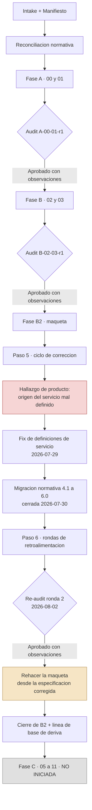

# 08 · Proceso SDD y estado de la corrida

> Índice del **proceso** que produjo este repositorio y del **estado** en que quedó la corrida, no del producto que se especifica. Sirve para responder, sin abrir 300 KB de informes: en qué fase está parada la corrida, qué decidió el agente humano del proyecto, qué está bloqueado y por qué.
> **Fuente primaria:** `SDD/Estado/Informe-Avance.md` v3.0 (2026-08-02), `SDD/Estado/Redefinicion-Servicio.md` v2.0, `SDD/Estado/Fix-Definir-Producto.md`, `SDD/Estado/Fix-Ejecución-Glosario-Framework.md` v1.0 y `CHANGELOG.md` de la raíz.
> **Los informes de auditoría y la migración normativa 4.1 → 6.0 se catalogan en [`09_Auditorias-Y-Migracion.md`](09_Auditorias-Y-Migracion.md);** este índice sólo los referencia.

---

## 1. Qué es este repositorio

| Hecho | Evidencia |
|---|---|
| `SelfHosted.Service.Core` **no contiene código**: es el destino documental de una corrida del Orquestador SDD | `CHANGELOG.md` [1.0]: «Ningún archivo de código entra en esta entrada: la solución todavía no tiene proyecto compilable» |
| El **framework normativo vive en otro repositorio**, `IA/IA.SDD`, y el orquestador de un destino **nunca lo modifica** | `Informe-Avance.md` Anexo A; `Fix-Ejecución-Glosario-Framework.md` cabecera |
| El producto se llama **SelfHosted Service**; la identidad de código es `SelfHosted.Service.Core` | Modelo de cuatro identidades, decisión D-F |
| El corpus SDD entró a git recién el **2026-07-29** (301 archivos). Antes vivía sólo en disco, y eso costó la pérdida irrecuperable de `Informe-Avance.md` v1.9 | `CHANGELOG.md` [1.0]; nota de reconstrucción del `Informe-Avance.md` |
| Es el **caso degenerado del framework**: un único proyecto de código, salida aplanada bajo `SDD/Docs/` sin `Proyectos/` ni `Solucion/` | `Master-Prompt.md` §3.5; decisión D-G |

> **El árbol en disco está por delante del último commit y del último informe.** `git status` sobre el repositorio indexado muestra ~52 archivos modificados y 11 rutas sin seguimiento respecto de la entrada `[1.0]` del `CHANGELOG.md`, entre ellas los dos informes de la ronda del 2026-08-01/08-02 y los `_legacy/2026-08-01/` y `2026-08-02/`. **Hecho verificable; su interpretación no está declarada en ninguna fuente de este repositorio.**

**`SDD/Estado/` no es artefacto de las doce categorías.** Sus cuatro documentos son de trabajo del proceso, viven fuera de `SDD/Docs/` a propósito y **ningún subagente los consume como insumo** (`Informe-Avance.md` cabecera). Quedaron además fuera del alcance de la migración normativa.

---

## 2. El framework SDD y sus fases

### 2.1 Las fases de esta corrida

| Fase | Qué produce | Categorías tocadas |
|---|---|---|
| Reconciliación normativa | Diff del conjunto normativo contra el destino (`Master-Prompt.md` §2.1) | — |
| Validación de intake | Verifica el documento de entrada antes de despachar subagentes | `SDD/Intake/` |
| Derivación del manifiesto | Fuente canónica de la jerarquía, derivada de §13 del intake | `SDD/Intake/` |
| **A** | Contexto y necesidades de negocio | `00`, `01` |
| **B** | Especificación funcional y capa de experiencia | `02`, `03` (`04` omitida por gating) |
| **B2** | **Validación visual**: maqueta HTML + ciclo de corrección + retroalimentación a la documentación | `SDD/Maquetas/`, retroalimenta `02` y `03` |
| Migración normativa (M1..M6) | Adecuación del árbol emitido a un conjunto normativo nuevo | Todo lo emitido — ver índice 09 |
| **C a G** | Categorías `05` a `11` | **No iniciadas** |

**Cada fase cierra con un audit independiente.** `Master-Prompt.md` §10 no admite avanzar sin audit aprobado, y un P0 o un P1 bloquean el avance hasta su corrección.

### 2.2 Flujo del proceso

---

## 3. Estado de cada fase, con fecha

Tomado de `Informe-Avance.md` v3.0 §1, fechado **2026-08-02**. Es el estado más reciente declarado por una fuente de este repositorio.

| Fase / hito | Estado | Fecha |
|---|---|---|
| Reconciliación normativa (`Master-Prompt.md` §2.1) | **Cerrada.** Caso «sin procedencia», salida B: regenerar desde cero. Árbol previo archivado en `SDD/Docs/_legacy/2026-07-28/`, 119 archivos verificados con `diff -r` antes de vaciar | 2026-07-28 |
| Validación de intake | **Cerrada sin bloqueantes** | 2026-07-29 |
| Derivación del manifiesto | **Cerrada.** Cinco intervenciones el mismo día; la 1.7 es la primera canónica | 2026-07-29 |
| **Fase A · `00` y `01`** | **Corte aprobado.** 16 documentos, 2881 líneas. Audit APROBADO CON OBSERVACIONES, cero P0 | 2026-07-29 |
| Adecuación al conjunto normativo 4.1 | **Cerrada** (decisión D-J) | 2026-07-29 |
| **Fase B · `02`** | **Generada y aprobada.** 94 archivos, 8402 líneas; 36 CU, 37 RN, 18 RC | 2026-07-29 |
| **Fase B · `03`** | **Generada y aprobada.** 23 archivos, 5046 líneas; 16 superficies contra un piso de 4 | 2026-07-29 |
| Fase B · `04-Prompts-AI` | **Omitida por gating** (`usa_llm` = false). La omisión se registra con su motivo, no se silencia | 2026-07-29 |
| **Corte de la Fase B** | **Aprobado**, seis P1 corregidos y reverificados | 2026-07-29 |
| Fase B2 · maqueta construida | 16 superficies, `index.html`, tres assets, 352 KB; servida en `http://127.0.0.1:8137/` | 2026-07-29 |
| Fix de las definiciones de servicio | **Ejecutado.** Intake a 2.4; `02` a 38 CU / 40 RN / 19 RC; `03` a 18 superficies. **La maqueta no se rehizo** | 2026-07-29 |
| **Migración normativa 4.1 → 6.0** | **Cerrada.** 144 filas resueltas, cero P0 y cero P1 abiertos — ver índice 09 | 2026-07-30 |
| Fase B2 · rondas 1 y 2 de retroalimentación (paso 6) | Auditadas, consolidaron decisiones del agente humano en el intake y las propagaron a `02` y `03` | 2026-07-30 y 2026-07-31/08-01 |
| Fase B2 · ronda 3 de retroalimentación | **RECHAZADA** (2 P0, 2 P1, 4 P2, 3 P3) | 2026-08-01 |
| Ronda de corrección del RECHAZADO | **Emitida en dos tramos**; el segundo cerró lo que faltaba | 2026-08-02 |
| Re-audit de la ronda 2 | Declarado **«en curso»** por `Informe-Avance.md` v3.0. **El informe existe y dio APROBADO CON OBSERVACIONES** — ver índice 09. *`Informe-Avance.md` no fue actualizado tras ese veredicto* | 2026-08-02 |
| Flags de `Master-Prompt.md` §4 | **Declarados por primera vez** en el manifiesto v2.2 §2. `requiere_maqueta` confirmado en `true` | 2026-08-02 |
| **Reconstrucción de la maqueta** | **Pendiente.** Es el paso donde B2 quedó detenida desde el 2026-07-29 | — |
| **Fase C y siguientes (`05` a `11`)** | **No iniciadas** | — |
| Proyecto de código | **No iniciado** | — |

> **Interpretación, no hecho declarado:** el estado vigente más probable es «Fase B2, paso 6 destrabado por el re-audit aprobado del 2026-08-02, con la reconstrucción de la maqueta como próximo paso». `Informe-Avance.md` v3.0 no llegó a registrarlo porque se emitió con el re-audit todavía en curso.

---

## 4. Catálogo de decisiones del agente humano del proyecto

`Informe-Avance.md` §2. Todas del 2026-07-28 y 2026-07-29, todas aplicadas y trazadas en el control de cambios del artefacto que tocaron.

| ID | Decisión | Fecha | Impacto |
|---|---|---|---|
| **D-A** | Manifiesto **aprobado**; la 1.7 pasa a `Vigente` y es fuente canónica de la jerarquía | 2026-07-29 | Manifiesto §1 |
| **D-B** | Flags de generación aprobados. B-1 queda sin objeto: `tiene_persistencia` es `true` por SQLite | 2026-07-29 | Registrado en `Informe-Avance.md` §3 |
| **D-C** | Invariantes de solución aprobadas, con **C-1** (desambiguar «proyecto»), **C-2** (marcadores) y **C-3** (uso de las cuatro identidades) | 2026-07-29 | Inyectadas en todo despacho de subagente |
| **D-D** | Matriz de navegadores: **Chrome escritorio estable ≥ 150.0.7871.186**, red local; se agrega el eje del equipo operador (Windows Server 2022 21H2) | 2026-07-28 | Intake §17.P.9 |
| **D-E** | Raíz de nombres de código pasa de `SelfHosted` a la identidad completa. **Absorbida por D-F** | 2026-07-29 | Intake §12, §13, §16, §17 |
| **E-1** | `Nombre-Proyecto` **no** acompaña el cambio de raíz: los planos documentación y código son independientes por diseño | 2026-07-29 | Intake §13; manifiesto §1.3 |
| **E-2** | Los proyectos de prueba toman la raíz de la identidad de código | 2026-07-29 | Intake §13, §16 |
| **D-F** | **Modelo de cuatro identidades**: producto `SelfHosted Service`, documental `SelfHosted-Service`, código `SelfHosted.Service.Core`, agrupación `SelfHosted.Service.Core.sln` | 2026-07-29 | Cabecera del intake; manifiesto §1 |
| **F-1** | Identidad documental **(b)**: el slug se deriva del nombre de producto y pasa de `SelfHosted-Service-Core` a `SelfHosted-Service` | 2026-07-29 | Renombre de los dos artefactos de `SDD/Intake/` |
| **D-G** | **Un único proyecto de código.** Las cuatro capas de Clean Architecture pasan de proyectos de compilación a espacios de nombres | 2026-07-29 | Intake §12–§19 y Parte C; manifiesto §2 y §2.1 |
| **D-H** | Proyecto `SelfHosted.Service.Core` sin sufijo de rol, con la presentación bajo carpeta `Web/`. Costó tres pasadas el mismo día | 2026-07-29 | Intake §13, §16; manifiesto §1 |
| **D-I** | Plan de la Fase A aprobado, con `Program.cs` en la raíz del proyecto | 2026-07-29 | Ejecutado |
| **D-J** | **Adecuar la Fase A al conjunto 4.1** en lugar de cerrarla bajo 4.0 | 2026-07-29 | Manifiesto §1.1 v1.8 y v1.9 |
| **D-K** | Corte de la Fase A aprobado; la **Fase B se aprueba completa** (`02` y `03` juntas, sin audit intermedio) | 2026-07-29 | Fase B despachada |

**Decisiones de la migración normativa (`D-M1` a `D-M5`, 2026-07-30):** están en `SDD/Docs/Audit/Plan-Migracion-4.1-a-6.0.md` §7.1 y se catalogan en el índice 09.

**Decisiones de producto abiertas por `Redefinicion-Servicio.md` (`Q-1` a `Q-28`):** ver §6 de este índice.

### 4.1 Por qué D-H costó tres pasadas

| Forma evaluada | Por qué se descartó |
|---|---|
| `SelfHosted.Service.Core` con las capas en la raíz | La presentación quedaba sin segmento propio: tres espacios de nombres hermanos que había que enumerar en el test de arquitectura |
| `SelfHosted.Service.Core.Web` | Anidaba las capas bajo `.Web`, dejaba el dominio debajo de la presentación y obligaba a reexpresar el referente de una regla marcada `[E]` |
| **`SelfHosted.Service.Core` + carpeta `Web/`** (adoptada, propuesta por el agente humano) | Único costo: desviación declarada de `Master-Prompt.md` §3.2. Las cuatro capas quedan simétricas y la regla `[E]` se cita literal |

---

## 5. Puntos abiertos del proceso

`Informe-Avance.md` §4. Se listan por estado; las fechas son las de última actualización declarada.

| # | Punto | Estado | Quién decide | Bloquea |
|---|---|---|---|---|
| **PA-1** | Confirmar quién es el **Product Owner** (campo incorporado en el intake 2.3) | Abierto | Agente humano | Nada hoy |
| PA-2 | Exclusiones `F-18` a `F-22` | **Cerrado**, y nunca fue un punto abierto: el orquestador lo abrió por error | — | Nada |
| **PA-3** | Responsable de los riesgos `RG-01` a `RG-10`, material `[FA]` no declarado en el intake | Abierto | Agente humano | No bloquea |
| **PA-4** | **22 de 24** especificaciones `[D-i]` sin revisar; `DI-17`, `DI-18` y `DI-19` condicionan la forma de una pantalla | Abierto, ampliado 2026-07-29 | Agente humano | **La Fase C y la reconstrucción de la maqueta** |
| **PA-5** | **Cuatro objetos declarados y no diseñados**: secreto, red del proyecto, volumen/directorio de montaje e **imagen** | Abierto | Trabajo de la Fase C | No bloquea |
| **PA-6** | Asignación de `F-23`, `F-24` y `F-25` a un corte vertical | Abierto | Se resuelve en `07-Plan-Sprint` | No bloquea |
| **PA-7** | Evaluación de los riesgos de plataforma `RP-01` a `RP-03` (probabilidad, impacto, responsable) | Abierto | Agente humano, con la medición de PT-01 | No bloquea |
| **PA-8** | Forma del plazo de **38 de los 44** criterios de éxito: puntual o sostenido | Abierto | `08-Calidad-Y-Pruebas` | No bloquea |
| **PA-9** | **24 brechas** declaradas por `02` (`B-01` a `B-24`, con `B-09` cerrada) y **25 brechas** de `03` sobre 27 identificadores | Abierto, ampliado 2026-07-29 | Según cada brecha | No bloquean la Fase B |
| **PA-10** | Observación sobre `E-16`: `RN-21` admite dos lecturas; la categoría declaró la que aplicó | Abierto | Agente humano | No bloquea |
| PA-11 | `E-17` exige distinguir «pausado» y «finalizado» y el contrato visual de `E-18` no tiene fila | **Confirmada** por el audit de la Fase B como defecto del intake | Agente humano | No bloquea |
| PA-12 | Aplicabilidad de `Rules-UX-UI-DX.md` §1.4 con `usa_llm` false | **Cerrado** por el audit de la Fase B; el defecto es de la regla (registrado como R-3 contra el repositorio fuente) | — | Nada |
| **PA-13** | **Distinción visual de las aristas que declaran espera**: ninguna regla del catálogo de diseño cubre representación de aristas de lienzo | Abierto | Agente humano | La Fase B2 |
| **PA-14** | `E-22` del intake incumple lo que `E-16` declara exigible: `RN-02`, `RN-08`, `RN-10`, `RN-38`, `RN-39`, `RN-40` sin caso de prueba propio; `RN-08` pasa de un caso a seis | Abierto, ampliado 2026-07-29 | Agente humano; lo consume `08` | No bloquea |
| **PA-15** | **Conflicto declarado**: el alta de servicio ¿es superficie propia `SUP-17` (como el fix la emitió) o estado de `SUP-06` (como la decisión anterior del mismo día resolvió)? | **Reabierto** 2026-07-29 | Agente humano | **El cierre de la Fase B2** |

**Dos flags que `Informe-Avance.md` §7.2 deja anotados para lectura del agente humano:**

| Flag | Valor | Por qué merece lectura |
|---|---|---|
| `equipo_n` | 2 | De ahí se sigue que la categoría `07` produce **sprint plan completo** y no `Mini-Plan.md` |
| `tiene_observabilidad_critica` | true | Queda en `true` **por la regla literal** de §4, no por exigencia dura del producto: no hay SLO (`[E]`) y la p99 ≤ 300 ms está marcada `[S]`, propuesta y no confirmada |

---

## 6. `Redefinicion-Servicio.md` · hallazgo de producto propuesto y no aplicado

**Qué es.** Documento de trabajo de 224 KB, **v2.0, estado `Propuesto`**, que registra un hallazgo de producto detectado en el **paso 5 de la Fase B2** y el análisis de impacto que su corrección requeriría. **No modifica ningún artefacto**; espera decisión del Product Owner.

**Cómo se llegó.** El agente humano recorrió el alta de servicio con origen «imagen de registro» y preguntó de dónde saca el usuario el valor `registro-privado/portal-api`. La respuesta expuso que el problema **no era de representación visual sino de definición de producto**: el origen del servicio quedó especificado como campo técnico de tres valores sin que nadie decidiera qué ofrece el producto al dar de alta un servicio. **Ninguno de los cinco puntos de la cadena lo levantó el audit independiente de la Fase B ni el auto-chequeo de los subagentes.**

**Estructura del documento — regla de precedencia que hay que respetar:**

| Parte | Secciones | Estatuto |
|---|---|---|
| **Normativa** | §16 a §23 | **Es lo que se monta.** Autocontenida |
| **Derivación** | §1 a §15 | **Antecedente, no especificación.** Contiene **seis pasajes superados**, marcados uno por uno |

> Donde las dos partes difieran, **manda la normativa**. Ningún pasaje de §1–§15 puede usarse para contradecir §16–§23, ni siquiera sin marca de superado. Orden de lectura recomendado por su §0.2: §16 → §19 → §18 → §17 y §20 → §21 → §22 → §23.

**Los cuatro problemas del modelo (§3):**

| # | Problema |
|---|---|
| `P-1` | Se colapsaron dos ejes —«qué clase de bloque agrego» y «de dónde sale la imagen»— en un solo campo `origen.tipo` de tres valores |
| `P-2` | **Parcialmente retirado.** Sobrevive su hallazgo final: no existe capacidad de buscar, listar ni explorar imágenes de un registro (cero ocurrencias en el intake) |
| `P-3` | Imagen pública e imagen privada fusionadas, con un `credencialId` que apunta a un almacén de credenciales **que no existe** en ninguna superficie |
| `P-4` | El **servicio sin origen** no es representable: `origen` es obligatorio |

**Hallazgos colaterales (§6):** `H-A` término «registro» polisémico (**corregido** el 2026-07-29 con glosario + calificación en nueve archivos); `H-B` falta el campo de **comando de arranque**, con la consecuencia de que el alta especificada **no puede dar de alta `ia-video`**, uno de los ocho contenedores del parque que `NB-02` exige adoptar; `H-C` las vías de alta no se presentan como alternativas; `H-D` dos ambigüedades emitidas (`credencialId` y `proveedor`); `H-E` **no hay regla de colisión de puerto en el host** (ninguna de nueve reglas de puertos la cubre).

**Alcance de impacto (§4 y §22):**

| Artefacto | Qué habría que tocar |
|---|---|
| `PRODUCT-INTAKE` §4 y anexos `E-2`, `E-6`, `E-7`, `E-9`/nuevo | Capacidades del alta; cinco variantes de origen; comando de arranque; Dockerfile como contenido; credenciales de registro; digesto; tipos cerrados; puertos publicados; **la imagen como objeto con identidad** |
| `02-Especificacion-Funcional` | `CU-03`, `CU-06`, `CU-08`, `CU-13`, `CU-15`, `CU-16`, `CU-17`, **dos CU nuevos** (higiene de imágenes, volver a un despliegue anterior), **tres RN nuevas**, glosario y restricción de puerto único por host |
| `03-UX-UI-DX` | `SUP-17` alta, `SUP-06` panel lateral, `SUP-11` catálogo; **falta un wireframe nuevo** para imágenes |
| `SDD/Maquetas/` | La superficie de alta y su cableado |

> **Consecuencia declarada:** como toca §4 y un anexo de la Parte D del intake, **obliga a rehacer parte de la Fase B ya auditada. No es un parche hacia adelante.**

**Las 28 decisiones de §23** (29 filas, porque `Q-4` está partida en `Q-4a`/`Q-4b`):

| Grupo | Cantidad | Identificadores |
|---|---|---|
| **Cerradas** | 4 | `Q-4a`, `Q-4b`, `Q-9`, `Q-23` — entraron al intake como `D-14` a `D-17` |
| **Con propuesta escrita, sin confirmar** | 8 | `Q-1`, `Q-2`, `Q-3`, `Q-14`, `Q-22`, `Q-24`, `Q-25`, `Q-26` — aplicadas como `[D-i]` `DI-17` a `DI-24`, **revisables** |
| **Abiertas, sin valor supuesto** | 17 | `Q-5` a `Q-8`, `Q-10` a `Q-13`, `Q-15` a `Q-21`, `Q-27`, `Q-28` |

**Las que más pesan** (`Informe-Avance.md` §6.3): `Q-15` (digesto por despliegue — «la de mayor palanca»: sin ella `CU-37` y `CU-38` no son implementables); `Q-27` (exploración de registro — «el primer minuto de uso»); `Q-28` (origen editable después del alta); `Q-8` y `Q-12` (seguridad: construir ejecuta código en el mismo servidor que administra el motor de contenedores).

**Qué bloquea la reconstrucción de la maqueta** (`Informe-Avance.md` §6.7): confirmar `DI-17`, `DI-18` y `DI-19` y **decidir `Q-27`**. Y para que la maqueta pueda demostrar el ciclo de vida de imágenes, además `Q-15` y `Q-17`; sin las dos, **`SUP-18` no se construye**.

**Advertencia de orden (§21.4), respetada por la ejecución del fix:** la maqueta **no se rehace desde este documento**. El orden es documento → especificación → maqueta. Saltear el paso del medio produce una maqueta que no traza a ningún artefacto, que es el defecto que la Fase B2 existe para evitar.

---

## 7. Los dos documentos de fix

Ambos son órdenes de trabajo sobre el **framework** (`IA/IA.SDD`), no sobre este producto.

### 7.1 `Fix-Definir-Producto.md` — agenda de trabajo sobre el framework

Fechado **2026-07-29**, contra la entrada `[4.1]` del `CHANGELOG.md` del framework. Un punto por sección, para tratarlos de a uno. Su Parte I registra lo **ya aplicado** en `[4.1]` (normalización de 66 slugs, fichas AG-10/AG-11 que estaban intercambiadas, rutas `rules/` inexistentes, `equipo_n`, y la separación **Product Owner / stakeholder** con AG-00 declarado como rol que *formaliza, no arbitra*).

| Punto | Qué propone | Severidad |
|---|---|---|
| **1** | **Separar producto, solución de código y proyecto de código.** «Es el punto de fondo de todo el análisis»: hoy hay dos niveles en dos planos y hacen falta cuatro | **major** |
| **2** | Definir «producto» como concepto de primer nivel (hoy se usa con dos sentidos incompatibles y no está en ningún glosario) | minor |
| **3** | Cerrar la **triple asignación de la priorización MoSCoW** (AG-00 corregido en `[4.1]`; AG-01 y AG-06 pendientes). *«El mejor costo/beneficio de todo lo pendiente»* | minor |
| **4** | Declarar la **frontera del framework**: el tramo previo al intake es externo por diseño y no está declarado como tal | minor |
| **5** | Qué hace el integrador ante contradicciones entre stakeholders. Recomendación: **escalar siempre** | — |
| **6** | Especialidades faltantes (**Product Owner**, **AppSec**, **Modelador de Datos**) y desdoblamiento por nivel de `05` y `09` | minor / **major** |
| **7** | **Registro de decisión de producto**: el ADR existe sólo en la categoría `05`; las decisiones de producto se escriben como si fueran hechos | minor |
| **8** | Replicar el catálogo de ambigüedades de `Rules-Contexto.md` §6.1 a las once categorías restantes. Recomienda **esperar** a que el patrón pruebe su valor | — |
| **9** | Menores: lista de siglas, «13 vs 14 especialidades», cuatro copias de la convención de nombres, once enlaces relativos rotos | — |

**Orden sugerido:** 3 → 2 → 4 y 5 → 7 → 6 (gatillado) → 1 y 6 (desdoblamiento, juntos con un solo snapshot en `_legacy/`) → 8.

### 7.2 `Fix-Ejecución-Glosario-Framework.md` — orden de trabajo autocontenida

**v1.0, 2026-07-29, estado `Propuesto`.** Se ejecuta sobre `IA/IA.SDD` en una sesión propia; **acá el framework no se tocó** y se leyó en sólo lectura.

| Defecto | Qué pasa |
|---|---|
| **A** | El framework **no tiene regla de cuándo desambiguar** un término polisémico. El criterio correcto existe pero vive dentro del intake de esta solución (§12): *se desambigua cuando los contextos colisionan; no se desambigua cuando son disjuntos* |
| **B** | El glosario de la categoría `02` es **sección de un documento condicional** (el modelo conceptual, obligatorio sólo con persistencia) y **ningún criterio de aceptación lo verifica**. «Glosario» aparece una sola vez en `Rules-Especificacion-Funcional.md` y cero veces en su §6. Ocho de las trece reglas de categoría no lo mencionan nunca |

**El mecanismo que los vuelve consecuentes:** `Master-Prompt.md` §8 construye cada despacho con una lista de paths y **el subagente lee por secciones, no de corrido**. Un lector humano resuelve la referencia por contexto; un subagente que recibió tres secciones de setenta, no. Caso concreto: en la Fase C, AG-05 lee «el registro queda en el estado previo» en `CU-01` y `CU-20` y tiene tres referentes posibles que producen **tres decisiones de arquitectura distintas**.

**Cuatro intervenciones propuestas:** §5.2 nueva en `Master-Prompt.md` (criterio de desambiguación, con «el contexto de lectura de un subagente es la sección, no el documento»); precisar §10 del audit con completitud, polisemia gobernada y el **criterio negativo del falso positivo**; sacar el glosario de `02` del documento condicional a artefacto propio `Glosario-Funcional.md`; y un criterio de aceptación uniforme en §6 de las trece reglas. `Rules-UX-UI-DX.md` es el **modelo a replicar**: la única de las trece que gobierna su glosario correctamente. Ninguna invariante D1-D9 se modifica.

> **Este fix se ejecutó afuera:** la migración normativa 4.1 → 6.0 emitió `Glosario-Funcional.md` como artefacto nuevo de la categoría `02` — ver índice 09.

---

## 8. Versionado y archivado

### 8.1 Convención

| Regla | Detalle |
|---|---|
| **El archivo vivo no lleva versión en el nombre** | La declara en el campo `Versión` de su cabecera (`Rules-Necesidades-Negocio.md` §3.1). Las **copias archivadas sí** llevan sufijo `-v<X.Y>.md` |
| **Archivado previo obligatorio** | Antes de editar un artefacto vigente se archiva su estado en el `_legacy/<YYYY-MM-DD>/` de **su propia carpeta**, con bloque de archivado antepuesto (`Master-Prompt.md` §5.1) |
| **Fila de control de cambios por edición** | Ninguna fila histórica se altera. La migración verificó **cero de 485 filas históricas alteradas** |
| **Escritura del intake restringida** | `Master-Prompt.md` §13 admite **dos** casos y ningún otro: consolidar una respuesta del humano, y la migración estructural de M2 |
| **Un archivo que se corrige después deja de ser un archivo** | Por eso `_legacy/` y los informes de auditoría quedaron fuera de la migración normativa |

### 8.2 Mapa de carpetas `_legacy/` en el árbol

Fechas de archivado presentes en disco, por carpeta. **Es la línea de tiempo material de la corrida.**

| Carpeta | Fechas archivadas |
|---|---|
| `SDD/Intake/_legacy/` | 2026-07-27, 07-28, 07-29, 07-30, 08-01, 08-02 |
| `SDD/Docs/_legacy/` | **2026-07-28** — el árbol completo anterior (120 archivos), archivado por la reconciliación «sin procedencia, salida B» |
| `SDD/Docs/00-Contexto/_legacy/` | 2026-07-30 |
| `SDD/Docs/01-Necesidades-Negocio/_legacy/` y `…/Necesidades-De-Negocio/_legacy/` | 2026-07-30 |
| `SDD/Docs/02-Especificacion-Funcional/_legacy/` y sus tres subcarpetas | 2026-07-29, 07-30, 08-01 (`reglas-conceptuales-de-modelo/`: sólo 07-30) |
| `SDD/Docs/03-UX-UI-DX/_legacy/` y `Wireframes/_legacy/` | 2026-07-29, 07-30, 08-01 |
| `SDD/Docs/03-UX-UI-DX/Representaciones/_legacy/` | 2026-07-30, 08-01 |

**Lectura de las fechas:** `2026-07-28` = regeneración desde cero; `2026-07-29` = fix de las definiciones de servicio (19 artefactos, sin desvíos de archivado); `2026-07-30` = migración normativa 4.1 → 6.0 (144 archivados, la línea de base de todas las auditorías M4 y M6); `2026-08-01`/`08-02` = rondas de retroalimentación del paso 6 de la Fase B2.

### 8.3 Desvíos de archivado registrados

| Desvío | Fecha | Registro |
|---|---|---|
| El intake **v2.1 no quedó archivado** —se editó en su lugar— y no es recuperable, porque `SDD/` no tenía seguimiento en git | 2026-07-29 | Control de cambios del propio intake; `Informe-Avance.md` §3. Sin hueco de contenido: la 2.0 está archivada íntegra y la 2.2 declara entrada por entrada lo que la 2.1 introdujo |
| `Informe-Avance.md` **v1.9 perdida** al reemplazar `apuntes.md`; reconstruida desde el historial de la conversación | 2026-07-29 | Nota de reconstrucción del propio documento; `CHANGELOG.md` [1.0] |
| Intake y plan corregidos **sin bump ni archivado** tras el informe de M6 ronda 1 | 2026-07-30 | Dos P1 nuevos de `Informe-Migracion-4.1-a-6.0-r2.md` — ver índice 09 |

---

## 9. Criterios operativos que la corrida produjo

Hechos registrados por `Informe-Avance.md` que valen como criterio para cualquier agente que continúe la corrida.

| Criterio | Evidencia |
|---|---|
| **Un hallazgo de auditoría es un piso, no una medida.** El audit localiza bien los defectos y **subestima su extensión** | Tres veces verificado: los cuatro estrechamientos de la columna `Responsable` en la Fase A (el audit reportó uno), la contabilidad de `H-04` en la Fase B (19 actores no humanos y no 16), y el dato de anchos de ventana ya aplicado en dieciséis archivos |
| **El audit y la maqueta verifican propiedades distintas.** El audit verifica que lo escrito **cumpla las reglas**; la maqueta verifica que lo escrito **alcance** | El hallazgo más importante de la corrida —el alta de servicio sin superficie— lo encontró el agente humano mirando la maqueta, después de que el audit de la Fase B y el auto-chequeo de AG-03 **no lo levantaran**. Es la justificación empírica más fuerte de la Fase B2 |
| **Dato completado sin fuente y sin declarar como brecha** es el modo de falla verificado de esta corrida | La Fase A lo produjo tres veces y el audit no lo encontró; se agregó como instrucción explícita al despacho del auditor de la Fase B, que encontró **ocho**, cuatro de ellos P1 |
| **Una brecha falsa también es un defecto propio**: manda a alguien a decidir algo ya decidido | De 39 brechas evaluadas en la Fase B: 27 confirmadas, 8 parciales, 3 con componente falso, 1 íntegramente falsa |
| **Criterio de cita de versión del intake** (fijado el 2026-08-02, causa de que `P0-01` se repitiera en cada ronda) | La **cabecera** de cada documento declara la versión **vigente** del intake; el **cuerpo** y las filas de control de cambios conservan la versión que **originó** cada contenido, que es la que permite abrir la copia archivada. Declarado en `Especificacion-Funcional.md` §8 y `03-UX-UI-DX/README.md` §4 |

---

## 10. Hallazgos sobre el framework, registrados desde esta corrida

`Informe-Avance.md` Anexos A y B. **No son materia de esta solución**: se revisan en `IA.SDD`. El anexo A advierte verificar contra la 4.1 antes de actuar, porque algunas pueden estar cerradas.

| # | Hallazgo |
|---|---|
| `A-1` | El perfil de convención **no declara precedencia** sobre el algoritmo de derivación de `NombreSolucionCodigo` |
| `A-2` | El algoritmo de derivación **no contempla nombres ya expresados en forma de código** (nunca habla del punto) |
| `A-3` | El framework **no modela la identidad del artefacto de agrupación** (`.sln`): cero ocurrencias en los tres documentos de entrada |
| `A-4` | No hay regla de acoplamiento entre `Nombre-Proyecto` y `nombre-proyecto-codigo`. **Corregido en alcance**: la regla existe, pero vive en `SDD-User-Guide.md`, que no es fuente normativa |
| `A-5` | `Rules-Necesidades-Negocio.md` §6 exige el sufijo de versión en el filename que §3.1 derogó. **Bloqueante en las dos direcciones**; se sorteó aplicando §3.1 y declarándolo en el despacho del auditor |
| `A-6` | El changelog de `[4.1]` afirma que ninguna documentación emitida deja de cumplir, y **para esta corrida no se sostuvo**. Un cambio que **retira** autoridad es retroactivo por naturaleza y el framework no tiene categoría para eso |
| `F-01`..`F-03` | Del auditor de la Fase A: tercer residuo del regex en §4.5; `.NET 10` como vocabulario prohibido por D7; contradicción §2.1/§2.2 de `Rules-Contexto.md` |
| Anexo **B** | **Análisis de causa de la identidad**: el framework asume *un* nombre con tres renderizaciones tipográficas. `Master-Prompt.md` §3.2 «concatenar sin separadores» hace **inexpresable** una raíz multi-segmento (la norma en .NET, Java y Python), y §8 repite `{{NOMBRE_SOLUCION}}` dos veces en el esqueleto de despacho de todo subagente. Cadena causal de seis pasos: *nadie se equivocó en un paso; el modelo no tenía la forma que el caso necesitaba* |

---

## Fuentes

| Archivo | Qué contiene |
|---|---|
| `CHANGELOG.md` | Entrada única `[1.0] - 2026-07-29`: incorporación del corpus SDD (301 archivos) al repositorio, inventario por categoría con conteos de archivos y líneas, y tabla de estado al cierre. Refleja el estado del 2026-07-29, **anterior** a la migración normativa y a las rondas del paso 6 |
| `SDD/Estado/Informe-Avance.md` | **Fuente principal de este índice.** v3.0, 2026-08-02. §1 estado de la corrida fase por fase; §2 las decisiones D-A a D-K con dónde quedaron aplicadas; §3 lo ejecutado con evidencia; §4 los puntos abiertos PA-1 a PA-15; §5 qué sigue; §6 el fix de las definiciones de servicio; §7 la corrida del 2026-08-02 y los flags; Anexo A hallazgos sobre el framework; Anexo B análisis de causa de la identidad |
| `SDD/Estado/Redefinicion-Servicio.md` | v2.0, `Propuesto`, 224 KB. Hallazgo de producto del paso 5 de la Fase B2. §0 estatuto de sus dos partes y pasajes superados; §1–§15 derivación (comparación contra Railway); §16–§23 **parte normativa**: tronco común de alta, modelos de datos, catálogo, datos de la maqueta, qué tocar en la especificación y las 28 decisiones consolidadas |
| `SDD/Estado/Fix-Definir-Producto.md` | 2026-07-29. Agenda de trabajo sobre el framework SDD: Parte I lo aplicado en `[4.1]`, Parte II nueve puntos abiertos ordenados por dependencia, con severidad y orden sugerido |
| `SDD/Estado/Fix-Ejecución-Glosario-Framework.md` | v1.0, 2026-07-29, `Propuesto`. Orden de trabajo autocontenida para `IA/IA.SDD`: los dos defectos de gobierno del glosario y del criterio de desambiguación, el ejemplo verificado del término «registro», la cadena causal de siete pasos y cuatro intervenciones archivo por archivo |
| `SDD/Docs/Audit/` | Los catorce informes de auditoría y el plan de migración. **Catalogados en [`09_Auditorias-Y-Migracion.md`](09_Auditorias-Y-Migracion.md)** |
| `SDD/**/_legacy/<fecha>/` | Copias archivadas del estado previo de cada artefacto, con sufijo `-v<X.Y>.md`. **No se leen como documentación vigente**: son el registro de lo que un artefacto decía antes de una edición |
