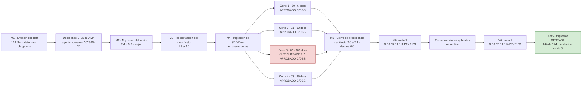

# 09 · Auditorías y migración normativa

> Catálogo de los **catorce documentos de `SDD/Docs/Audit/`** —trece informes de auditoría independiente más el plan de migración— y de la **migración normativa del conjunto SDD 4.1 → 6.0**. Sirve para saber **qué informe mirar** ante una pregunta concreta y **qué hallazgos siguen abiertos**, sin abrir 900 KB de informes.
> **Fuente primaria:** `SDD/Docs/Audit/` (14 archivos). El estado de la corrida que estos informes auditan está en [`08_Proceso-SDD-Y-Estado.md`](08_Proceso-SDD-Y-Estado.md).

---

## 1. Cómo leer estos informes

| Regla | Detalle |
|---|---|
| **Escala de severidad** | `P0` bloquea y detiene la cadena · `P1` **bloquea avance hasta corrección** (`Master-Prompt.md` §10) · `P2` y `P3` se documentan y no bloquean |
| **Veredictos posibles** | `APROBADO` · `APROBADO CON OBSERVACIONES` (admitido con P1, P2 y P3) · `RECHAZADO` |
| **El informe es por ronda** | No es un documento que cada ronda amplía: `-r1`, `-r2`. Un informe anterior **nunca se modifica**; sus afirmaciones se tratan como hipótesis a verificar |
| **El auditor es independiente** | Perfil «Arquitecto de Soluciones + QA Senior», invocado desde cero, sin participación en la generación. **Excepción declarada:** `B2-Fix-Definiciones-Servicio-r1.md` §2 declara que se ejecutó en la misma sesión que la corrección y que **no es una auditoría por un agente separado**, sino una verificación independiente en método |
| **Los informes de auditoría quedaron fuera de la migración** | Reescribirlos bajo el vocabulario nuevo haría que el registro dejara de ser un registro (`Plan-Migracion` §5) |
| **Un hallazgo es un piso, no una medida** | Criterio operativo de la corrida: el audit localiza bien los defectos y **subestima su extensión**. Verificado tres veces — ver índice 08 §9 |

---

## 2. Catálogo de los catorce documentos

### 2.1 Auditorías de la corrida de generación

| Informe | Alcance | Veredicto | P0/P1/P2/P3 | Fecha |
|---|---|---|---|---|
| `A-00-01-r1.md` | **Fase A**: los 16 archivos vivos de `00-Contexto` (6) y `01-Necesidades-Negocio` (10). Normativa 4.0 | APROBADO CON OBSERVACIONES | **0 / 1 / 1 / 3** sobre la solución + **3 P3** al repositorio fuente | 2026-07-29 |
| `B-02-03-r1.md` | **Fase B**: 94 archivos de `02-Especificacion-Funcional` y 23 de `03-UX-UI-DX`. Normativa 4.1, con **muestreo declarado** por volumen | APROBADO CON OBSERVACIONES | **0 / 6 / 5 / 7** sobre la solución + **7** al repositorio fuente y al intake (2 al intake, 5 a reglas y catálogo de diseño) | 2026-07-29 |
| `B2-Fix-Definiciones-Servicio-r1.md` | **Fix de las definiciones de servicio**: intake v2.4, `02` v1.1 (38 CU, 40 RN, 19 RC), `03` v1.1 (18 superficies), `Informe-Avance.md` v2.9 | APROBADO CON OBSERVACIONES | **0 / 2 / 4 / 4** *(el control de cambios del propio informe dice 3 P3; el §1 dice 4 — discrepancia interna de la fuente)* | 2026-07-29 |
| `B2-Retroalimentacion-Decisiones-2026-07-30-r1.md` | **Fase B2 paso 6, ronda 1**: intake v3.2 con su snapshot, 15 documentos de `02`, 10 de `03` y 26 copias archivadas | APROBADO CON OBSERVACIONES | **0 / 1 / 4 / 3** | 2026-07-30 |
| `B2-Retroalimentacion-Decisiones-2026-08-01-r1.md` | **Fase B2 paso 6, ronda 2**: el incremento del 2026-08-01 — intake v3.5 con dos snapshots, 20 documentos de `02` y 14 de `03`; 35 vivos y 36 archivados | **RECHAZADO** | **2 / 2 / 4 / 3** (11 hallazgos) | 2026-08-01 |
| `B2-Retroalimentacion-Decisiones-2026-08-01-r2.md` | **Re-audit del incremento de corrección del 2026-08-02**: manifiesto v2.2, intake v3.6 y v3.7, 20 documentos de `02` y 4 de `03` | APROBADO CON OBSERVACIONES | **0 / 1 / 3 / 5** (9 hallazgos) | 2026-08-02 |

**Qué buscar en cada uno:**

- **`A-00-01-r1`** — matriz D1-D9 por documento, estructura obligatoria, `Rules-Contexto` §6 y `Rules-Necesidades-Negocio` §6, y los tres hallazgos de framework `F-01` a `F-03`.
- **`B-02-03-r1`** — la evaluación de **39 brechas en las dos direcciones** (27 confirmadas, 8 parciales, 3 con componente falso, 1 íntegramente falsa) y la caza dirigida de **datos completados sin fuente y sin declarar**: encontró ocho, cuatro de ellos P1. *Es el informe que cerró `PA-12` y confirmó `PA-11`; abrió `PA-14`.*
- **`B2-Fix-Definiciones-Servicio-r1`** — **§3 es la tabla de trazabilidad fila por fila de §22 de `Redefinicion-Servicio.md`**, con artefacto y versión. Verifica decisión por decisión que **ninguna de las veinticinco no cerradas se presume resuelta**; su verificación bidireccional CU↔RN **encontró diez discrepancias y las diez se cerraron antes de emitir**.
- **`B2-Retroalimentacion-…-07-30-r1`** — verifica que **ninguna decisión abierta se cerró por arrastre indebido** y que los 23 documentos con historia previa agregaron exactamente una fila de control de cambios sin reescribir ninguna anterior.
- **`B2-Retroalimentacion-…-08-01-r1`** — **el único RECHAZADO de la corrida de generación.** Los dos P0 son **citas de evidencia que no resuelven**, que `Deriva-Rules.md` §1 tipifica como peores que no citar porque simulan verificación: `P0-01`, los veinte documentos de `02` citaban el intake como v3.4 cuando el vigente era v3.5; `P0-02`, un barrido de `03/README.md` §9 cuyo resultado no reproducía.
- **`B2-Retroalimentacion-…-08-01-r2`** — **el informe vigente de la Fase B2**. Cierra las cinco condiciones del r1 y declara lo que no pudo verificar (§11).

### 2.2 Plan e informes de la migración normativa 4.1 → 6.0

| Informe | Alcance | Veredicto | P0/P1/P2/P3 | Fecha |
|---|---|---|---|---|
| `Plan-Migracion-4.1-a-6.0.md` | **No es un informe de auditoría: es el plan**, emitido por M1. v1.3, estado «Ejecutado y cerrado». 144 filas, tabla de saltos por archivo de reglas, renombres, riesgos y las decisiones `D-M1` a `D-M5` | — (aprobado por el agente humano el 2026-07-30) | — | 2026-07-30 |
| `M4-00-Contexto-r1.md` | **M4 corte 1**: los 6 entregables de `00-Contexto` v2.0 contra su línea de base `_legacy/2026-07-30/` | APROBADO CON OBSERVACIONES | **0 / 1 / 2 / 3** | 2026-07-30 |
| `M4-01-Necesidades-Negocio-r1.md` | **M4 corte 2**: los 10 entregables de `01-Necesidades-Negocio` v2.0 | APROBADO CON OBSERVACIONES | **0 / 1 / 2 / 1** | 2026-07-30 |
| `M4-02-Especificacion-Funcional-r1.md` | **M4 corte 3, ronda 1**: los 101 entregables de `02`. 24 verificaciones por script + muestreo dirigido de 14 sobre 101 | **RECHAZADO** | **1 / 0 / 4 / 2** | 2026-07-30 |
| `M4-02-Especificacion-Funcional-r2.md` | **M4 corte 3, ronda 2**: los mismos 101, remedidos con script propio. 39 verificaciones de cobertura total + muestreo de 13 documentos y 14 términos | APROBADO CON OBSERVACIONES | **0 / 0 / 4 / 2**; **cero hallazgos nuevos** | 2026-07-30 |
| `M4-03-UX-UI-DX-r1.md` | **M4 corte 4 y último**: los 25 entregables de `03` v2.0. Cobertura 100 % por script: 76 filas de control de cambios celda por celda, 21 bloques ASCII byte a byte, 428 enlaces, 316 entradas de TOC | APROBADO CON OBSERVACIONES | **0 / 1 / 3 / 3** | 2026-07-30 |
| `Informe-Migracion-4.1-a-6.0.md` | **M6 ronda 1**: los 144 entregables de `SDD/Intake/` y `SDD/Docs/` contra los 144 archivados. 21 verificaciones de cobertura total + muestreo dirigido por riesgo | APROBADO CON OBSERVACIONES | **0 / 3 / 11 / 6** (20 hallazgos) | 2026-07-30 |
| `Informe-Migracion-4.1-a-6.0-r2.md` | **M6 ronda 2**: los mismos 144, invocado desde cero. 23 verificaciones por script; verifica las tres correcciones que el orquestador aplicó **después** del informe r1 y que nadie había verificado | APROBADO CON OBSERVACIONES | **0 / 2 / 14 / 7** (23 hallazgos) | 2026-07-30 |

> **Anomalía de nomenclatura declarada.** El informe de M6 ronda 1 se llama `Informe-Migracion-4.1-a-6.0.md` **sin sufijo `-r1`**, y el de la ronda 2 sí lo lleva. `Informe-Migracion-…-r2.md` §14 lo analiza: el nombre cumple `Migracion-Rules.md` §2.1 (que nombra el artefacto sin segmento de ronda) y **no puede** cumplir la regla por rondas de `Master-Prompt.md` §10. **El conflicto es del framework, no del destino.**

### 2.3 Los seis P1 de la Fase B, que son la parte sustantiva de `B-02-03-r1`

Los seis quedaron **corregidos y reverificados** por el orquestador sobre el árbol emitido (`Informe-Avance.md` §1). Se conservan acá porque describen el modo de falla que la corrida tuvo que aprender a cazar.

| # | Defecto |
|---|---|
| `H-01`, `H-02`, `H-05` | **Tres citas a casos de prueba del anexo `E-22`** cuyo contenido fue reescrito para que verifiquen algo que no verifican, más un conteo de reglas sin cobertura que era tres y decía dos |
| `H-03` | **Restricción de cardinalidad inventada** en el modelo conceptual («con como máximo uno pendiente»), en una sección obligatoria |
| `H-04` | Trece de dieciséis **nombres de actor sin traza**, bajo la afirmación explícita del índice de que todo dato traza. *La corrección encontró que el universo son 19 actores no humanos y no 16* |
| `H-06` | La correspondencia **superficie ↔ caso de uso** declarada en cuatro vistas independientes que se contradecían en cinco superficies. Se resolvió de raíz: `Experiencia-De-Uso` §9.2 es canónica por regla y §9.3 su inversión mecánica declarada. Verificador programático: **0 discrepancias** sobre 16 superficies y 36 casos de uso |

**Lo que el auditor declaró no haber encontrado, porque acota el problema:** la caza dirigida sobre persona objetivo, umbrales, valores de criterios de aceptación y contrato visual dio **negativo**, y **no hay ninguna columna de tabla rellenada completa con valores plausibles sin fuente** — que es el defecto exacto que la Fase A produjo tres veces.

### 2.4 Las cinco condiciones del RECHAZADO del 2026-08-01, y cómo se cerraron

`B2-Retroalimentacion-…-08-01-r1.md` §7 fijó cinco condiciones. `Informe-Avance.md` §7.1 registra el estado verificado **sobre disco** al arrancar la ronda de corrección del 2026-08-02, y no contra lo que las filas de control de cambios declaraban.

| Condición | Cómo estaba al arrancar el 2026-08-02 | Cómo quedó |
|---|---|---|
| `P0-01` · re-apuntar la trazabilidad de `02` al intake vigente | **Abierta.** Sólo 2 de 20 documentos citaban v3.5; los otros 18 seguían en v3.4 y el glosario conservaba 18 marcas `[+3.4]` | **Cerrada.** 20 documentos declarando vigencia v3.7 |
| `P0-02` · el barrido de `requiere_maqueta` que no reproducía | Cerrada la noche anterior | **Cerrada y rehecha**: la emisión del manifiesto v2.2 invalidó la evidencia corregida —las menciones pasaron de cuatro a diez— y se reprodujo antes de reescribirla |
| `P1-01` · `CU-38` cierra por arrastre lo que su fuente declara abierto | Cerrada en contenido, **sin fila de control de cambios** que citara el hallazgo | **Cerrada.** «Recuperación automática» sobrevivía como dato firme en cuatro lugares que el fix anterior no había alcanzado |
| `P1-02` y `P2-02` · intake v3.6 | `P1-02` cerrada; `P2-02` **medio cerrada**; y la v3.6 **emitida sin su fila de control de cambios**, contra §13 regla 3 | **Cerradas.** La fila 3.6 quedó escrita y la v3.7 rehizo los tres agregados de §19 |
| P2 y P3 restantes | `P2-01`, `P2-04`, `P3-01`, `P3-03` cerradas; `P2-03` cubierta sólo en `CU-38` | `P2-03` cerrada en `CU-13`, `CU-18`, `RN-20` y el glosario |

> **La corrección del `P1-01` se hizo retirando lo que decidía, no ampliando la decisión** —`FA-05` perdió el adverbio, `CA-07` y `CA-09` declaran qué no evalúan, `US-CU-38-6` acotó su enunciado y `B-31` pasó de tres puntos a seis—. El re-audit lo señala como **la dirección correcta cuando la fuente declara algo abierto**.

### 2.5 Cómo evolucionó el método de auditoría a lo largo de la corrida

Los despachos del auditor no fueron iguales: cada uno incorporó lo que la fase anterior dejó ver. Está registrado en el control de cambios del `Informe-Avance.md`.

| Fase | Qué se agregó al despacho del auditor | Por qué |
|---|---|---|
| **A** | Despacho base: matrices D1-D9, estructura obligatoria, §6 de cada regla, coherencia cross-doc | — |
| **B** | **Exigir muestreo declarado** (117 archivos) · **evaluar las brechas en las dos direcciones** · **buscar datos completados sin fuente y no declarados** | La Fase A produjo tres veces el mismo defecto —columnas rellenadas con valores plausibles sin fuente— y **el audit no lo encontró**; dos de los tres los encontró la adecuación a 4.1 |
| **Fix de definiciones** | Verificar **decisión por decisión** que ninguna de las 25 no cerradas se presume resuelta; emitir la trazabilidad de §22 fila por fila con artefacto y versión | La orden de trabajo prohibía cerrar decisiones abiertas |
| **B2 paso 6** | Verificar que **ninguna decisión abierta se cerró por arrastre** y que cada documento agregó **exactamente una** fila de control de cambios sin reescribir ninguna anterior | Es el modo de falla propio de una ronda de retroalimentación |
| **M4 / M6** | **Cobertura total por script** (21 a 39 verificaciones según el corte) + muestreo dirigido **por riesgo, no al azar**; y la regla de **no tomar por cierta ninguna afirmación** de los orquestadores ni de los informes previos | El volumen (144 documentos) y el riesgo de la sustitución léxica |

**Una segunda pasada que vale como dato:** `B2-Fix-Definiciones-Servicio-r1.md` registra que, tras emitirse el informe, se ejecutó una **pasada de coherencia estructural** que encontró **nueve defectos** —tablas de contenido incompletas, subsecciones fuera de orden, dos conteos de estados mal— y los nueve se corrigieron antes de cerrar. El veredicto no cambió porque ninguno era de contenido. *Que la primera pasada no los haya encontrado es en sí un dato: verificaba coherencia semántica y trazabilidad, y no estructura.*

---

## 3. La migración normativa 4.1 → 6.0

### 3.1 Por qué se hizo y qué cambió

| Hecho | Detalle |
|---|---|
| **Origen** | Conjunto SDD **4.1**, declarado en el bloque de procedencia del manifiesto §1.1. Reconstruible en `IA/IA.SDD/_legacy/4.1/` |
| **Destino** | Conjunto SDD **6.0** (`CHANGELOG.md` del framework, entrada `[6.0] - 2026-07-29`) |
| **Los veintiún saltos son major** | Por la entrada `[5.0]`, que renombró el vocabulario normativo y subió major los diecisiete archivos de reglas a la vez. Consecuencia: **ningún documento del destino queda «no tocar»**; los 141 emitidos entran como «regenerar contenido» |
| **Dos reglas nuevas** | `Vocabulario-Rules` (incorporada en `[5.0]`, transversal a los 141 documentos, inyectada en todo despacho) y `Migracion-Rules` (en `[6.0]`, gobierna esta corrida) |
| **Fuera de alcance** | `SDD/Docs/Audit/` (registros), `SDD/Maquetas/`, `SDD/Estado/`, todos los `_legacy/`, código y `/samples/`, `AGENTS.md`, y las categorías `04` a `11` (no generadas) |

**Renombres aplicados:**

| Clase | De → a |
|---|---|
| Archivos | `SOLUTION-INTAKE-…` → `PRODUCT-INTAKE-…` · `SOLUTION-MANIFEST-…` → `PRODUCT-MANIFEST-…` · `Alcance-Proyecto.md` → `Alcance-Producto.md` |
| Identificadores | `Nombre-Solucion` → `Slug-Producto` · `NombreSolucionCodigo` → `Raiz-Codigo` · `Nombre-Proyecto` → `Nombre-Proyecto-Codigo` · `nombre-proyecto-codigo` → `Identidad-Codigo` · `project_type` → `tipo_proyecto_codigo` |
| Términos | «solución» (nivel superior) → «producto» · «proyecto» (unidad de compilación) → «proyecto de código» · «plan de adecuación» → «plan de migración normativa» |

> **El renombre de archivo no se hace en su lugar:** se archiva el estado previo y se escribe el nombre vigente (`Master-Prompt-Migracion.md` §6).

### 3.2 El riesgo dominante: la sustitución léxica

`Vocabulario-Rules.md` §9.5 **prohíbe el reemplazo global de cadena** y exige el procedimiento por ocurrencia: enumerar → clasificar por sentido → sustituir sólo lo que cambia de referente → verificar con barrido negativo. El framework documenta en su propia entrada `[5.1]` las cuatro clases de daño que produjo hacerlo de la otra manera **sobre sí mismo**.

| Trampa propia de este destino | Por qué |
|---|---|
| **`Proyecto` es entidad del dominio del producto** | El agrupador de servicios del lienzo, con `CU-01`, `CU-02`, `RC-01` y variable compartida. *«Sustituir "proyecto" por "proyecto de código" en 02 y 03 sería el peor daño posible de esta migración»* |
| **La cadena `soluci` dentro de «re*soluci*ón»** | Palabra frecuente acá (`RN-24`, `RC-11`, informes de conflicto, banda de resultado). Es exactamente la ocurrencia que produjo las 30 «reproducto» del framework |
| **~1370 ocurrencias de «proyecto» sin marca reconocible** | Se clasificaron por ocurrencia en M4, documento por documento |

**Resultado verificado por las dos rondas de M6:** **cero sobre-sustituciones**, **cero sub-sustituciones** en los cortes 1 a 3 (dos en el README de `03`, levantadas como P2), «resolución» viva en las cuatro categorías y en el intake, **cero «reproducto» reales**, cero concordancias de género rotas, y **cero de las 485 filas históricas** de control de cambios alteradas.

### 3.3 Las fases M1..M6 y su resultado

| Fase | Qué hizo | Resultado |
|---|---|---|
| **M1** | Emite el plan aplicando el diff normativo de `Master-Prompt.md` §2.1. Detención obligatoria para decisión humana | Plan v1.0 con 143 filas (144 al incorporar el `Glosario-Funcional.md` ausente) |
| **M2** | Migración estructural del **intake** | `2.4 → 3.0` (major). Siete bloques que la plantilla 2.1 no ubica quedaron **preservados íntegros** por resolución `[R-2]` |
| **M3** | **Re-derivación del manifiesto** | `1.9 → 2.0`, declarando «la procedencia no se cerró: es trabajo de M5» |
| **M4** | Migración de `SDD/Docs/` **en cuatro cortes por categoría**, con audit independiente entre medio y despacho al subagente titular de cada categoría (`D-M3`) | 142 documentos. **Emite `Glosario-Funcional.md`** como artefacto nuevo de `02` (82 términos) y lleva `Glosario-UX.md` de 39 a 63 |
| **M5** | **Cierre de procedencia** en el manifiesto | `2.0 → 2.1` (minor), §1.1 declarando el conjunto **6.0** con sus 21 versiones de archivo |
| **M6** | **Auditoría independiente** de la migración completa, en dos rondas | Las dos: cero P0. Migración declarada **COMPLETA**, 144 de 144 filas resueltas, verificadas por seis medidas independientes |

**Las seis medidas de completitud aplicadas a cada fila** (`Informe-Migracion-…-r2.md` §8): el documento existe con el nombre vigente · su estado previo está archivado en el `_legacy/2026-07-30/` de su propia carpeta con sufijo `-v<X.Y>.md` · lleva fila de control de cambios fechada que declara la migración y su fase · su cabecera cumple §4.1 de la regla de su categoría · su versión subió respecto de la archivada · ninguna fila histórica fue alterada.

### 3.4 Los seis hallazgos P0 propios de una migración

`Migracion-Rules.md` §6 los tipifica. Las dos rondas de M6 los verificaron **uno por uno con medición propia** y **ninguno se cumple**.

| # | Hallazgo P0 | Cómo se midió en la ronda 2 |
|---|---|---|
| 1 | **Invención** | Los dos glosarios son el mayor riesgo y se rastrearon los dos. Los 82 términos de `Glosario-Funcional.md` no intersecan con los 34 del glosario raíz (0 coincidencias por script); los 6 términos que el cierre de `P1-01` agregó a `Glosario-UX.md` se rastrearon a artefacto hermano. El intake no agrega ningún bloque de prosa nuevo en 5 480 líneas |
| 2 | **Sección exigida rellenada con contenido inferido** | Ninguna de las 21 secciones de la plantilla se rellenó. Los tres artefactos que `Rules-UX-UI-DX` 4.0 vuelve obligatorios y **no tienen fuente quedaron sin emitir**, declarados con su destinatario |
| 3 | **Procedencia reescrita con migración parcial** | Seis medidas independientes sobre las 144 filas, todas al 100 %. Las 21 versiones que la procedencia declara coinciden con las cabeceras reales del framework |
| 4 | **Corrección manual pisada** | **0 de 485** filas históricas alteradas, por comparación literal contra el archivado |
| 5 | **Estado previo no archivado** | 144 archivados para 143 documentos con origen. **Las dos correcciones posteriores al informe r1 no archivaron**, pero el estado migrado sigue siendo reconstruible: se levanta como **`P1-r2-01`, no como P0** |
| 6 | **Fila del plan sin resolver y sin declararse** | Las 144 filas de §4 tienen destino en disco y estado final enumerado |

**Un método que estos informes usan sistemáticamente:** enumerar las **polisemias evaluadas y descartadas** por contextos disjuntos —siete en el corte 1, once en el corte 2, catorce en el corte 3 r2, trece en M6 r2— *«para que la ronda siguiente no las vuelva a levantar»*. Es la aplicación del criterio que `Fix-Ejecución-Glosario-Framework.md` propone elevar a regla del framework (ver índice 08 §7.2).

### 3.5 Decisiones del agente humano sobre la migración

| ID | Decisión | Fecha | Impacto |
|---|---|---|---|
| **D-M1** | **Plan aprobado.** M2 habilitada | 2026-07-30 | La migración procede sobre las 143 filas con la clasificación emitida |
| **D-M2** | **La Fase B2 se migra**, no se cierra antes | 2026-07-30 | Los documentos que el fix tocó entran a M4 como cualquier otro. **Obligación correlativa: terminada M6, evaluar la coherencia de B2 sobre el árbol migrado y decidir si continúa o se reejecuta** |
| **D-M3** | Despacho de subagentes titulares autorizado para M4 | 2026-07-30 | Sin ella la migración habría tenido que declarar el anti-patrón «usar un subagente genérico» |
| **D-M4** | El referente de «proyecto» **se decide por contexto**; ante duda no se sustituye | 2026-07-30 | Incorporada como §3.5 paso 3 del plan |
| **D-M5** | **La migración se declara cerrada**; se declina una ronda 3 | 2026-07-30 | Fundamento: dos rondas con cero P0 y 144 filas resueltas es lo que §10 pide. Las rondas mostraron **daño decreciente y hallazgos crecientes de completitud de glosario**, que es trabajo de calidad del glosario y no de la migración. **Las 21 observaciones P2 y P3 quedan abiertas y declaradas** |

### 3.6 Las 144 filas, por categoría

Estado final verificado en `Informe-Migracion-…-r2.md` §8.2. Es el inventario de lo que la migración tocó.

| Fila del plan | Documentos | Cierre |
|---|---|---|
| `SDD/Intake/` — intake y manifiesto | 2 | M2 y M3, con confirmación humana. Intake `2.4 → 3.0` (major); manifiesto `1.9 → 2.0 → 2.1` |
| `SDD/Docs/00-Contexto/` | 6 | Corte 1 |
| `SDD/Docs/01-Necesidades-Negocio/` | 10 | Corte 2 |
| `SDD/Docs/02-Especificacion-Funcional/` | **101** (100 emitidos + `Glosario-Funcional.md` de emisión inicial) | Corte 3, tras un RECHAZADO en la ronda 1 |
| `SDD/Docs/03-UX-UI-DX/` | 25 | Corte 4 |
| **Total** | **144 de 144 resueltas** | Migración **COMPLETA** |

**Clasificación de las 144 según §4.3 del plan:** 141 «regenerar contenido», 1 «regenerar contenido (fase M2, como propuesta)», 1 «re-derivación (fase M3)», 1 «regenerar contenido · emisión inicial». **Ninguna «no tocar»**, coherente con que los veintiún saltos sean major.

### 3.7 Qué quedó abierto al cerrar la migración

| Punto | Cuándo se trata |
|---|---|
| **Coherencia de la Fase B2 sobre el árbol migrado**, y decisión de continuar o reejecutar (obligación de `D-M2`) | Después de M6 |
| **`Linea-Base-Visual.md`, `Contrato-Datos-Maqueta.md` y `Bitacora-Validacion-Maqueta.md`**, que `Deriva-Rules` 3.1 exige para un destino con `requiere_maqueta` == true | Los emite la Fase B2 bajo la 6.0, fuera de la migración |
| **Siete inconsistencias del propio destino** provenientes del fix de la Fase B2, que la migración enumeró y **deliberadamente no propagó** (`Migracion-Rules.md` §4.2 regla 3) | No declarado en la fuente |
| **Las categorías `04` a `11`**, que nunca existieron bajo la 4.1 | Se generarán bajo la 6.0 cuando la corrida llegue a ellas |

---

## 4. Hallazgos abiertos vigentes

### 4.1 Resumen por severidad

| Origen | P0 | P1 | P2 | P3 | Estado |
|---|---|---|---|---|---|
| **Migración M6** (rondas 1 y 2) | 0 | **0** | **14** | **7** | Plan v1.3: «cero P1 abiertos tras corregirse los cinco que las dos rondas levantaron». **Las 21 observaciones P2 y P3 quedan abiertas y declaradas** |
| **Fase B2 paso 6, ronda 2** (`…-08-01-r2`, 2026-08-02) | 0 | **1** | **3** | **5** | Ninguna bloquea el avance; el P1 debe cerrarse **antes de que se generen `08` y `09`** |
| **Fase B** (`B-02-03-r1`) | 0 | 0 (los 6 P1 corregidos y reverificados) | 5 | 7 | Cierre de los P2 y P3 **no declarado en la fuente** |
| **Fix de definiciones** (`B2-Fix-…-r1`) | 0 | 2 | 4 | 3–4 | Cierre **no declarado en la fuente** |
| **Fase B2 paso 6, ronda 1** (`…-07-30-r1`) | 0 | 1 | 4 | 3 | Cierre **no declarado en la fuente** |
| **Fase A** (`A-00-01-r1`) | 0 | 0 | 0 | 0 sobre la solución | Un P1, un P2 y dos P3 corregidos; un P3 desestimado con evidencia y resuelto después con la nota al pie que el informe pedía |
| **Contra el repositorio fuente `IA.SDD`** | — | — | — | 3 P3 del audit de la Fase A (`F-01`..`F-03`) + 7 del audit de la Fase B + `A-1` a `A-6` del `Informe-Avance.md` | **No son materia de este destino.** Se tratan en `IA/IA.SDD` |

**Total de hallazgos abiertos verificables sobre este destino: 21 (migración, P2/P3) + 9 (Fase B2 ronda 2: 1 P1, 3 P2, 5 P3) = 30**, más los P2/P3 de los tres informes cuyo cierre la fuente no declara.

### 4.2 Los hallazgos abiertos que más pesan

| Hallazgo | Informe | Por qué importa |
|---|---|---|
| **`P1-r2-02`** · La regla de inclusión de `Rules-Especificacion-Funcional` 4.0 §3.3 está incumplida en `Glosario-Funcional.md`: «Evento de auditoría» aparece en 24 de 100 artefactos hermanos y **cero veces en todo el glosario**; la ronda 1 lo dio por cumplido habiendo medido sólo la dirección inversa | `Informe-Migracion-…-r2` | **«La condición más sustantiva de las cinco, porque toca contenido y no registro»**: el glosario de `02` es el insumo contra el que `03`, `05`, `06`, `08` y `11` miden su no duplicación |
| **`P1-r2-01`** · Intake y plan, ambos en estado `Aprobado`, corregidos **sin bump, sin archivado** y, en el intake, fuera de los dos casos de escritura de `Master-Prompt.md` §13 | `Informe-Migracion-…-r2` | Hay que **regularizar la forma, no revertir el contenido**: revertirlo reabriría `P1-01` y `P1-03` |
| **`P1-01`** de la ronda 2 de B2 · La salvedad de `tiene_observabilidad_critica` en el bloque de flags del manifiesto afirma que el umbral p99 «no está confirmado por la fuente», y **la fuente citada declara lo contrario en la misma sección**. El valor del flag no cambia; lo que no se sostiene es la salvedad | `B2-Retroalimentacion-…-08-01-r2` | **Es la única de las nueve que puede propagar un dato equivocado aguas abajo.** Corregir antes de generar `08` y `09` |
| **`P2-r2-01`, `P2-r2-02`, `P2-r2-09`** · El plan se contradice a sí mismo: §8 declara «119 de 144» mientras el manifiesto y §8.2 declaran las 144 cerradas; §4 declara «documento de origen» para 141 filas y §8.1/§8.2 lo desmienten | `Informe-Migracion-…-r2` | *«Sin esto el contrato entre orquestadores queda declarando 119 filas resueltas sobre un árbol con 144»* |
| **`P2-r2-03`** · `03/README.md`:222 atribuye al manifiesto `Maqueta-Rules` 2.0 y `Deriva-Rules` 2.0; el manifiesto vivo declara **3.1 y 3.1** desde el cierre de M5 | `Informe-Migracion-…-r2` | **Defecto introducido por M5**: reescribió la procedencia después de cerrado el corte 4 y no revisó quién citaba el bloque |
| **`P2-11` → `P2-r2-12`** · El cierre del campo bloqueante `Product Owner` no quedó registrado fuera del documento migrado: §7.1 del plan sólo registra `D-M1` a `D-M4` | `Informe-Migracion-…-r2` | Conecta con el punto abierto **`PA-1`** del `Informe-Avance.md` |

### 4.3 Lo que los auditores declaran **no** haber podido verificar

Cada informe cierra con esta sección. Es tan informativa como los hallazgos: acota qué se sabe con evidencia y qué no.

| Punto | Informe que lo declara |
|---|---|
| **Si la maqueta materializa lo que los diecinueve wireframes especifican.** Sólo se verificaron las afirmaciones del `README` de `03` sobre su estado —veinte archivos HTML, último cambio 2026-07-30 19:39—, y las tres reproducen | `B2-…-08-01-r1` §8 y `-r2` §11 |
| **Si la confirmación de `requiere_maqueta` en `true` es la que el agente humano dio el 2026-08-02.** El registro de la conversación no vive en este repositorio; se verificó la consolidación contra el manifiesto, no contra el acto original | `B2-…-08-01-r2` §11 |
| **Si los otros diez flags fueron confirmados por el humano o derivados por el orquestador.** El manifiesto declara el origen documental de cada uno; lo que no consta es si el humano los revisó uno por uno | `B2-…-08-01-r2` §11 |
| **El delta exacto del 2026-08-02 sobre los 24 documentos de `SDD/Docs/`**: el estado al 2026-08-01 no existe en disco y no hay commit intermedio. Afecta a `P2-01` y `P2-02`, donde no pudo determinarse si el defecto lo introdujo esa ronda o la anterior | `B2-…-08-01-r2` §11 |
| **Si las decisiones del agente humano del 2026-07-31 y 08-01 son exactamente las que el intake consolidó.** El insumo original (`Casos-Estudios-Re-Definidos.md` 3.6) **vive en el repositorio de documentación, no en éste** | `B2-…-08-01-r1` §8 |
| **Los conteos de términos de los glosarios**: las filas agrupan varios términos separados por punto medio, de modo que el total no es scriptable sin criterio. Verificado por muestreo, no recontado | `B2-…-08-01-r1` §8 y `-r2` §11 |

### 4.4 Un defecto de proceso que los propios informes levantan

`Informe-Migracion-…-r2.md` §13, recomendación de proceso:

> Las tres correcciones de esta ronda se aplicaron **después del informe que las pedía y antes de que nadie las verificara**, sobre artefactos aprobados y sin dejar rastro de versión. El patrón funcionó porque las correcciones eran buenas; el mecanismo que garantiza que lo sean —archivar, bumpear, declarar y re-auditar— **no se usó**.

El mismo informe registra cómo lo detectó: los tres únicos archivos con fecha de modificación posterior a las 12:57 del 2026-07-30 son `Plan-Migracion-4.1-a-6.0.md` (13:01), `PRODUCT-INTAKE-SelfHosted-Service.md` (13:01) y `Glosario-UX.md` (13:12). **Ésa es la razón de existir de la ronda 2.**

---

## 5. Qué informe mirar, según la pregunta

| Si la pregunta es… | Mirar |
|---|---|
| ¿Se cumple D1-D9 en `00` y `01`? | `A-00-01-r1.md` §3 |
| ¿Qué brechas de `02` y `03` son reales y cuáles falsas? | `B-02-03-r1.md`, evaluación de las 39 brechas en las dos direcciones |
| ¿Dónde se aplicó cada fila de §22 de `Redefinicion-Servicio.md`, y con qué versión? | `B2-Fix-Definiciones-Servicio-r1.md` **§3** |
| ¿Alguna decisión abierta se cerró por arrastre? | `B2-Retroalimentacion-…-07-30-r1.md` |
| ¿Por qué se detuvo la Fase B2 el 2026-08-01? | `B2-Retroalimentacion-…-08-01-r1.md` §7 (los dos P0) |
| ¿Cuál es el estado vigente de la Fase B2? | `B2-Retroalimentacion-…-08-01-r2.md` §10 y §11 |
| ¿Qué cambió del conjunto 4.1 al 6.0 y qué alcanzó a este destino? | `Plan-Migracion-4.1-a-6.0.md` §2 y §3 |
| ¿Se rompió algo con el renombre de «proyecto»? | `Informe-Migracion-…-r2.md` §7.1 (la doble dirección del renombre) |
| ¿Está realmente completa la migración? | `Informe-Migracion-…-r2.md` §8 (las 144 filas con sus seis medidas) y §10 |
| ¿Qué contenido del intake no ubica la plantilla vigente? | `Informe-Migracion-…-r2.md` §9.1 (los siete bloques preservados por `[R-2]`) |
| ¿Qué no pudo verificar el auditor? | Sección «Lo que este audit no pudo verificar» de `B2-Retroalimentacion-…-08-01-r2.md` §11 |

---

## Fuentes

| Archivo | Qué contiene |
|---|---|
| `SDD/Docs/Audit/A-00-01-r1.md` | Audit de la **Fase A** (16 archivos de `00` y `01`), normativa 4.0. Matriz D1-D9 y de estructura por documento, cumplimiento de §6 de las dos reglas, coherencia cross-doc, cinco hallazgos sobre la solución y tres P3 sobre el framework. APROBADO CON OBSERVACIONES |
| `SDD/Docs/Audit/B-02-03-r1.md` | Audit de la **Fase B** (94 + 23 archivos), normativa 4.1, con muestreo declarado. 6 P1 / 5 P2 / 7 P3 sobre la solución y 7 sobre el repositorio fuente y el intake. Evaluación bidireccional de 39 brechas y caza dirigida de datos sin fuente. APROBADO CON OBSERVACIONES |
| `SDD/Docs/Audit/B2-Fix-Definiciones-Servicio-r1.md` | Audit del **fix de las definiciones de servicio**. §3 es la tabla de trazabilidad fila por fila de §22 de `Redefinicion-Servicio.md`; verifica decisión por decisión que ninguna de las 25 no cerradas se presume resuelta; siete verificaciones mecánicas reproducibles. Declara su propio límite de independencia |
| `SDD/Docs/Audit/B2-Retroalimentacion-Decisiones-2026-07-30-r1.md` | Audit del **paso 6 de la Fase B2, ronda 1**. Verifica que ninguna decisión abierta se cerró por arrastre y la disciplina del control de cambios sobre 23 documentos |
| `SDD/Docs/Audit/B2-Retroalimentacion-Decisiones-2026-08-01-r1.md` | Audit del **paso 6, ronda 2**. **RECHAZADO** por dos P0 de citas de evidencia que no resuelven. Cinco condiciones para promover |
| `SDD/Docs/Audit/B2-Retroalimentacion-Decisiones-2026-08-01-r2.md` | **Re-audit del incremento del 2026-08-02**, el informe vigente de la Fase B2. Cierra las cinco condiciones del r1; §10 veredicto y condiciones, §11 lo que no pudo verificar |
| `SDD/Docs/Audit/Plan-Migracion-4.1-a-6.0.md` | **El plan de la migración**, v1.3 «Ejecutado y cerrado». Tabla de saltos por archivo de reglas, renombres de archivo/identificador/término, procedimiento de sustitución léxica por ocurrencia, documentos fuera de alcance, riesgos, decisiones `D-M1` a `D-M5` y estado de las 144 filas |
| `SDD/Docs/Audit/M4-00-Contexto-r1.md` | Audit de **M4 corte 1** (`00-Contexto`, 6 documentos). Enumera siete polisemias evaluadas y descartadas por contextos disjuntos |
| `SDD/Docs/Audit/M4-01-Necesidades-Negocio-r1.md` | Audit de **M4 corte 2** (`01`, 10 documentos). Doble dirección del renombre sobre 89 ocurrencias, con cero sobre y sub-sustituciones; once polisemias descartadas |
| `SDD/Docs/Audit/M4-02-Especificacion-Funcional-r1.md` | Audit de **M4 corte 3, ronda 1** (`02`, 101 documentos). **RECHAZADO**: 59 de 101 documentos citaban una ruta de archivado que no existe en disco |
| `SDD/Docs/Audit/M4-02-Especificacion-Funcional-r2.md` | Audit de **M4 corte 3, ronda 2**. Cierra el P0 (las 118 rutas resuelven), remide todo con script propio, **cero hallazgos nuevos**. Catorce polisemias descartadas |
| `SDD/Docs/Audit/M4-03-UX-UI-DX-r1.md` | Audit de **M4 corte 4** (`03`, 25 documentos). Cobertura 100 % por script sobre cabeceras, versiones, 76 filas de control de cambios, 21 bloques ASCII, 428 enlaces y 316 entradas de TOC |
| `SDD/Docs/Audit/Informe-Migracion-4.1-a-6.0.md` | **M6 ronda 1**: auditoría de la migración completa sobre los 144 entregables. 3 P1 / 11 P2 / 6 P3. Declara la migración completa y legítimo el cierre de procedencia del conjunto 6.0 |
| `SDD/Docs/Audit/Informe-Migracion-4.1-a-6.0-r2.md` | **M6 ronda 2**, el informe de cierre. Verifica las tres correcciones que el orquestador aplicó sin verificación; §8 el estado final de las 144 filas con sus seis medidas; §9 el contenido sin destino; §11 el estado de los 20 hallazgos de la ronda 1; §13 veredicto y condiciones; §14 la anomalía de nomenclatura del informe r1 |
